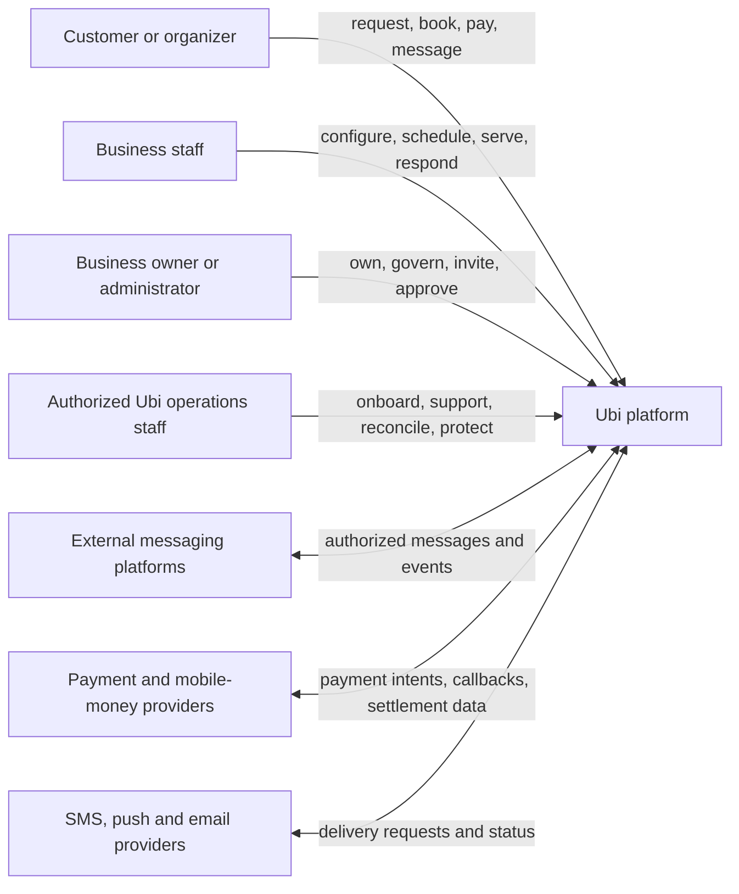

# Stakeholders, actors and responsibilities

Status: **Draft**  
Depends on: requirements ledger, scope and principles  
Blocks: identity model, permissions, workflows, legal responsibility matrix, client information architecture

## Purpose

This document identifies every class of human, organization, automated component and external provider that may participate in Ubi. It prevents “the user” or “the business” from becoming vague design shortcuts.

The actor list is deliberately broader than Version 1. First-release participation will be selected later; future actors are documented now so core ownership boundaries do not need destructive redesign.

## System context

The diagram shows communication, not legal responsibility. Controller/processor, merchant-of-record, payment-agent, tax, and professional-liability conclusions require the launch jurisdiction and commercial contracts.

## Actor classification

Every actor is classified by:

- **Nature** — human, organization, service account, automated process or external provider.
- **Identity assurance** — anonymous, link-authorized, contact-verified, authenticated, business-verified or privileged.
- **Authority scope** — self, booking, resource, booking operation, branch, organization or Ubi platform.
- **Relationship** — customer, member, representative, provider, processor, support operator or regulator.
- **Risk** — ordinary, sensitive, financial, ownership, security or emergency.

An actor may occupy several roles. A salon owner can also book another business as a customer. Roles must therefore be memberships/capabilities, not mutually exclusive account types.

## Customer-side human actors

### ACT-C01 — Visitor

A person viewing a public business profile, service or availability without providing personal information.

Needs:

- Fast, low-bandwidth public content.
- Clear price, location, availability and human contact information.
- No forced account creation.

Boundaries:

- May view only deliberately public data.
- Cannot infer private schedule details, customer names or operational occupancy beyond published availability.

### ACT-C02 — Guest booker

A person starting or completing a booking without a permanent authenticated Ubi account.

Needs:

- Phone-first identification.
- A secure way to resume/manage the booking.
- Clear confirmation and payment state.

Risks:

- Mistyped/shared phone numbers.
- Forwarded manage-booking links.
- Duplicate guest profiles.
- Booking for another person without clear authority.

### ACT-C03 — Verified Ubi customer

A customer with an authenticated Ubi account and one or more verified contact methods.

May:

- View their authorized cross-business booking history.
- Manage active bookings subject to merchant policy.
- Communicate through Ubi.
- Control profile, sessions, consent, privacy requests and account closure.

Must not:

- See a merchant’s internal notes, risk labels, staff discussion or other customers.
- Automatically gain access to every merchant-side customer record merely because contact information resembles theirs.

### ACT-C04 — Organizer/booker for another person or group

A person arranging a wedding, family shoot, corporate event, appointment, class or transport for participants other than themselves.

Additional concepts:

- Booker versus attendee/beneficiary.
- Organization/employer represented, when applicable.
- Authority to receive messages, approve quotations and make payments.
- Participant information minimized to what fulfilment actually requires.

### ACT-C05 — Attendee, guest or beneficiary

A person affected by a booking but not necessarily the contractual booker. They may need limited schedule/direction information without price, private messages or management rights.

### ACT-C06 — Customer representative or guardian

A person legally or practically acting for another person. Minor, accessibility, healthcare and formal agency rules are jurisdiction- and vertical-specific and are not assumed in the general platform.

## Business-side human actors

### ACT-B01 — Prospective merchant

An owner/representative evaluating Ubi before an organization is created or verified.

Needs:

- Honest eligibility and channel-integration prerequisites.
- Demonstration or sandbox without exposing real customer data.
- Clear pricing and responsibility information.

### ACT-B02 — Organization creator

An authenticated person who begins organization setup. Creation does not by itself prove legal ownership or representation authority.

### ACT-B03 — Verified owner/legal representative

The highest business authority recognized by Ubi for ownership, contracting, high-risk recovery and account closure.

Responsibilities typically include:

- Truthful business information and lawful operation.
- Staff access and offboarding.
- Service, price, availability, payment and cancellation policies.
- External channel and payment-account authorization.
- Responding to customer disputes and lawful requests within allocated responsibility.

### ACT-B04 — Organization administrator

Manages configuration, staff and ordinary operations but does not automatically have authority to transfer ownership, change legal identity or access every highly sensitive financial/security operation.

### ACT-B05 — Branch manager

Manages specified branches and their operations, staff, resources and reports. Cross-branch access requires explicit scope.

### ACT-B06 — Booking/reception agent

Creates and edits bookings, handles calls/walk-ins, checks customers in, manages ordinary rescheduling/cancellation and coordinates the daily calendar within assigned scope.

### ACT-B07 — Service provider

Delivers the booked service: photographer, barber, consultant, trainer, driver, technician or similar.

Typical scope:

- Own/assigned schedule.
- Operational customer details required for fulfilment.
- Service status and permitted notes.
- No automatic access to organization-wide finance, integrations or ownership.

### ACT-B08 — Inbox/support agent

Handles Ubi and connected-channel conversations. May claim/assign threads, pause automation and respond within assigned operations. Booking and financial changes require separate capabilities.

### ACT-B09 — Finance/reconciliation user

Views payment attempts, provider evidence, balances, refunds, settlement and reconciliation exceptions. Access to conversation content or service notes is limited to what dispute/reconciliation work requires.

### ACT-B10 — Analyst/read-only reviewer

Views explicitly approved operational or aggregated reports. Export and row-level personal-data access are separate capabilities.

### ACT-B11 — External collaborator

Temporary or limited participant such as event planner, contractor, accountant or agency. Access expires automatically and is restricted to assigned bookings, projects, operations or reports.

## Ubi internal human actors

Internal employment never creates automatic access to production customer data.

### ACT-U01 — Merchant onboarding specialist

Guides setup, verifies prerequisites and may configure data only through merchant-authorized, audited workflows. Uses demonstration/test data where possible.

### ACT-U02 — Customer support specialist

Diagnoses account and booking problems using minimum necessary metadata. Content or impersonation access requires explicit purpose, authorization and audit.

### ACT-U03 — Integration operations specialist

Diagnoses webhook, token, provider-policy and delivery failures without receiving raw long-lived credentials in ordinary tools.

### ACT-U04 — Payment operations/reconciliation specialist

Investigates provider discrepancies, refunds, disputes and settlement. Cannot arbitrarily alter verified money state without controlled evidence and approval.

### ACT-U05 — Trust and safety specialist

Reviews abuse, impersonation, harassment, fraud and prohibited use under documented policy, restricted queues and auditable actions.

### ACT-U06 — Privacy/compliance specialist

Coordinates data inventories, access/deletion/export requests, retention, subprocessors, incidents and jurisdictional reviews.

### ACT-U07 — Security responder

Investigates security events using time-bounded privileged access and incident procedures. Break-glass actions are separately logged and reviewed.

### ACT-U08 — Site reliability/operator

Operates infrastructure and reliability controls. Infrastructure administration does not imply routine authorization to browse application content.

### ACT-U09 — Data engineer/analyst

Builds governed data pipelines and metrics using minimized/pseudonymized datasets where possible. Production personal-data access is exceptional and audited.

### ACT-U10 — Platform administrator

A narrowly assigned high-risk role for platform configuration. It is not a universal superuser identity and should be divided by capability/environment.

### ACT-U11 — Independent auditor/reviewer

Receives scoped evidence and logs, not uncontrolled production access. May be internal or contracted under confidentiality and processing terms.

## Non-human Ubi actors

### ACT-S01 — Android client

Acts using a human session and locally cached authorization context. It is not trusted to enforce final permissions, availability or payment truth.

### ACT-S02 — Desktop/web client

Acts using a human session. Browser/client state never establishes tenant access independently.

### ACT-S03 — Customer web client

Acts anonymously, through scoped handoff/manage-booking authorization, or an authenticated customer session.

### ACT-S04 — Background synchronization worker

Processes durable commands and remote changes with service identity, tenant context, idempotency and audit/correlation IDs.

### ACT-S05 — Availability/hold scheduler

Computes or expires availability/holds. It may not bypass authoritative database constraints.

### ACT-S06 — Notification worker

Sends purpose-approved messages and processes delivery status. It receives only the content and destination needed for the task.

### ACT-S07 — Ubi assistant/automation

Collects information, proposes structured drafts and replies within explicit business policy. It must expose escalation and cannot independently claim unverified money or unavailable capacity.

### ACT-S08 — Integration adapter

Normalizes provider-specific messages/events while preserving source identifiers, limitations and authorization scope.

### ACT-S09 — Payment webhook processor

Authenticates, deduplicates and records provider events. A webhook is evidence processed under provider rules, not automatically sufficient to settle every reconciliation exception.

### ACT-S10 — Audit/analytics pipeline

Processes governed events under distinct service identities and data-access policies. Analytics telemetry cannot mutate operational truth.

## External organizations and systems

### ACT-X01 — Messaging/social provider

Telegram, Meta platforms or future approved channels. The provider owns its accounts, APIs, availability, platform policies, identity scope and delivery limits.

### ACT-X02 — Payment/mobile-money provider

Creates or verifies payment activity, settlement and reversals under its license and contract. Ubi’s exact regulatory role remains an open jurisdictional decision.

### ACT-X03 — SMS/push/email provider

Processes destinations and notification content. Delivery reports may be delayed or incomplete.

### ACT-X04 — Identity/verification provider

May provide OTP, phone intelligence, business verification or identity proofing. Its assertion has a defined assurance and must not grant unrelated authority.

### ACT-X05 — Hosting/storage/network provider

Processes infrastructure or encrypted application data under contract, security controls, region and subprocessor terms.

### ACT-X06 — Call/media provider

Future provider for signaling/media relay/notifications. Call content, metadata, recording and emergency limitations require separate policy.

### ACT-X07 — Regulator, court or law-enforcement authority

May make legally valid requests. Ubi requires an identity-verification, scope-review, preservation, disclosure and transparency process appropriate to law.

### ACT-X08 — Licensed professional adviser

Local counsel, accountant, tax adviser, payment/compliance specialist or security assessor whose review supports decisions outside software expertise.

## Operational responsibility matrix

This is a product-responsibility proposal, not a final legal allocation.

| Activity | Customer | Merchant | Ubi | External provider |
|---|---|---|---|---|
| Provide accurate booking request | Responsible | Informed | Enables/records | — |
| Define service, price and availability | Informed | Responsible | Enforces configured rules | — |
| Capture call/walk-in booking | Confirms when appropriate | Responsible | Provides tooling/audit | — |
| Protect Ubi credentials/sessions | Responsible for own devices | Responsible for staff governance | Responsible for platform controls/recovery | Identity provider supports |
| Authorize social-channel connection | — | Responsible | Implements minimum-scope secure connection | Channel grants/controls access |
| Verify payment transaction | Initiates/provides required details | Reviews exceptions | Processes authenticated evidence/reconciles | Provider is source for provider-side event |
| Deliver booked service | Participates | Responsible | Records/communicates; does not perform service | — |
| Define merchant cancellation/refund policy | Accepts or disputes | Responsible within law | Presents/snapshots/enforces approved capabilities | Payment provider executes supported refund |
| Platform uptime/security | Uses/report issues | Uses/report issues | Responsible for Ubi-controlled systems | Responsible for provider-controlled systems |
| Customer-data accuracy | Provides/corrects | Maintains merchant-created notes/details | Provides correction tools and platform governance | Processes per contract |
| Legal/regulatory compliance | Own obligations | Own business/professional obligations | Ubi corporate/platform obligations | Provider obligations |

## Critical actor journeys to specify next

1. Guest discovers a business, requests/books, pays and returns through a secure link.
2. Customer becomes a verified Ubi account without losing or exposing bookings.
3. Owner creates and verifies an organization.
4. Owner creates branches and distinct booking operations.
5. Owner invites, scopes and later removes staff.
6. Receptionist captures a call/walk-in while offline and synchronizes safely.
7. Service provider sees only assigned operational information.
8. Inbox agent takes over a channel conversation from automation.
9. Finance user reconciles a customer-reported payment against provider evidence.
10. Ubi onboarding specialist assists without silently owning the merchant account.
11. Support diagnoses a problem without unrestricted data access.
12. Ownership is transferred or recovered after device/SIM loss, death, dispute or staff departure.
13. External integration is revoked, expires or changes capability.
14. Organization closes while records, customer rights, disputes and statutory retention remain.

## Edge conditions that must not be postponed

- One-person businesses where owner, receptionist and service provider are the same human.
- A staff member working for several unrelated organizations.
- One organization with several brands and branches.
- Family/shared phone numbers and recycled mobile numbers.
- Customer booking for another person.
- Owner loses phone/SIM or dies/becomes unavailable.
- Co-owners dispute control.
- Contractor needs temporary access.
- Merchant is suspended while customers have future confirmed bookings.
- Channel provider revokes access while conversations are active.
- Ubi employee is also a merchant or customer.
- Poor connectivity leaves permission or ownership changes pending on a device.

## Approval criteria

This actor blueprint can move to **Proposed** when:

- Launch-market interviews confirm or correct the actor set.
- The legal/commercial operator and first vertical are chosen.
- Every first-release use case names a primary actor and affected parties.
- No actor relies on shared credentials.
- Internal/support access is separated from merchant roles.
- Customer, merchant, Ubi and provider responsibility boundaries are reviewed by operations and counsel.
