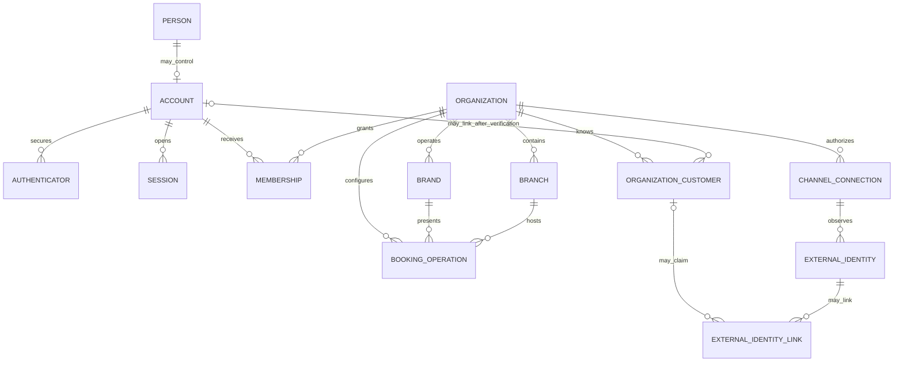
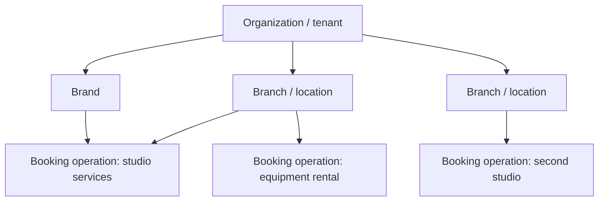

# Identity, organization and tenancy blueprint

Status: **Draft**  
Depends on: stakeholder and actor catalogue  
Blocks: permissions, schema, APIs, offline sync, public URLs, support tooling and legal responsibility mapping

## Executive decision direction

Ubi must keep these concepts separate:

1. A **person** in the real world.
2. An **account** used to authenticate to Ubi.
3. A **customer relationship record** owned within a merchant organization.
4. A **membership** authorizing an account to act for an organization.
5. An **organization** that forms the primary tenant boundary.
6. A **brand**, **branch** and **booking operation** belonging to that organization.
7. An **external-channel identity** that is meaningful only inside its provider/connection context.

Phone numbers, usernames, subdomains and external platform IDs are attributes or locators. None of them alone proves ownership or authorization.

## Conceptual model



This is conceptual, not the approved physical schema. Several concepts may require additional history, claim, verification and audit tables.

## Identity principles

1. **Authentication is not authorization.** Signing in proves control of an authenticator, not authority over a business.
2. **Identity proofing is risk-based.** Ordinary guest booking does not require the same real-world proof as ownership transfer or settlement-account change.
3. **Identifiers are opaque and stable.** Display names, phones and usernames change.
4. **Contact matching is not identity proof.** Shared, mistyped, recycled and reassigned phone numbers exist.
5. **One account can hold many roles.** Customer, owner and staff are contextual relationships.
6. **Merchant customer data remains tenant-scoped.** Linking to a global account must not expose cross-merchant relationships.
7. **External identities are provider-scoped.** An Instagram sender ID and Telegram user ID cannot be merged merely by name or phone similarity.
8. **Recovery is an identity event.** It is not simply “send another OTP” for high-risk accounts.
9. **Non-human identities are explicit.** Workers, integrations and service accounts never reuse employee credentials.
10. **Lifecycle is auditable.** Creation, verification, linking, recovery, suspension, transfer and closure retain appropriate evidence.

## Person and account model

### Person

Represents a natural person when Ubi needs that abstraction. A person may exist without an account, such as a named attendee. The platform should avoid creating a global person graph unnecessarily.

### Account

Represents Ubi authentication and self-service identity. Proposed characteristics:

- Opaque immutable account ID.
- Account lifecycle state.
- Preferred language and accessibility preferences.
- Verified contact methods as separate records with verification history.
- Bound authenticators and recovery methods.
- Active/revoked sessions and registered devices where justified.
- Security events, risk flags and account closure workflow.

An account does not contain an `is_owner` or `is_staff` global flag. Authority comes from memberships and policy.

### Contact method

Phone, email or future contact channel must record:

- Normalized value and display value.
- Country/number metadata where applicable.
- Verification method/time and assurance.
- Current verification status.
- Replacement/revocation history.
- Purpose/consent where required.

The normalized value may be uniquely associated with active authentication depending on the approved policy, but historical and shared-number cases require controlled handling rather than destructive reassignment.

### Authenticator

An account may bind multiple authenticators over time. The mechanism decision is deferred, but the model must support:

- Possession-based phone verification for initial low-friction access.
- Device-bound or syncable passkeys/cryptographic authenticators for stronger staff/owner security where available.
- Recovery codes or assisted recovery for appropriate risk tiers.
- Revocation after device loss, compromise or staff departure.
- Step-up authentication for high-risk operations.

Biometric data used by the device to unlock a cryptographic authenticator should remain on the device/platform; Ubi should not collect raw fingerprints or face templates for ordinary authentication.

## Customer identity architecture

### Organization customer

Each merchant organization maintains its own customer relationship record. It may include:

- Merchant-visible name and preferred contact.
- Organization-specific notes with visibility controls.
- Booking relationship and source.
- Consent/communication preferences applicable to that merchant.
- Duplicate/merge status and audit.
- Optional verified link to a Ubi account.

This structure prevents Merchant A from seeing Merchant B’s notes, booking history or relationship merely because the same person uses both.

### Guest booking

A guest may create a booking using minimum contact information. Access can be provided through:

- A scoped manage-booking link.
- Phone verification for the specific booking/customer relationship.
- Later authenticated account linking.

Risk-sensitive actions may require fresh phone verification even when a link is valid.

### Promotion from guest to Ubi account

Proposed sequence:

1. Customer proves control of a contact method associated with the guest booking.
2. Ubi authenticates or creates an account.
3. The system creates a verified claim linking the account to the relevant organization-customer record/booking.
4. Only authorized customer-facing booking data becomes visible.
5. Merchant-only notes, risk data and internal conversation remain hidden.
6. Suspected duplicate or disputed claims enter review rather than automatic merge.

### Duplicate customer records

Duplicates are expected because calls, walk-ins and several external channels may provide different identifiers.

Rules:

- Similarity proposes a merge; it does not perform one.
- Exact phone match is evidence, not sufficient authority by itself.
- Merge preserves source records, booking ownership and audit history.
- Unmerge/recovery path exists for incorrect merges.
- Cross-organization customer records are never merged into one merchant-visible record.

## Organization hierarchy



The model supports:

- One-person business: one organization, one brand, one branch, one operation, one owner membership.
- Multi-service business: one organization with several booking operations.
- Multi-branch chain: shared organization/brand with scoped branch operations.
- Hospitality example: accommodation, hall, conference room and transport operations under one organization.
- Owner/operator group: a person holds memberships in several organizations without data crossing between them.

### Organization

Proposed attributes/concepts:

- Immutable internal ID.
- Legal/operating name and separately versioned public names.
- Country of establishment/operation and timezone defaults.
- Verification state and evidence references.
- Lifecycle state and restriction reason category.
- Contract/subscription/billing relationship.
- Default currency/language/calendar presentation.
- Risk tier and feature eligibility.
- Created/updated/audit metadata.

Organization lifecycle direction:

```text
draft
→ verification_pending
→ active
→ restricted or suspended
→ closing
→ closed
→ deletion_eligible where law/contracts permit
```

Suspension does not automatically delete future bookings or remove customer access. Customer communication, fulfilment, refunds and record retention require explicit closure procedures.

### Brand

Public identity that may own a name, logo, contact presentation and domain/subdomain. A brand is not the authorization boundary by default.

### Branch

Physical or operational location with address, timezone, contact, opening rules and scoped staff. Virtual/field-service operations may use a non-public operational branch when useful.

Branches may be hierarchical only if real business evidence requires it. Arbitrary deep organization trees should be avoided initially.

### Booking operation

The primary unit for booking configuration. It owns or references:

- Booking archetype and policy.
- Service/package catalog.
- Required resources and capacity rules.
- Availability/exception rules.
- Price/deposit/cancellation configuration.
- Assigned staff.
- Customer booking entry points.
- Channel routing and inbox queues.
- Reporting scope.

Operation names in the UI should be ordinary business language, not “tenant” or “bounded context.”

## Membership model

A membership relates one account to one organization and includes:

- Lifecycle state: invited, active, suspended, expired, revoked.
- Base role bundle(s).
- Scope grants for organization, branches, operations, resources or self.
- Additional explicit grants/denials if approved.
- Inviter, acceptor and approval history.
- Effective start/end and last review.
- Employment/contract metadata only where needed; Ubi is not initially an HR system.

An account may have multiple memberships. A membership cannot be copied to another organization by client request without a fresh invite/authorization process.

## Ownership model

“Owner” is high-risk authority, not merely a convenient administrator label.

Requirements:

- At least one active accountable owner/representative per active organization.
- Ownership claim/verification evidence separated from ordinary membership.
- Adding/removing owners requires stronger authentication, notification and possibly delay/approval.
- Last owner cannot casually remove themselves.
- Ownership transfer preserves the previous owner and decision evidence in audit history.
- Recovery after loss, death, incapacity or dispute uses an exceptional review process appropriate to jurisdiction and business evidence.
- Ubi support cannot quietly self-assign ownership.

Small businesses may not have a second approver. In that case, high-risk actions should use step-up authentication, cooling-off periods, out-of-band alerts and assisted review rather than an impossible dual-approval requirement.

## Tenant boundary

### Proposed primary boundary

One organization is one application tenant.

Tenant isolation requirements:

- Every organization-owned operational record carries an immutable organization ID, including child records where duplication improves safe authorization and indexing.
- Cross-record relationships enforce matching organization ownership, preferably with database constraints in addition to application checks.
- Server authorization derives tenant context from authenticated membership or verified scoped token; never from a client-provided organization ID alone.
- Background jobs carry explicit tenant and correlation context.
- Cache, search index, object storage paths, logs, exports and analytics preserve tenant scope.
- Administrative/support tooling uses the same authorization policy, with additional purpose/audit controls.
- Test suites attempt cross-tenant access on every resource class.

### Isolation tiers

Initial direction is a shared application/database model with strong tenant keys and policy enforcement. Future regulated or enterprise customers may justify separate schemas, databases, encryption keys or deployments, but tiering is not promised until operationally designed.

The physical isolation decision remains open until scale, jurisdiction, customer commitments and operational capability are studied.

## Identifier policy

### Internal IDs

Must be:

- Immutable.
- Globally or safely namespace-unique.
- Opaque to customers.
- Non-reassignable.
- Safe for offline creation where necessary or server-mapped through an explicit protocol.
- Distinct from provider identifiers.

Exact UUID/ULID strategy is deferred to the database blueprint.

### Public IDs

Booking codes, usernames and business slugs:

- Are human-facing locators, not authorization credentials unless specifically designed as high-entropy tokens.
- Can change under a redirect/reservation policy.
- Must prevent impersonation, misleading names, reserved words and abusive Unicode confusables.
- Must not expose record counts or predictable database sequences.

### Subdomains

Working direction:

```text
<business-slug>.<primary-domain>
```

One subdomain resolves the public brand/business hub. Individual operations can be selected within that business context or opened directly through signed/opaque routes. Creating a separate DNS hierarchy for every service is not required.

Slug controls require:

- Normalization and uniqueness.
- Reserved names and trademark/impersonation complaints.
- Rename history and redirect expiry.
- Suspension/closure behaviour.
- Domain ownership and certificate automation.

## External identity and connection model

An external identity record is scoped by:

- Provider.
- Provider account/application environment.
- Merchant channel connection where required.
- Provider-scoped subject/conversation identifiers.
- Observed display metadata and timestamps.
- Link/claim confidence and evidence.

Rules:

- A merchant explicitly authorizes a channel connection through the official provider flow.
- Ubi stores minimum scopes and token metadata; secrets are protected separately.
- Provider revocation/expiry changes connection state without deleting normalized Ubi records needed for legitimate operations.
- Customers are not globally merged across Telegram, WhatsApp, Instagram, Facebook and Ubi based on name similarity.
- Linking an external identity to a customer record is scoped, auditable and reversible when incorrect.
- External message identity cannot authenticate a customer to unrelated Ubi data unless a designed verification exchange establishes that authority.

## Non-human identity

Every service, worker and integration must have:

- Unique service identity.
- Minimum permissions and environment scope.
- Short-lived credentials where supported.
- Rotation and revocation.
- Workload/tenant/correlation context in logs.
- No shared human credentials.
- No production credential reuse in development/test.

Provider webhooks authenticate through provider-supported signatures/tokens and replay controls; source IP alone is insufficient authorization.

## Ubi risk-based identity tiers

These are internal design tiers, not a claim of formal NIST conformance.

| Tier | Typical actor/action | Direction |
|---|---|---|
| U0 — Public | View public business data | No identity; aggressive data minimization and rate/abuse controls |
| U1 — Scoped/guest | Manage one booking through link or fresh contact verification | Narrow token scope, expiry, revocation and risk-based re-verification |
| U2 — Authenticated | Customer history; ordinary staff operations | Authenticated account, secure session/device controls, recovery and monitoring |
| U3 — Privileged | Ownership, settlement, integrations, bulk export, high-value refund, platform administration | Strong/recent authentication, step-up, alerts, approvals/delay where appropriate and detailed audit |

The authentication blueprint will choose assurance per action after evaluating account takeover, privacy, fraud, availability and exclusion risks. Phone OTP alone must not become the permanent security ceiling for high-risk owners.

## Lifecycle workflows requiring detailed sequence specifications

### Account creation

1. Collect only the contact/consent required.
2. Verify control using approved mechanism.
3. Create opaque account identity.
4. Establish session/device and notify the user.
5. Offer stronger authenticator enrollment according to risk.

### Organization creation

1. Authenticated person starts a draft.
2. Business information and representative claim are collected progressively.
3. Required evidence/agreements depend on country, features and payment/channel eligibility.
4. Organization activates with one accountable owner membership.
5. Public profile/operations activate separately when their requirements are satisfied.

### Staff invitation

1. Authorized member chooses role/scope and destination contact.
2. Invite is single-purpose, expiring and revocable.
3. Recipient authenticates or creates an account.
4. Recipient sees the organization and permissions before acceptance.
5. Membership becomes active and both parties are notified/audited.

### Staff offboarding

1. Authorized member revokes/schedules membership end.
2. Active sessions and offline authorization are invalidated promptly.
3. Conversations, bookings and tasks are reassigned without deleting history.
4. Organization-owned data remains with the organization; personal account remains the person’s.
5. Tokens/devices/exports are reviewed according to risk.

### Account/contact recovery

1. Identify the account without disclosing sensitive existence/data.
2. Assess requested action and affected organization authority.
3. Use available authenticators, trusted-device/session evidence and approved recovery methods.
4. Apply delay/manual review for high-risk ownership/financial cases.
5. Notify previous contact/authenticators where safe.
6. Revoke compromised sessions and record the recovery event.
7. Provide redress for rejected or disputed recovery.

### Organization closure

1. Verify authority and explain effects.
2. Stop new public bookings according to scheduled policy.
3. Handle future bookings, messages, balances, refunds and disputes.
4. Export/transfer appropriate organization data.
5. Disconnect/revoke provider access.
6. Apply retention/deletion/legal-hold policy.
7. Close organization while preserving required audit/evidence.

## Core invariants

1. An account ID is never reused.
2. A phone/email change does not rewrite historical actor identity.
3. Every membership references exactly one account and one organization.
4. Every active organization has an accountable ownership/recovery path.
5. Every organization-scoped resource has enforceable tenant ownership.
6. A child resource cannot reference a parent from another tenant.
7. A public slug is not an authorization credential.
8. An external identity is unique only in its documented provider scope.
9. Guest-to-account linking does not expose merchant-internal data.
10. Revoked membership cannot regain access through stale offline state after synchronization/connectivity returns.
11. Organization closure does not silently erase unresolved money, future service or lawful retention obligations.
12. Ubi support access never changes underlying ownership unless a controlled recovery/transfer workflow authorizes it.

## Open decisions

- Launch-country business verification and evidence.
- Whether all merchants require formal verification or feature/risk-tiered verification.
- Primary authentication and stronger-authenticator enrollment sequence.
- Phone-number reuse and shared-number policy.
- Customer account-linking/redress process.
- Exact tenant physical isolation and encryption-key model.
- Public username/slug rename and dispute policy.
- Co-owner, legal representative, succession and deceased/incapacitated owner procedures.
- Enterprise identity federation timing.
- Data-residency and cross-border identity-provider constraints.

## Validation and security basis

The design direction follows risk-based separation of identity proofing, authentication and federation, and explicitly considers privacy and customer experience as recommended in [NIST SP 800-63 Revision 4](https://pages.nist.gov/800-63-4/). It also applies deny-by-default and least-privilege authorization guidance from the [OWASP Authorization Cheat Sheet](https://cheatsheetseries.owasp.org/cheatsheets/Authorization_Cheat_Sheet.html).

These references guide engineering; they do not determine Ubi’s country-specific legal obligations or constitute a claim of formal compliance.

## Approval criteria

- Pilot interviews validate the organization/branch/operation structure.
- Guest and verified customer linking is privacy-reviewed.
- Ownership, recovery and closure are reviewed by security, operations and local counsel.
- Tenant invariants are implementable in both authorization and database layers.
- Every first-release external identity has a provider-specific scope model.
- Identity risk tiers are mapped to concrete authentication/session/recovery requirements.
