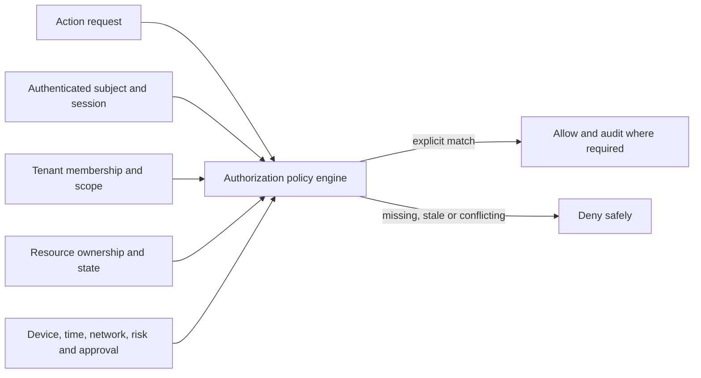

# Roles, permissions and approval blueprint

Status: **Draft**  
Depends on: actors; identity, organization and tenancy  
Blocks: APIs, database authorization, Android/desktop navigation, audit, support tooling and testing

## Executive decision direction

Ubi should use a hybrid authorization model:

- **Role bundles** make onboarding understandable.
- **Capabilities** define the actual permitted actions.
- **Scopes** restrict capabilities to an organization, branch, booking operation, resource, conversation queue, assigned booking or self.
- **Context/risk rules** require conditions such as recent authentication, verified organization state, online server decision, amount limits or approval.
- **Explicit server-side deny by default** prevents unspecified access.

This combines understandable role-based access control with scoped/contextual policy. A title such as “Manager” is never the final security decision.

## Authorization decision model



Conceptual policy predicate:

```text
allow(subject, action, resource, context) only when:
  subject is authenticated to the required risk tier
  AND subject has an active membership/service grant
  AND membership tenant equals resource tenant
  AND a granted capability covers the requested action
  AND granted scope contains the resource scope
  AND no explicit restriction/organization state blocks the action
  AND required step-up, approval, amount/time/device conditions are satisfied
```

The client may hide unavailable actions for clarity, but the server independently evaluates every request.

## Authorization domains

Capabilities are grouped to avoid one unstructured permission list:

| Domain | Examples |
|---|---|
| Organization | View/edit profile, verify, close, transfer ownership |
| Membership | Invite, view, change scope, suspend, revoke, review |
| Branch/operation | Create, configure, activate, archive |
| Catalog | View/edit/publish services, packages, add-ons and prices |
| Availability/resource | View/edit schedules, blocks, capacity and assignments |
| Booking/request/quote | View, create, edit, accept, decline, quote, reschedule, cancel, complete, no-show |
| Customer | View operational contact, edit, merge, export, delete/request restriction |
| Conversation | View, assign, reply, take over, close, export, moderate |
| Payment | View, mark reported, verify exception, refund, reconcile, change settlement settings |
| Integration | View, connect, change scope, pause, rotate/reconnect, disconnect |
| Reporting/export | View aggregates, view details, export personal/financial data |
| Audit/security | View audit, manage sessions/devices, security settings, incident hold |
| Support/platform | Assist merchant, restricted impersonation, suspend, restore, policy enforcement |

## Capability naming convention

Proposed internal convention:

```text
<domain>.<resource>.<action>
```

Examples:

```text
booking.record.create
booking.record.accept
booking.record.cancel
booking.quote.issue
conversation.thread.reply
conversation.thread.takeover
payment.transaction.view
payment.refund.request
payment.refund.approve
organization.membership.invite
organization.ownership.transfer
integration.channel.connect
report.customer_data.export
```

Capabilities must describe one security-relevant effect. Vague grants such as `manage_everything` are prohibited in policy/storage even if the UI offers an “Administrator” role bundle.

## Scope model

Proposed scope levels:

```text
organization
├── branch
│   └── booking operation
│       └── resource / queue / assigned records
└── booking operation not tied to a physical branch
```

Additional subject-relative scopes:

- `self` — the account’s own profile/security.
- `assigned` — resources/bookings/conversations explicitly assigned to the member.
- `created_by_self` — rarely appropriate; must not replace operational ownership.
- `customer_owned` — authenticated customer’s authorized booking/profile data.
- `token_grant` — one booking/action authorized by a scoped expiring token.

Rules:

- Broader scope does not imply capabilities the role does not possess.
- A capability does not imply organization-wide scope.
- Branch scope includes operations assigned to that branch only according to explicit hierarchy.
- Cross-tenant scope is forbidden for merchant memberships.
- Ubi platform scopes use a separate policy plane; they are never expressed as membership in every merchant.

## Understandable business role bundles

These are starting templates, not immutable job definitions.

### Owner

Default for verified accountable representative.

- Broad organization operational/configuration capabilities.
- Ownership and closure capabilities subject to high-risk controls.
- Can delegate ordinary administration.
- Cannot bypass Ubi platform security, provider rules or legal restrictions.

### Administrator

- Manages branches, operations, catalog, ordinary staff access and reporting.
- May connect ordinary integrations if explicitly allowed.
- Cannot automatically transfer ownership, change contracting identity or access platform-only controls.

### Branch manager

- Operational/configuration authority within assigned branches/operations.
- May invite/change lower-risk staff within delegated boundaries if granted.
- Finance/refund/export capabilities are separately assigned.

### Booking/reception agent

- Views calendar and permitted customer details.
- Creates call/walk-in bookings.
- Manages ordinary request acceptance, rescheduling and cancellation within policy.
- Cannot change organization ownership, provider credentials or settlement destinations.

### Service provider

- Views assigned schedule and minimum fulfilment details.
- Updates arrival/start/completion and permitted service notes.
- Cannot view unrelated customers, organization-wide reports or channel credentials.

### Inbox agent

- Views assigned queues/conversations.
- Replies and takes over from automation.
- May create a booking draft from a conversation.
- Final booking/money changes require the corresponding booking/payment capability.

### Finance

- Views scoped transaction/reconciliation data.
- Handles refund requests, reconciliation notes and supported provider operations within limits.
- Does not automatically receive customer conversations or service notes.

### Analyst/read-only

- Views selected aggregates or operational records.
- Export, personal-data detail and financial detail are distinct grants.

### External collaborator

- Explicit booking/project/operation scope.
- Mandatory expiry.
- No member administration, ownership, integration or settlement rights.

## Initial role-capability matrix

Legend: `D` default, `O` optional explicit grant, `—` not included in the role bundle. Every grant remains scope- and context-limited.

| Capability area | Owner | Admin | Branch manager | Booking agent | Provider | Inbox agent | Finance | Analyst |
|---|:---:|:---:|:---:|:---:|:---:|:---:|:---:|:---:|
| View assigned organization/branch operations | D | D | D | D | D | D | D | D |
| Edit organization legal/contract identity | D* | — | — | — | — | — | — | — |
| Transfer/claim ownership | D* | — | — | — | — | — | — | — |
| Manage branch/operation configuration | D | D | D | — | — | — | — | — |
| Manage service catalog/prices | D | D | D | O | — | — | — | — |
| Manage availability/resources | D | D | D | O | O (assigned) | — | — | — |
| View scoped bookings | D | D | D | D | D (assigned) | O | O (financial minimum) | O |
| Create manual booking | D | D | D | D | O | O (draft) | — | — |
| Accept/reschedule/cancel within policy | D | D | D | D | O (assigned) | O | — | — |
| Issue custom quotation | D | D | D | O | O | O | O (price review) | — |
| View/reply to scoped conversations | D | D | D | O | O (assigned) | D | O (dispute only) | — |
| Take over/pause automation | D | D | D | O | O | D | — | — |
| View scoped payment state | D | D | O | O (status only) | — | O (status only) | D | O (aggregate) |
| Request refund | D | O | O | O (policy limit) | — | — | D | — |
| Approve/execute refund | D* | O* | O* | — | — | — | D* | — |
| Change settlement destination | D* | — | — | — | — | — | O* | — |
| Invite/revoke ordinary staff | D* | D* | O* (scope-limited) | — | — | — | — | — |
| Grant owner/admin/finance authority | D* | O* (not owner) | — | — | — | — | — | — |
| Connect/disconnect channel integration | D* | O* | — | — | — | — | — | — |
| Connect/change payment integration | D* | O* | — | — | — | — | O* | — |
| Export customer-level data | D* | O* | O* | — | — | — | O* | O* |
| View audit/security records | D* | O | O (scope) | — | — | — | O (finance) | O (sanitized) |

`*` indicates step-up authentication, notification, approval, delay or stronger audit may apply according to the high-risk action matrix.

This matrix must be reduced to only the roles/capabilities required for the first vertical before implementation.

## Customer authorization

Customer access uses different policy from merchant membership.

### Public visitor

- May view intentionally public business/catalog/availability representations.
- Cannot query raw resource schedules or identify other bookings.

### Guest token holder

- Receives only the booking/action scope encoded server-side for the token grant.
- Link possession alone may be insufficient for financial, identity or high-risk changes.
- Tokens expire, can be revoked and must not authorize unrelated bookings.

### Authenticated customer

- May access only bookings/customer records linked through verified claims.
- May perform actions allowed by the applicable snapshotted/current merchant policy and booking state.
- Cannot access merchant-only notes, internal risk decisions or staff/channel metadata.
- Customer account closure does not delete merchant records the merchant/Ubi must lawfully retain; display and linkage consequences require privacy design.

### Organizer/participant

- Booker, payer, attendee and beneficiary permissions are separate.
- A participant does not automatically see price or private organizer conversation.
- Adding participants must not create unsolicited Ubi accounts.

## High-risk action matrix

Exact controls depend on country, organization risk tier and provider capability.

| Action | Baseline control direction | Additional control candidates |
|---|---|---|
| Add/remove owner | Recent strong authentication | Co-owner approval, cooling period, old/new owner alerts, evidence review |
| Transfer ownership | Recent strong authentication and verified authority | Dual confirmation, manual review, delay and dispute hold |
| Change legal business identity | Recent authentication | Verification evidence, contract update, compliance review |
| Change settlement bank/mobile-money destination | Recent strong authentication | Out-of-band alert, cooling period, finance/owner approval, provider verification |
| Connect payment provider | Recent authentication and owner/authorized admin | Provider OAuth, business eligibility, audit and test transaction |
| Connect/disconnect messaging channel | Recent authentication | Explain scopes/effects, provider OAuth, alert affected staff, preserve history |
| Grant admin/finance/export access | Recent authentication | Owner/admin approval, expiry/review for temporary grants |
| Bulk customer-data export | Recent strong authentication | Purpose/reason, owner approval, encrypted short-lived delivery, download audit |
| Delete/close organization | Strong authentication | Impact preview, future-booking/payment checks, delay, owner confirmation and counsel rules |
| High-value refund | Authenticated finance/owner | Amount threshold, two-person approval, provider evidence and reconciliation |
| Merge customer records | Trained authorized member | Preview, evidence, audit, reversible link/unmerge workflow |
| Ubi support content access | Approved support purpose | Merchant/customer consent when possible, time limit, supervisor/break-glass review |
| Suspend merchant/customer | Authorized trust/safety role | Documented policy reason, proportionality, notice/redress and review |

## Approval model

An approval is a distinct durable object/process, not a boolean field placed casually on the affected record.

Proposed approval data:

- Requesting actor and authority.
- Requested action and target resource.
- Before/after summary or immutable proposed command.
- Reason and evidence references.
- Required approver policy and threshold.
- Approver decisions/timestamps.
- Expiry and cancellation.
- Execution result/idempotency key.
- Audit/correlation information.

Approval states direction:

```text
draft → pending → approved → executing → executed
                 ↘ rejected
pending → expired or cancelled
approved → invalidated if target/security context materially changes
```

Approvals cannot be replayed for a changed amount, target, scope or destination.

### Microbusiness practicality

One-person businesses cannot supply two independent approvers. For them, proportional alternatives include:

- Strong recent authentication/passkey.
- Clear before/after confirmation.
- Cooling-off period for destination/ownership change.
- Notifications to previous and new contacts.
- Provider-side verification.
- Manual Ubi review only for exceptional risk.

Dual approval becomes configurable/required for larger businesses or risk thresholds rather than burdening every merchant.

## Membership invitation and delegation

Invite must specify before acceptance:

- Organization and inviter identity.
- Proposed role in familiar language.
- Branch/operation/resource scope.
- Expiry if temporary.
- Sensitive permissions highlighted separately.

Controls:

- Single-use, expiring, revocable invite token.
- Contact verification and authenticated acceptance.
- No authority before acceptance.
- Cannot invite a role/scope more powerful than the inviter may delegate.
- Owner/admin/finance/export grants may require separate approval.
- Existing account membership conflicts are shown without leaking unrelated account data.

## Revocation and permission change

Revocation must:

1. Update authoritative membership state transactionally.
2. Invalidate affected server sessions/tokens or force re-evaluation.
3. Reach connected online clients promptly.
4. Prevent offline clients from successfully synchronizing newly unauthorized commands.
5. Preserve authored records/audit under the organization rather than deleting history.
6. Reassign open conversations/tasks where required.
7. Notify appropriate owner/security contacts.

Permission elevation and reduction both create audit events. Sensitive elevation may require a new accepted grant rather than an invisible role edit.

## Offline authorization

Offline UX is not offline authority over the server.

Rules:

- The Android client caches a signed/versioned authorization snapshot only for understandable local UI and low-risk local actions.
- Local commands record actor, membership version, device and creation time.
- The server reauthorizes every synchronized command using current policy and relevant historical context.
- Revoked/elevated permissions are never inferred solely from stale local data.
- Denied sync explains which local changes remain unsent and provides a safe recovery/export/escalation path.
- High-risk actions such as ownership, settlement changes, exports and provider connections require online authoritative evaluation.

## Ubi internal and support access

### Separate policy plane

Ubi workforce roles are not merchant memberships. They use a dedicated workforce identity and authorization system with environment separation.

### Support access levels

1. **Metadata only** — account/organization IDs, status, error codes and redacted diagnostics.
2. **Merchant-authorized view** — scoped record/content access for a support case and limited time.
3. **Controlled action** — narrowly defined assistance requiring user confirmation or supervisor policy.
4. **Break-glass** — emergency access for security/safety/recovery, strong authentication, explicit reason, short expiry, immediate alert and mandatory review.

Prohibited direction:

- Universal shared admin credentials.
- Routine direct production database browsing.
- Invisible impersonation.
- Support changing verified payment/ownership history without controlled domain action.
- Production access from unmanaged devices or development credentials.

## Service-to-service authorization

- Each workload has a unique identity and minimum API/database/topic permissions.
- Authorization includes environment and service purpose.
- Tenant context is explicit and validated, not trusted from an unverified message field.
- Events include producer identity, schema version, tenant context and correlation/idempotency information.
- Workers cannot call arbitrary domains “because they are internal.”
- Secret rotation and revocation do not require full platform redeployment where avoidable.

## Database and data-access enforcement requirements

The later database blueprint must implement:

- Organization ID on tenant-owned records.
- Same-tenant foreign-key/constraint strategy for sensitive relationships.
- Query patterns that always include tenant scope.
- Row-level security or equivalent defense-in-depth where operationally supportable.
- Separate database roles for application runtime, migrations, read/report jobs and operators.
- No application connection using database owner/superuser.
- Views/projections that minimize columns for service providers, inbox agents and analytics.
- Export pipelines with explicit authorization and expiring encrypted artifacts.
- Audit that records policy decision/action without logging secrets or unnecessary message/payment content.

## Audit requirements

Security/business-significant audit records include:

- Actor type/ID and effective membership/service identity.
- Organization and scope.
- Action, target type/ID and outcome.
- Policy/membership version when useful.
- Approval/reference and reason category.
- Session/device/request/correlation information.
- Time from authoritative server clock.
- Before/after summary for selected high-risk changes, with sensitive minimization.
- Source: Android, desktop, web, API, provider webhook, worker or Ubi operations.

Audit logs are protected data. Access, retention, export and deletion exceptions require policy.

## Authorization testing strategy

Every protected operation must have automated tests for:

- Unauthenticated request.
- Authenticated account without membership.
- Membership in a different tenant.
- Correct tenant but missing capability.
- Correct capability but wrong scope/branch/operation/resource.
- Suspended/revoked/expired membership.
- Stale offline membership version.
- Customer attempting merchant action and merchant attempting another merchant’s action.
- Provider/service account outside allowed purpose/environment.
- Missing/expired/replayed approval or step-up condition.
- Bulk/list/search/export leakage, not only single-record endpoints.
- Identifier tampering and guessed public IDs.
- Background job/event with forged tenant context.

The default expected outcome is denial. Positive tests prove only explicitly granted combinations.

## Open decisions

- Exact first-release role bundles and local-language names.
- Which admin capabilities may be delegated and by whom.
- Refund/discount/export/quotation approval thresholds.
- Whether explicit deny grants are needed initially or role/scope removal is sufficient.
- Policy engine implementation versus application-native policy module.
- Row-level-security approach and operational tooling compatibility.
- Passkey/strong-authenticator availability for target devices.
- Enterprise federation and SCIM timing.
- Merchant-authorized support-access UX and emergency exceptions.
- Permission review frequency and inactive-membership expiration.

## Design basis

The policy follows the least-privilege and deny-by-default principles documented by the [OWASP Authorization Cheat Sheet](https://cheatsheetseries.owasp.org/cheatsheets/Authorization_Cheat_Sheet.html). Authentication strength and identity proofing will be selected through risk analysis informed by [NIST SP 800-63 Revision 4](https://pages.nist.gov/800-63-4/), rather than treating one login method as equally suitable for every action.

## Approval criteria

- First-release role bundles are validated with actual business owners/staff.
- Every first-release API/domain command maps to one capability and scope.
- Customer, merchant, Ubi workforce and service authorization planes are separate.
- High-risk actions have proportional controls for one-person and larger businesses.
- Offline revocation/denied-sync behaviour is prototyped and tested.
- Cross-tenant negative tests are defined for list/search/export/background paths.
- Security, privacy, operations and local counsel review the sensitive-action/responsibility boundaries.
