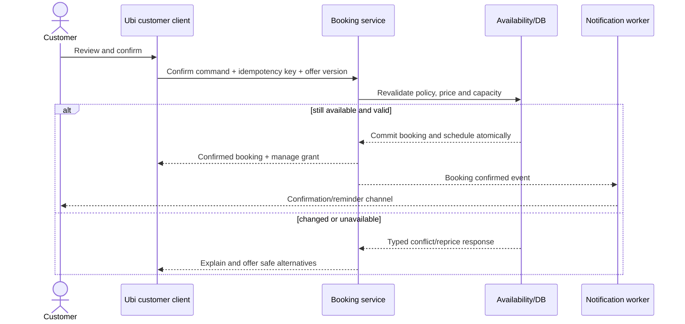
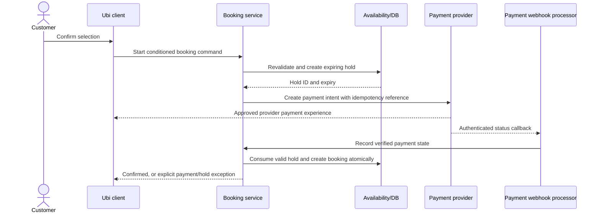
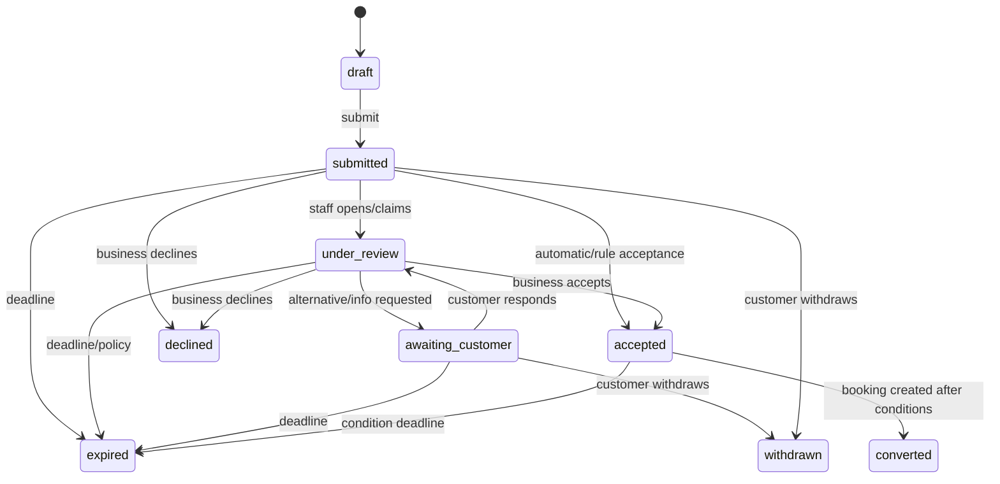
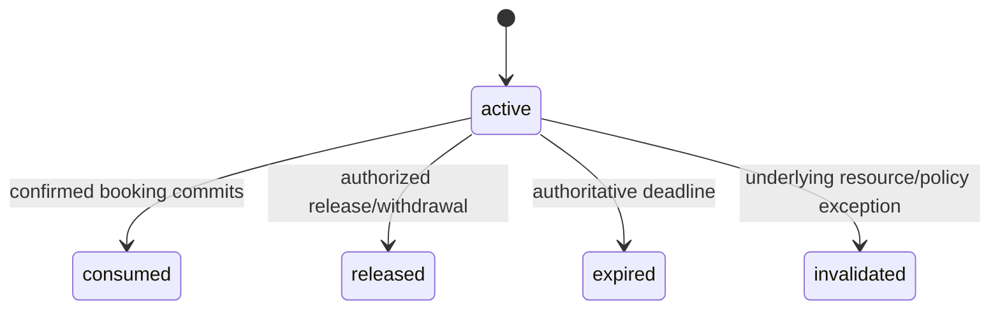
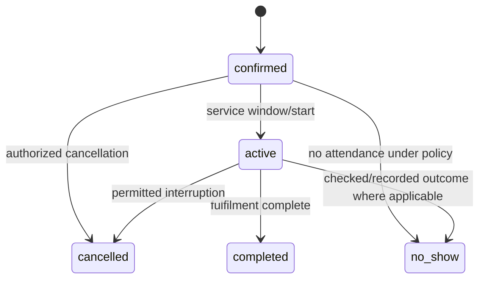

# Standard booking workflow blueprint

Status: **Draft**  
Depends on: booking archetypes; identity and permissions  
Blocks: domain state machines, API commands, database constraints, client flows, notifications and tests

## Definition

A standard booking uses a published service/package whose essential scope, pricing method, duration/capacity requirements and booking policy are known before submission. It may confirm instantly or require business approval/payment, but it does not require open-ended negotiation of the service scope.

## Core principle

The customer experience may appear as a short sequence, but the platform must preserve distinct objects and meanings:

```text
draft ≠ submitted request
request ≠ hold
hold ≠ booking
booking ≠ payment
payment reported ≠ payment verified
booking confirmed ≠ service completed
```

## Entry sources

A standard flow can begin from:

- Public business subdomain.
- Direct service/package link.
- Secure conversation handoff link with editable prefill.
- Ubi customer experience.
- Repeat/rebook action.
- QR code.
- Staff entry from call, walk-in or external conversation.
- Approved external provider flow that hands control to Ubi.

Every submitted record captures source channel, source reference where permitted, initiating actor, campaign/referral metadata only when lawful, and whether fields were customer-entered, staff-entered or prefilled.

## Customer-facing standard flow

The visible steps adapt to the archetype. The common logical sequence is:

1. **Resolve business and operation** — verify that the public profile/operation/service is active.
2. **Understand intent** — choose service/package or confirm the service already discussed.
3. **Choose necessary options** — staff/resource, party size, duration, location or add-ons only when they change availability/price/fulfilment.
4. **Choose schedule** — show human-friendly candidate times/dates generated for the complete requirement.
5. **Identify/contact** — collect minimum customer/booker information; avoid email/password requirement for ordinary guest booking.
6. **Review** — show exact date/time/timezone, service, location, price/deposit, confirmation condition and applicable policy.
7. **Commit** — customer submits one idempotent command; the server revalidates current rules and capacity.
8. **Satisfy condition** — payment or business approval when required.
9. **Outcome** — show one truthful state: confirmed, request sent, payment processing, or action needed.
10. **Return access** — provide secure manage-booking path and confirmation code/contact fallback.

The UI should omit steps that add no information. Prefilled values remain reviewable/editable unless a verified immutable value is required and explained.

## Workflow mode S1 — Instant confirmation without required prepayment

Best for known low-risk appointments/resources where Ubi can authoritatively check availability.



Invariants:

- A successful response means the authoritative capacity transaction committed.
- The same idempotency key cannot create another booking.
- A stale availability offer is revalidated; it never overrides newer capacity.
- Green success treatment appears only after the confirmed result.

## Workflow mode S2 — Instant selection with required payment/deposit

Best when the selected service can be confirmed automatically after verified payment.



Rules:

- Payment, hold and booking remain separate records.
- The customer sees hold expiry before paying when practical.
- Client success screens do not verify payment; authenticated provider evidence and reconciliation rules do.
- If verified payment arrives after hold expiry, Ubi does not overbook. It creates an exception requiring safe alternative/refund handling.
- Provider callback duplication/out-of-order delivery is expected and idempotent.
- A payment-processing state is not shown as confirmed.

## Workflow mode S3 — Business approval without required prepayment

Best for variable staff assignment, manually reviewed availability or businesses that want to accept every request.

```text
customer submits standard request
→ request state: submitted
→ business reviews/assigns/verifies
→ business accepts proposed schedule OR proposes an alternative
→ customer accepts alternative when required
→ server revalidates capacity
→ booking created as confirmed
```

Hold policy options:

- **No hold while reviewing** — simplest; staff acceptance can fail if capacity changed and must offer alternatives.
- **Short automatic hold** — protects selected capacity for a configured review period but can reduce availability.
- **Staff-created hold** — staff chooses when a request is credible/ready.

The product must explain whether the requested time is reserved. “Request received” must never look like “booking confirmed.”

## Workflow mode S4 — Business approval followed by deposit/payment

```text
request submitted
→ business reviews
→ business accepts scope/time conditionally
→ hold created or refreshed with deadline
→ customer receives payment action
→ payment verified
→ hold consumed and booking confirmed
```

Rules:

- Conditional acceptance explains that confirmation depends on payment by a deadline.
- If the customer does not pay, request/hold expires according to policy.
- If capacity becomes invalid before a valid hold exists, business must propose another option.
- Manual “paid” actions cannot impersonate provider verification; cash/manual evidence uses separate states and permissions.

## Workflow mode S5 — Staff-created call/walk-in booking

### Online path

1. Staff taps one persistent “Add booking” action.
2. Selects source: call, walk-in, message, existing customer or another approved source.
3. Chooses/reuses customer with privacy-safe duplicate suggestions.
4. Selects operation/service and necessary options.
5. Chooses time from current availability or records an allowed override with reason/permission.
6. Reviews price/payment/confirmation and customer notification.
7. Commits one idempotent booking/request command.
8. Customer receives confirmation/request summary when contact/consent permits.

Target: common call/walk-in booking should require minimal typing and remain understandable without training documentation.

### Offline Android path

1. Staff completes the same business-language form from locally cached catalog/availability.
2. The app saves a durable local command and local provisional record.
3. UI states: **Saved on this phone — waiting to sync**, not confirmed online.
4. When connected, the server authenticates current membership, revalidates data and applies idempotently.
5. If accepted, local record becomes server-confirmed and notifications follow policy.
6. If conflict/permission/configuration changed, the command enters a visible resolution queue.

Offline rules:

- A provisional record must not use green confirmed status.
- Staff sees potential stale availability before selecting.
- The server never silently replaces another booking.
- Conflict resolution offers alternatives, authorized override where safe, cancellation of the local proposal, or escalation.
- Original local input remains recoverable until resolved.

## Workflow mode S6 — Walk-in queue/check-in

```text
staff/customer records arrival
→ queue entry created
→ estimated wait and non-guaranteed wording shown
→ assigned/called
→ service started
→ completed, left, cancelled or no-show/skipped
```

Appointments and queue entries share staff/resource throughput rules. A queue estimate is never represented as a confirmed appointment time.

## Booking-request lifecycle



State meanings:

- `draft` is not visible as a submitted commitment unless intentionally shared.
- `submitted` means received durably by the authoritative system.
- `under_review` identifies responsibility but does not reserve capacity by itself.
- `awaiting_customer` identifies the next actor and required action.
- `accepted` means the business agrees subject to documented remaining conditions; it is not necessarily a confirmed booking.
- `converted` means a confirmed booking record was created.
- Terminal states retain reason, actor and timestamps.

## Hold lifecycle



Hold invariants:

- Expiry uses authoritative server time.
- Active holds consume the configured amount of capacity.
- Consuming a hold and creating the booking are one atomic domain operation.
- Extending a hold is an authorized state change with limits/audit.
- A released/expired hold cannot be replayed.
- Invalidated holds trigger explicit customer/staff resolution and do not silently disappear.

## Confirmed booking and fulfilment lifecycle

Commitment and fulfilment should not be collapsed into one ambiguous status.

### Booking commitment



### Schedule changes

Rescheduling is an audited schedule-version transition, not a permanent `rescheduled` terminal status.

```text
current schedule v1
→ proposed schedule v2 and optional hold
→ required approvals/payment difference
→ atomically activate v2 and release v1 capacity
→ retain v1 as superseded history
```

If v2 fails, v1 remains active unless an explicit cancellation policy says otherwise.

## Price and policy snapshot

At submission/confirmation, the system records enough versioned information to explain the commitment later:

- Service/package/add-on labels and quantities.
- Currency and exact monetary amounts.
- Base price, adjustments, fees/taxes when applicable and total.
- Deposit/payment requirement.
- Cancellation/rescheduling/no-show terms relevant to the booking.
- Schedule, timezone and location representation.
- Confirmation mode and remaining conditions.
- Policy/catalog versions and actor-approved changes.

Later merchant catalog edits do not rewrite historical customer commitments.

## Availability-offer semantics

An availability response should include an opaque offer/version reference and short validity expectation. It is not a reservation.

At final commit, the server checks:

- Operation/service remains active.
- Configuration/policy version is still acceptable.
- Price has not materially changed without customer review.
- Resource/capacity remains available.
- Customer/party satisfies required limits.
- Requested time respects business timezone, advance/cutoff and buffers.
- Idempotency key has not already completed a different request.

If price/policy changed, Ubi requires a new review/consent rather than silently committing different terms.

## Notification semantics

Domain state is authoritative; notification delivery is a separate outcome.

- Booking/request succeeds even if a notification provider is temporarily unavailable, provided return access is safely available.
- Notification worker retries idempotently and records provider status.
- Confirmation message says confirmed only for a confirmed booking.
- Request, payment-processing, hold-expiry and action-needed messages use distinct wording.
- External-channel templates/limits may change the delivery path without changing booking truth.
- Staff sees failed/high-risk delivery where operational follow-up is needed.

## Cancellation workflow

1. Authenticate/authorize actor or scoped token.
2. Load booking and applicable snapshotted/current legal policy.
3. Calculate consequence preview: capacity release, deposit/refund, fee, linked resources and customer impact.
4. Obtain explicit confirmation and reason category; free text only when useful.
5. Commit cancellation and capacity release atomically where possible.
6. Start separate refund/reconciliation workflow if applicable.
7. Notify parties and integration sources according to policy.
8. Retain audit and original commitment history.

Business cancellation may require different customer rights, refund or explanation than customer cancellation. Ubi must not assume they are symmetric.

## No-show workflow

- No-show can be recorded only after a policy-defined time/check.
- Authorized staff records party and reason/evidence category.
- Customer may dispute through defined support path.
- Financial consequences follow snapshotted policy and law.
- No-show analytics distinguish customer no-show, business/provider no-show and operational cancellation.

## Standard-flow exception matrix

| Exception | Required behaviour |
|---|---|
| Slot taken between display and confirm | Do not overbook; preserve draft and offer nearest valid alternatives. |
| Service/price changed | Show difference and require new customer review. |
| Duplicate tap/retry | Return the existing idempotent result. |
| Offline staff command conflicts | Keep local input, deny silent overwrite and open resolution workflow. |
| Payment verified after hold expired | Do not create conflicting booking; open payment/capacity exception and refund/alternative workflow. |
| Payment client says success but no verified callback | Show processing, poll/reconcile safely, never mark verified from client alone. |
| Notification fails | Preserve booking truth; retry and expose follow-up where necessary. |
| Staff/resource becomes unavailable | Business proposes reassignment/reschedule/cancellation with customer communication and audit. |
| Business operation suspended | Block new bookings; explicitly manage future commitments and refunds. |
| Customer loses manage link/phone | Risk-based recovery without exposing booking existence/data. |
| Timezone/calendar misunderstanding | Review shows exact local date/time; stored instant/timezone remains unambiguous. |
| Channel connection is revoked | Booking remains in Ubi; use permitted fallback and flag conversation delivery limitation. |

## Analytics events and success measures

Events must distinguish:

- Flow started, meaningful step completed, validation failed and abandoned.
- Availability shown versus hold created versus booking confirmed.
- Request submitted/accepted/declined/expired.
- Payment started/reported/verified/failed/refunded.
- Manual, walk-in, direct, handoff and connected-channel sources.
- User-visible help/error and staff intervention.
- Offline save, sync success, duplicate prevention and conflict resolution.

No metric may call a submitted request a completed booking.

Primary measurements:

- Completion and confirmation rate by flow/source/archetype.
- Median/p95 customer completion time.
- Median staff manual-booking time.
- Help/error rate and field correction rate.
- Conflict/double-booking/lost-change rate.
- Request response time and expiry rate.
- Payment exception and notification failure rate.

## Approval criteria

- Each first-release confirmation mode has a tested happy path and exception path.
- Request, hold, booking, payment and fulfilment states are distinguishable in language, data and UI.
- Availability/booking commit is transactionally safe and idempotent.
- Offline staff booking cannot silently overbook or lose entered data.
- Rescheduling preserves old commitment until the new schedule safely commits.
- Payment/notification failures cannot create false booking truth.
- Representative low-literacy users understand “requested,” “waiting for payment,” “saved offline” and “confirmed.”
