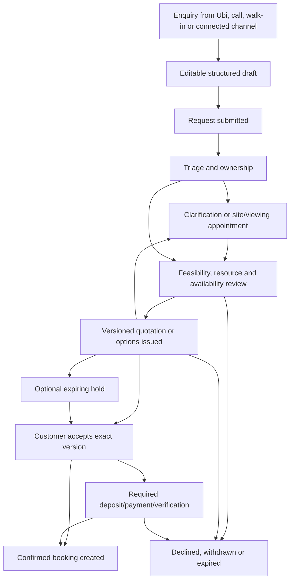
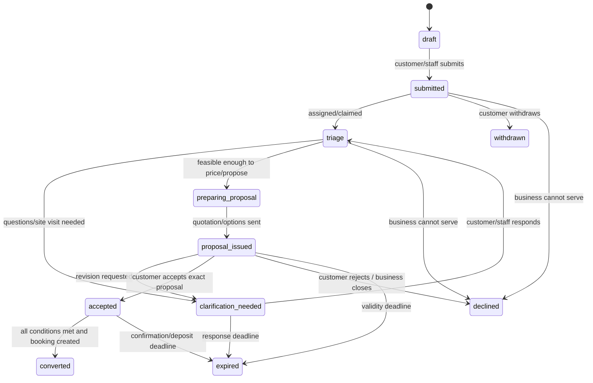
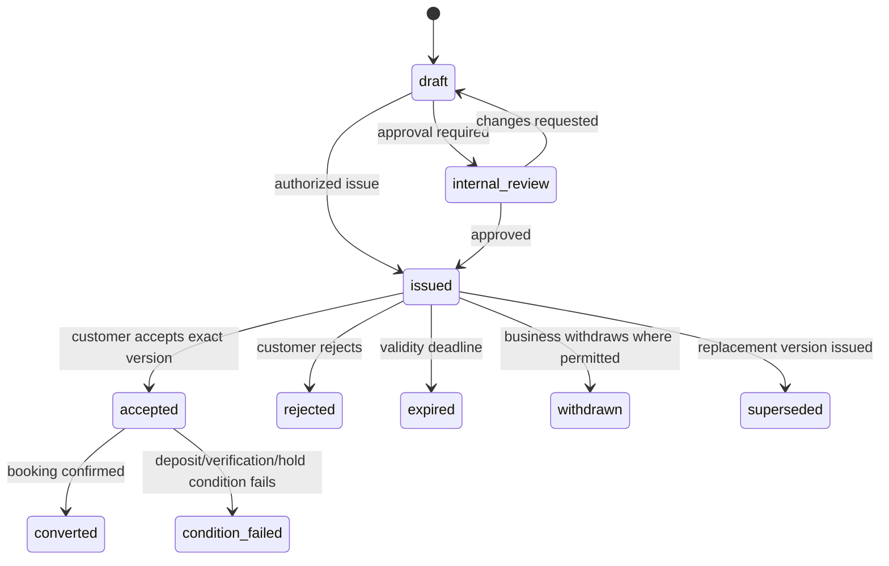

# Custom request and quotation workflow blueprint

Status: **Draft**  
Depends on: booking archetypes and standard workflows  
Blocks: custom intake, quotation domain/schema, inbox linkage, holds, payments, desktop workflows and notifications

## Definition

A custom request is used when Ubi cannot truthfully know the final scope, price, duration, resource requirement or feasibility from a standard published service alone.

Examples include:

- Wedding photography or videography.
- Event planning, decoration, catering, sound and lighting.
- Hall packages that depend on guest count and inclusions.
- Moving and complex home service.
- Mechanic repair after diagnosis.
- Architecture/design/consulting projects.
- On-location multi-person bridal services.

Submitting a custom request does not create a confirmed booking and does not reserve a date unless an explicit hold is created.

## Product promise

To the customer:

> Tell the business what you need. They will review it, ask only necessary questions, and send you clear options or a quotation.

To the business:

> Turn calls and messages into structured requests, compare the requirements with your availability, send a professional quotation, and confirm only after the customer and required conditions agree.

## End-to-end lifecycle



The diagram is logical. A site visit may itself be a separate confirmed standard booking linked to the custom request.

## Entry modes

### Direct guided request

Customer chooses “Request something custom” or a service configured for quotation. Ubi asks the shortest useful business-specific questions.

### Conversation-assisted request

Customer contacts the business through Ubi or a supported connected channel. Automation/staff extracts a draft from the conversation, then the customer or staff reviews and submits it.

### Staff-created request

Staff converts a call, walk-in, voice note or message into a structured request. Source provenance and original conversation reference are retained where permitted.

### Standard-to-custom escalation

During a standard flow, an answer may exceed standard constraints—for example a photography package for a very large event. Ubi preserves entered data and moves to custom request rather than forcing an invalid standard booking.

### Custom-to-standard recommendation

If the business determines the request matches a published package, staff can propose that standard service without retyping customer information. The customer reviews the exact resulting terms before confirmation.

## Guided intake design

### Rule: collect enough to decide the next action

The first intake should not attempt to replace a professional consultation. It should answer:

- What is wanted?
- When or within what range?
- Where?
- How large/complex?
- Which package/preferences already apply?
- How can the customer be contacted?
- What important evidence/reference is genuinely needed now?

### Typed field modules

Allowed starting field types:

- Short text.
- Long text with a clear prompt/limit.
- Single choice.
- Multiple choice.
- Yes/no/not sure.
- Whole/decimal number with unit.
- Quantity/participant count.
- Date or date range.
- Time or time window.
- Location/address/service area.
- Service/package/add-on reference.
- Photo/document/voice attachment where justified.
- Contact/participant reference.

Not allowed initially:

- Merchant-authored executable code.
- Hidden fields with undisclosed collection.
- Arbitrary HTML/scripts.
- Mandatory sensitive health/legal/identity-document fields without an approved vertical/privacy purpose.
- File requests without size/type/security/retention rules.

### Conditional questions

Simple declarative branching may show a question only when an earlier approved option requires it. Branching must be testable, versioned and explainable. Circular or unbounded logic is prohibited.

### Field provenance

Each answer may record:

- Customer entered.
- Staff entered from call/walk-in.
- Imported/prefilled from conversation.
- Derived suggestion.
- Later corrected and by whom.

Suggested/extracted values remain editable and are not treated as verified facts merely because automation produced them.

## Request lifecycle



State responsibility:

- `submitted` — Ubi received the request; business has not yet committed.
- `triage` — business/Ubi has an assigned next action.
- `clarification_needed` — customer or staff must provide defined information or complete a linked visit.
- `preparing_proposal` — business is working; capacity is not reserved unless a hold exists.
- `proposal_issued` — one immutable quotation/options version is available for decision.
- `accepted` — customer accepted that exact version; remaining confirmation conditions are explicit.
- `converted` — confirmed booking created.

Request states do not carry payment truth or resource capacity by themselves.

## Triage workflow

When a request arrives, Ubi should help the business answer:

1. Which operation/team owns this request?
2. Is essential information missing?
3. Is the preferred date/location/service area potentially feasible?
4. Does a standard package fit?
5. Is a consultation/viewing/site assessment required?
6. Who will reply and by when?
7. Should automation send an acknowledgement only, ask an approved deterministic question, or immediately request human review?

Priority may reflect event date/urgency, customer reply and service policy, but must not use opaque discriminatory scoring.

Request queues need:

- New/unassigned.
- Assigned/in review.
- Waiting for customer.
- Proposal due.
- Proposal sent/expiring.
- Deposit/action pending.
- Exception/escalation.
- Closed outcomes.

## Clarification and conversation

- Questions should be grouped into small understandable messages/steps.
- Staff sees structured answers beside the conversation, not as a replacement for it.
- New information can amend the request draft but does not rewrite an issued quotation.
- Staff/automation records whether the next action belongs to customer or business.
- Human takeover stops automated substantive replies.
- If a connected channel becomes unavailable, Ubi preserves the request and uses only consented/permitted fallback communication.

## Consultation, viewing or site assessment

A required assessment is modeled as a linked booking using A01 or A08:

```text
custom request
→ assessment booking confirmed
→ assessment completed/no-show/cancelled
→ findings added with restricted visibility
→ request returns to feasibility/proposal preparation
```

Completing the assessment does not automatically accept the final service or price.

## Feasibility and availability review

The business reviews:

- Preferred and alternative dates/times.
- Required staff/team/equipment/venue/vehicle.
- Travel, setup, cleanup and post-production obligations.
- Capacity and existing commitments.
- Service area/permit/safety/eligibility constraints.
- Supplier dependencies that Ubi can and cannot guarantee.
- Expected price model and deposit.

Outcomes:

- Prepare one quotation for the preferred option.
- Offer several schedule/scope options.
- Request more information/assessment.
- Recommend a standard package.
- Decline with an understandable reason category and permitted explanation.

Availability shown during preparation is not reserved until a hold is created.

## Quotation model

A quotation version should contain, as applicable:

- Immutable quotation/version ID and human reference.
- Request/customer/organization/operation linkage.
- Title and plain-language scope summary.
- Inclusions and explicit exclusions.
- Line items, quantities, units and exact currency amounts.
- Discount/adjustment and approving actor.
- Taxes/fees only after jurisdiction/configuration design.
- Total, required deposit and payment schedule.
- Proposed date/time/window/location and required resources at appropriate visibility.
- Delivery/fulfilment milestones where supported.
- Cancellation/rescheduling/change policy reference/snapshot.
- Quotation validity and acceptance deadline.
- Hold reference/expiry when capacity is reserved.
- Attachments/terms with version/integrity metadata.
- Issuer and approval/audit information.

Ubi product language should avoid claiming every quotation is legally a contract. Contract formation, electronic acceptance and mandatory disclosures depend on jurisdiction and merchant terms.

## Quotation lifecycle



Invariants:

- Issued quotation content is immutable.
- Revision creates a new version linked to the prior version.
- Customer acceptance names the exact version and actor/time/method.
- Only one compatible active version may be accepted according to policy.
- Superseding/withdrawing a quote triggers appropriate notice.
- An accepted quotation does not create capacity unless a hold/booking transaction does.
- Catalog edits do not alter existing quotation versions.

## Option proposals

A business may offer multiple alternatives, such as:

- Same package on several dates.
- Basic, standard and premium scope.
- Venue-only versus venue-plus-decoration.
- Repair option A versus replacement option B.

Each option must clearly identify differences in scope, schedule, price, deposit and validity. Customer selects one exact option; accepting one invalidates incompatible options atomically.

## Hold policy for custom requests

Possible business policies:

- No hold until customer accepts quotation.
- Hold while quotation is valid.
- Short hold after customer accepts while deposit is pending.
- Staff-created hold after seriousness/feasibility review.
- Paid/non-refundable reservation fee only after approved legal/payment design.

Hold UI must show:

- What date/resource is held.
- Expiry in exact local time.
- Whether extension is possible.
- What action confirms the booking.
- What happens if payment/provider confirmation is delayed.

Businesses need limits to prevent excessive speculative holds from blocking their calendar.

## Customer acceptance

Before acceptance, customer sees:

- Current quotation version.
- Scope/inclusions/exclusions.
- Exact or proposed schedule/location.
- Total and deposit/payment terms.
- Expiry/hold deadline.
- Cancellation/change policy.
- Whether acceptance immediately confirms or awaits payment/business condition.

Acceptance requires an authenticated account or scoped token plus risk-appropriate verification. The system records consent/evidence but does not overstate legal signature status without jurisdictional review.

## Conversion to confirmed booking

Conversion occurs only when:

1. Accepted quotation/version remains valid.
2. Required hold/resource capacity remains valid or can be committed transactionally.
3. Required deposit/payment/verification is satisfied.
4. Organization/operation/service remains eligible.
5. No incompatible quote option or prior conversion exists.
6. One idempotent transaction creates the booking, schedule/resource commitments and snapshots commercial terms.
7. Request and quotation record the resulting booking reference.

Conversion failure opens an explicit exception; it does not silently create a partial booking.

## Changes after confirmation

### Minor operational clarification

Non-commercial notes may be amended with audit and visibility controls.

### Scope or price change

Requires a versioned change order/amendment:

```text
confirmed booking terms v1
→ proposed amendment v2
→ availability/price/payment difference reviewed
→ required parties accept
→ v2 activated atomically
→ v1 retained as superseded history
```

### Schedule change

Uses the rescheduling process: proposed schedule/hold, approval/payment difference, atomic activation, preserved prior schedule.

Staff must not edit a confirmed custom booking’s price/scope in place without customer-visible evidence where the change affects the commitment.

## Decline, withdrawal and expiry

### Business decline

- Uses a reason category: unavailable date, outside service area, unsupported scope, capacity, eligibility, insufficient information, safety/policy or other permitted reason.
- Optional human explanation avoids discriminatory or sensitive internal details.
- Releases holds and addresses any payment/reporting exception.
- Preserves request for audit/retention period.

### Customer withdrawal/rejection

- Clarifies whether a hold is released and whether any payment/refund rule applies.
- Does not delete conversation/quotation history immediately.

### Expiry

- Uses authoritative server time and documented deadline/timezone.
- Expires quotation/hold/condition idempotently.
- Sends advance/expiry notifications where configured and permitted.
- Late customer action requires a refreshed proposal, not resurrection of stale capacity/price.

## Automation boundaries

Automation may:

- Acknowledge receipt.
- Ask approved deterministic intake questions.
- Extract an editable draft from conversation.
- Suggest a standard package or missing information.
- Remind about customer/business actions and deadlines.
- Route by configured operation/queue.

Automation must not independently:

- Invent or approve custom prices/discounts.
- Promise availability without authoritative validation/hold.
- Mark customer-reported payment as verified.
- Accept legal/high-risk custom terms for the merchant.
- Collect unnecessary sensitive information.
- Continue after human takeover.
- Conceal that the customer is interacting with automation where disclosure is required or needed for trust.

Future AI assistance requires a separate data-purpose, vendor, accuracy, bias, disclosure, security and human-control decision package.

## Attachments and media

- Allowed file types, size, count and retention depend on purpose.
- Uploads use authenticated/scoped URLs and malware/type validation.
- Images are resized/compressed for target devices while preserving authorized originals only when needed.
- Attachment visibility follows request/conversation role policy.
- Sensitive documents receive stronger classification and may be prohibited for ordinary verticals.
- Provider-hosted external attachments may expire; Ubi copies them only when permitted/necessary.
- Deletion/export processes include derived previews and object-store versions.

## Offline business handling

- Staff can draft notes/quotation preparation offline if locally authorized.
- Issuing a quotation, creating/extending holds, accepting money state or converting a booking requires server authority.
- Offline edits create versioned commands and detect newer server changes.
- Conflicts present both versions and do not silently overwrite customer-visible terms.
- Customer sees only authoritative issued versions, never an unsynchronized staff draft.

## Exception matrix

| Exception | Required behaviour |
|---|---|
| Conversation extraction is wrong | Customer/staff edits draft; retain provenance, do not treat suggestion as verified. |
| Preferred date already booked | Continue request without false promise; offer alternatives or decline. |
| Quote changes after customer opened it | Preserve viewed version; clearly present superseding version and require new acceptance. |
| Customer accepts an expired quote | Reject stale acceptance safely and request refresh. |
| Two staff issue conflicting quotes | Version/authority rules prevent incompatible acceptance; surface conflict internally. |
| Hold expires during payment | Do not overbook; record payment exception and offer refund/alternative workflow. |
| Payment amount differs from quote | Reconciliation exception; do not automatically convert. |
| Site visit is cancelled/no-show | Request returns to waiting/action state or closes by policy; final service remains unconfirmed. |
| Required supplier becomes unavailable | Propose approved substitute/amendment or cancel; preserve communication/evidence. |
| Business fails to respond | Reminders/escalation/expiry and customer-visible truthful status. |
| External message channel disconnects | Keep Ubi request; use permitted fallback and show delivery limitation. |
| Customer withdraws after business work | Apply disclosed/legal policy; do not invent fees after the fact. |
| Attachment contains malware/prohibited type | Quarantine/reject, explain safe next step, alert security if appropriate. |

## Performance and usability requirements

- Customer can start with one familiar “Custom request” choice, not a blank enterprise form.
- Intake is saved progressively and survives interruption.
- Low-bandwidth upload is optional/deferred where possible.
- Staff request list works from local/cache state; fresh money/hold/issue actions show connectivity requirements.
- The next responsible party and deadline are visible on every request.
- Status language is ordinary: “Waiting for the business,” “We need one more answer,” “Price sent,” “Pay deposit to confirm.”
- Green success is reserved for confirmed booking/payment verified/completed outcomes, not merely submitted requests or sent quotes.

## Measurement

- Request completion and abandonment by question/template.
- Time from submission to first meaningful business response.
- Percentage needing clarification/site visit.
- Quote issuance, acceptance, revision, expiry and decline rates.
- Time from accepted quote to confirmed booking.
- Hold expiry and payment/availability exception rates.
- Staff touches and message count per converted request.
- Extraction correction rate and human takeover rate.
- Customer help requests and misunderstanding rate.
- Revenue/booking value only from correctly defined confirmed/fulfilled records.

## Approval criteria

- Pilot merchants can model real custom enquiries without unrestricted custom code.
- Customers understand that request submission and quotation acceptance may still differ from confirmation.
- Quotation versions are immutable, comparable and acceptably clear.
- Holds, payments and booking conversion are atomic/idempotent where required.
- Staff can see responsibility/deadlines and safely take over from automation.
- Changes after confirmation preserve prior commercial/schedule history.
- Sensitive/custom attachments and fields have purpose, access and retention controls.
- Local counsel reviews electronic acceptance, cancellation, deposit and quotation language for the launch country.
