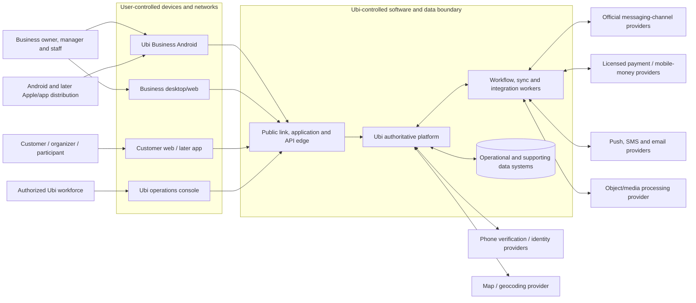

# Ubi system context and responsibility boundary

Status: **Draft**  
Architecture level: system context (technology-neutral)  
Depends on: actors, workflows, functional requirements and quality attributes  
Blocks: bounded contexts, platform components, external adapters, deployment, data flows, threat model and vendor selection

## Purpose

This document defines what the Ubi software system is, who interacts with it, which external systems it depends on and where truth and responsibility cross trust boundaries. It deliberately does not select a programming language, mobile framework, database provider or cloud.

## System of interest

**Ubi** is one software system composed of customer, business and Ubi-workforce experiences plus the services and data systems that coordinate them.

```text
Ubi software system
├── Ubi Business Android application
├── Ubi Business desktop/web workspace
├── Customer web experience and later customer applications
├── Ubi operations console
├── Public/deep-link and API edge
├── Authoritative business platform
├── Background workflow and integration processing
└── Operational, local, object, cache/search and analytical data systems
```

These surfaces have different audiences and privileges but share one controlled domain language and authoritative server model. They are not separate businesses or separate copies of booking truth.

## Context diagram



Diagram source: `diagrams/30-system-context.mmd`.

The arrows represent information exchange, not provider reliability, legal responsibility or automatic trust.

## People and organizational actors

### Customers and organizers

Interact anonymously, through a scoped link/verified contact, or through an authenticated account. They may browse public business data, submit standard/custom requests, manage permitted bookings, report/initiate payment and communicate with a business.

They do not receive merchant-internal notes, raw resource calendars, unrelated booking information, private provider metadata or broader tenant access from link possession alone.

### Business owner, managers and staff

Interact through Ubi Business Android and later the desktop workspace. Their effective authority is an authenticated account plus an active tenant membership, capability, scope and context decision. An owner title is not a client-side superuser switch.

### Ubi workforce

Uses a separate operations identity and console. Ubi employment never means automatic access to every organization. Support, onboarding, payment operations, privacy, trust/safety, security and infrastructure have separate capabilities, purpose, elevation and audit.

### External representatives and regulators

Auditors, legal representatives, providers and authorities receive or supply controlled information through approved case/export/legal processes. They are not granted ordinary application/database access merely because they are outside stakeholders.

## Client application boundaries

All clients are outside the authoritative trust boundary even when Ubi publishes their code.

| Client | Primary responsibility | Must never decide authoritatively |
|---|---|---|
| Ubi Business Android | Fast local-first daily operations, manual booking, cached schedule, visible synchronization | Final authorization, cross-device conflict, capacity, payment verification, audit truth |
| Business desktop/web | Larger-screen setup, multi-operation work, reporting, queues and administration | Tenant isolation, ownership, provider truth, financial state |
| Customer web | Lightweight public/link booking and manage flow without mandatory installation/account | Price, availability, token scope or confirmation truth |
| Later customer app | Account-linked bookings, native messages/calls and reusable customer experience | Merchant policy, record linkage or financial truth |
| Ubi operations console | Case-based onboarding/support/reconciliation/trust/privacy/security work | Direct history rewrite or universal unlogged access |

Clients may validate for usability and work offline within explicit rules. The server reauthenticates, reauthorizes and validates every synchronized command.

## Ubi authoritative responsibilities

Ubi is the system of record for:

- Ubi account/session/contact verification evidence and account lifecycle;
- organization, brand, branch, booking-operation and membership records;
- capability grants, approval decisions and Ubi audit evidence;
- Ubi catalog/configuration versions;
- Ubi availability rules, holds and booking/resource commitments;
- standard/custom request, quotation, amendment and fulfilment lifecycles;
- Ubi payment intent/evidence/allocation/reconciliation records—not provider settlement truth by invention;
- Ubi-native conversations/messages and normalized connected-channel records received lawfully;
- notification intents/attempts and known delivery evidence;
- contextual/manage-link grants and redemption history;
- privacy/retention cases and Ubi operational processing evidence.

The Ubi server may derive summaries and projections, but the authoritative source for each field/state must remain identifiable.

## External systems and authority contracts

### Phone verification and identity providers

External providers may establish that a challenge to a phone/email/device succeeded under their rules. They do not establish business ownership, tenant membership or continued identity forever.

Ubi responsibilities:

- generate/validate purpose and session binding;
- rate-limit and resist enumeration/abuse;
- store minimum verification evidence, not OTP secrets;
- decide resulting Ubi account/session/recovery authority;
- support provider outage and replacement.

### Official messaging/social providers

The provider is authoritative for its account identifiers, granted platform permissions and message/delivery events it actually exposes. Ubi is authoritative for connection configuration, normalized records, routing, automation/takeover and resulting Ubi domain commands.

No merchant passwords, scraping or personal-account automation are permitted.

### Payment/mobile-money providers

The licensed provider is authoritative for provider transaction, refund, reversal and settlement evidence under its service. Ubi is authoritative for its expected obligation, intent, evidence receipt, allocation/reconciliation decision and booking-policy response.

Redirect screens, SMS text, screenshots and customer/staff reports are not provider verification.

### Push, SMS and email delivery providers

Providers are authoritative only for the delivery states their protocols return. Ubi is authoritative for notification purpose, recipient policy, content/template version, retry/fallback and operational follow-up.

No delivery signal proves reading, comprehension or booking acceptance.

### Object storage and media processing

External storage/processing may hold encrypted/protected Ubi objects and produce transformations or safety results. Ubi owns object authorization, tenant relationship, metadata, retention/deletion requests, signed-access policy and the decision that a processed object is safe/usable.

Public permanent object URLs for private content are prohibited.

### Map/geocoding provider

Provider results are suggestions/evidence with provider attribution/terms. Ubi stores the business/user-confirmed location context separately. A coordinate is not automatically a verified address.

Core text booking/manual address paths must survive provider unavailability.

### Application stores and operating systems

App stores/OS vendors control distribution, signing validation, permissions, background limits, notifications and device execution. Ubi owns release approval, supported-version policy, secure local storage, graceful degradation and customer support.

### Hosting, network and managed-data providers

The selected infrastructure operator provides contracted compute/network/storage/control-plane capabilities. Ubi retains responsibility for architecture, data classification, tenant/application authorization, configuration, encryption/key access, backup validation, monitoring, incidents, vendor governance and truthful availability commitments.

## Trust zones

| Zone | Examples | Trust rule |
|---|---|---|
| Z0 public/untrusted | Internet, anonymous browser, public URL input, inbound provider endpoint before verification | Validate, rate-limit, minimize disclosure; no tenant trust |
| Z1 user device | Android, browser, local database, app secrets/session material | Device may be lost, shared, rooted, offline or tampered; server revalidates |
| Z2 application edge | TLS termination, routing, public-link resolver, authenticated API boundary | Authenticate/normalize/rate-limit; avoid domain bypass |
| Z3 Ubi application/domain | Authoritative commands, policy, transaction and workflow decisions | Least-privilege service identity and explicit tenant context |
| Z4 restricted data/control | Operational DB, secrets, backups, audit, provider credentials, privileged admin | Strongest access, network/control separation and monitoring |
| Z5 external providers | Identity, messaging, payments, delivery, maps/media | Treat as separate administrative/legal/security boundary; verify every callback |
| Z6 analytics/support | Governed telemetry, reporting, case tools | Minimized/pseudonymized by default; cannot mutate operational truth |

Movement between zones has an authenticated/authorized contract, data classification, timeout/failure policy, observability and retention owner.

## High-level data flows

### Public booking

```text
Customer client
→ public edge resolves business/operation
→ safe catalog and computed candidate availability
→ customer creates draft and verifies required contact/token
→ authoritative booking/request command
→ operational transaction and domain event
→ notification intent
→ approved delivery provider
```

### Offline business booking

```text
Staff action
→ encrypted/local tenant-scoped store and durable command
→ visible pending state
→ authenticated sync edge on reconnection
→ reauthorization + authoritative validation/transaction
→ accepted result or explicit conflict/rejection
→ local convergence and audit-visible result
```

### Connected-channel handoff

```text
Official provider event
→ provider-specific authenticated ingress
→ normalized tenant-scoped conversation
→ staff/approved automation creates editable structured draft
→ opaque contextual link
→ customer web/app review
→ authoritative request/booking command
```

### Integrated payment

```text
Booking/quote obligation
→ Ubi payment intent
→ licensed provider interaction
→ authenticated provider event/query
→ Ubi evidence validation and reconciliation
→ verified allocation
→ independent booking policy command
```

## Tenant and identity context propagation

Every protected synchronous/asynchronous operation carries or resolves:

- principal type and immutable principal ID;
- authenticated session/service identity and assurance/credential version;
- organization tenant ID or explicitly public/platform context;
- membership/grant ID and authorization version where applicable;
- requested action, resource identity and resource tenant;
- correlation/causation and idempotency identity;
- client/device/provider/source and time evidence;
- purpose/case/approval when required.

The server derives tenant/resource scope from trusted records. A client-supplied organization ID is routing input, never sufficient authorization.

## Boundary failure policy

For every provider/interface, Ubi must define:

- connection/authentication and credential owner;
- request/event schema and version;
- rate/size/idempotency/replay limits;
- timeout, retry, backoff and expiry;
- synchronous versus queued outcome;
- duplicate/out-of-order handling;
- circuit breaking/backpressure and tenant fairness;
- provider-versus-Ubi error classification;
- degraded user experience/manual fallback;
- reconciliation and operator queue;
- alert/runbook and data retention/deletion;
- exit/replacement/export procedure.

An integration is incomplete until these exist. A successful demo call is not production readiness.

## Environment boundary

At minimum, Ubi needs independently controlled development, test/CI, staging and production environments.

- Production data and credentials never flow into lower environments by default.
- Test/demo organizations are visibly separated from production commitments and money.
- Provider sandbox/test and live accounts/credentials/webhooks are isolated.
- Ubi workforce privileges are environment-specific.
- Deployments, migrations and configuration changes are attributable and reviewed.
- Synthetic test identities/phones/media are used; copied production data requires an exceptional approved de-identification process.

Exact account/project/network topology is defined in the deployment architecture.

## Availability and dependency posture

Ubi must continue its core supported work when non-critical providers fail:

| Dependency unavailable | Minimum Ubi behaviour |
|---|---|
| Messaging channel | Direct Ubi link/manual booking and existing Ubi booking records remain usable |
| Push/SMS/email | Booking remains committed; in-app/action queue and manual follow-up remain |
| Payment provider | No false success; pay-later/manual method only if configured; reconciliation preserves unknown attempts |
| Map/geocoding | Text address/landmark/manual location remains |
| Media processing | Text flow continues; attachment remains pending/unavailable safely |
| Search/cache | Authoritative bounded lookup/database fallback or clear degraded path; no cross-tenant result |
| Analytics | Operational commands continue; governed events queue/drop only under explicit durability policy |
| Android network | Cached schedule and eligible local queued work continue |

Identity provider failure may prevent new verification/login but should not unnecessarily terminate valid low-risk sessions; exact security trade-offs require identity architecture.

## Explicit system exclusions

The initial Ubi system is not:

- a consumer discovery/ranking marketplace;
- a hotel property-management/channel-manager suite;
- a medical record system;
- a bank, wallet, escrow or assumed merchant of record;
- a social-network account scraping/automation tool;
- a carrier/emergency calling service;
- a general enterprise resource planning/accounting/HR system;
- a globally multi-region platform from day one.

External changes require a recorded product, legal, architecture, data and operating decision.

## Context-level invariants

1. Only the Ubi authoritative platform can accept a Ubi booking/domain command.
2. No client, provider callback, notification or analytics system bypasses authorization and domain validation.
3. Provider evidence is retained with its source; it is not relabelled as broader Ubi truth.
4. Merchant tenant context and Ubi workforce/platform authority are separate policy planes.
5. Operational truth remains usable when analytics is unavailable.
6. Core booking value remains available without optional social integrations.
7. Customer web fallback does not require the customer application.
8. External failure produces a truthful pending/degraded/action-required state, never false success.
9. Every cross-boundary retry has a stable logical identity.
10. Ubi can disconnect/replace a provider without rewriting historical bookings.

## Context acceptance checks

1. Trace a guest web booking from public discovery through authoritative confirmation and failed SMS delivery.
2. Trace an offline staff booking through reconnect, revoked permission and conflict resolution.
3. Trace an officially connected message into a customer-reviewed handoff without provider account credentials entering Ubi.
4. Trace provider-verified payment after a redirect failure and duplicate/out-of-order webhooks.
5. Disconnect every optional provider individually and demonstrate the documented degraded path.
6. Attempt cross-tenant access at client, edge, application, worker, object, cache/search, export and analytics boundaries.
7. Demonstrate that an Ubi operator cannot browse content without the required purpose/elevation.
8. Show the system still distinguishes message, payment, booking, notification and fulfilment states in every failure scenario.

## Open decisions

- Launch country/city, operator entity and jurisdictional responsibilities.
- First vertical and exact first-release clients/capabilities.
- Hosting provider/region and recovery topology.
- Identity/OTP, notification, payment, map/media and connected-channel providers.
- Whether desktop is responsive web/PWA or later requires a packaged/native form.
- Provider/country data transfer, retention and subprocessor terms.
- Public primary domain/subdomain and verified app/universal-link association.
- Initial contractual availability/support commitments.

