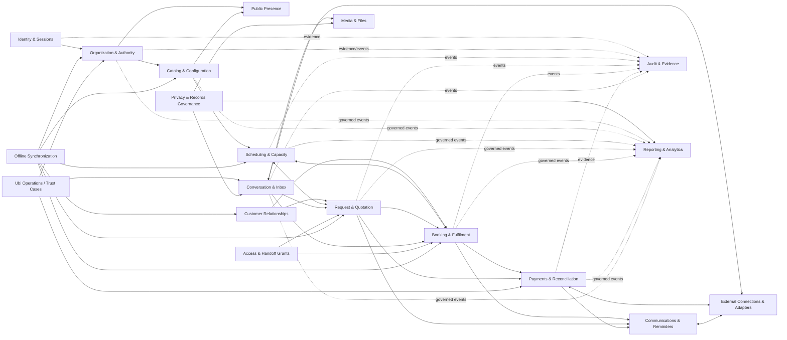

# Domain model and bounded-context architecture

Status: **Draft**  
Architecture level: logical domain architecture; not deployment topology  
Depends on: system context and complete workflow/requirement specifications  
Blocks: platform components, APIs/events, database ownership, sync, testing, team ownership and implementation backlog

## Purpose

This document divides Ubi into coherent domains with one owner for each rule and category of truth. A bounded context is a language, model and ownership boundary. It is **not automatically a microservice, database or team**.

The recommended initial implementation is a modular monolith plus background workers. Contexts become enforceable modules/schemas/contracts inside that deployable system. They are extracted only when measured scale, security isolation, availability or team ownership justifies the operational cost.

## Architectural direction

```text
Clear domain boundaries now
→ one transactional application where practical
→ durable outbox/inbox for asynchronous effects
→ independent workers/adapters for unreliable external I/O
→ extraction later only with evidence and a migration contract
```

This avoids both extremes:

- one undifferentiated “booking app” where any feature edits any table;
- premature microservices that introduce distributed failure before Ubi has validated one market.

## Subdomain classification

### Core differentiating domains

These directly determine whether Ubi can support many real businesses safely:

- **Scheduling & Capacity** — archetype-aware resource/capacity/hold computation.
- **Booking & Fulfilment** — authoritative service commitment and its lifecycle.
- **Request & Quotation** — custom scope/proposal/acceptance/conversion without false confirmation.
- **Offline Synchronization** — safe local-first command/result/conflict/convergence model.

### Supporting business domains

- Organization & Authority.
- Catalog & Operation Configuration.
- Customer Relationships.
- Conversation & Inbox.
- Secure Access/Handoff Grants.
- Payments & Reconciliation.
- Communications & Reminders.
- External Connections & Provider Adapters.
- Public Presence & Entry Points.
- Ubi Operations, Trust & Cases.

### Generic/platform domains

- Identity & Sessions.
- Media & Files.
- Audit & Evidence.
- Privacy & Records Governance.
- Reporting & Analytics.
- Ubi Subscription/Billing (later commercial scope).

Generic does not mean low risk. Identity, audit and privacy are critical even though they do not differentiate booking logic.

## Context map



Diagram source: `diagrams/31-bounded-context-map.mmd`.

An arrow means the downstream context consumes an explicit contract or event. It does not authorize direct writes to the upstream context’s storage.

## Context catalogue

### BC-IAM — Identity & Sessions

**Purpose:** authenticate Ubi accounts and service identities and manage contact verification, credentials, devices, sessions and recovery.

Owns:

- account lifecycle and immutable account ID;
- contact method and point-in-time verification evidence;
- authentication credential/passkey/OTP-challenge reference;
- session, refresh family, device/app-instance relationship;
- authentication assurance and recent-authentication evidence;
- account recovery case/decision linkage;
- service/workload identities.

Does not own:

- organization membership/ownership;
- tenant permissions;
- merchant customer records;
- external provider participants;
- business verification.

Critical invariants:

1. Contact identifiers are not account IDs.
2. Recovery cannot grant organization authority by itself.
3. Revoked sessions/credentials cannot silently regain validity.
4. Authentication assurance is explicit and time-bounded for step-up use.

Primary outputs: `AccountAuthenticated`, `ContactVerified`, `SessionRevoked`, `AccountRestricted`, authentication decision/introspection contract.

### BC-ORG — Organization & Authority

**Purpose:** represent tenant structure and decide whether an authenticated subject may act in a business scope.

Owns:

- organization, brand relationship, branch and booking-operation identity/lifecycle;
- business verification/status evidence references;
- membership, invite, role bundle, capability grant/deny and scope;
- owner/legal-representative recognition and transfer workflow;
- approval request/decision for privileged organization actions;
- authorization policy version and decision evidence;
- operation feature eligibility/country overlay assignment.

Does not own catalog configuration, bookings, customers or provider transactions.

Critical invariants:

1. One organization is the initial tenant boundary.
2. Account authentication is necessary but not sufficient for merchant action.
3. Tenant, capability, scope, resource and context must all authorize.
4. Delegation cannot grant authority the delegator lacks.
5. Last-owner/high-risk changes follow stronger recovery/approval controls.

Primary outputs: `OrganizationActivated/Restricted`, `OperationCreated/Paused`, `MembershipActivated/Revoked`, `AuthorityChanged`; online authorization-decision contract.

### BC-PUB — Public Presence & Entry Points

**Purpose:** publish the safe customer-facing representation of a business and resolve human-friendly URLs/subdomains.

Owns:

- public profile publication state;
- slug/subdomain reservation, rename, redirect, reserved-name and suspension rules;
- approved public contact/location/brand presentation;
- safe public operation/service projection and SEO/discovery metadata;
- public-link routing to the selected operation/service.

Consumes versioned organization/catalog publication events. It never queries/exposes raw private calendars or customer records.

Critical invariants:

1. A slug is a locator, not identity or authorization.
2. Only explicitly published safe fields are public.
3. Public availability is a bounded candidate projection, never private occupancy detail.
4. Suspended/renamed profiles preserve safe customer/booking recovery paths.

### BC-CAT — Catalog & Operation Configuration

**Purpose:** define what an operation offers and the versioned rules used to request/book it.

Owns:

- booking archetype/configuration version assigned to an operation;
- service, package, add-on and option definitions;
- localized names/descriptions and publication state;
- duration, fulfilment mode/location requirement and resource requirement template;
- price method/components and customer-visible policy references;
- intake field/template definitions and data-minimization validation;
- publication/test/activation/version lifecycle.

Does not own real-time availability, committed booking price snapshots or actual customer answers.

Critical invariants:

1. Only valid compatible archetype configuration can be published.
2. Published versions are immutable; edits create later versions.
3. Archiving configuration never rewrites historical commitments.
4. Exact money/currency and prohibited-field rules are server validated.

Primary outputs: `CatalogVersionPublished/Archived`, `ServiceVersionPublished`, query contracts for current/specific versions.

### BC-SCH — Scheduling & Capacity

**Purpose:** calculate and commit the use of staff, space, asset, pooled and capacity resources across time.

Owns:

- resource identity/type/eligibility within an operation;
- recurring availability rules and effective-dated exceptions/blocks;
- buffers, capacity pools and assignment constraints;
- candidate availability computation;
- temporary hold lifecycle and expiry;
- authoritative capacity commitment/release ledger or reservation boundary;
- scheduling conflict/override evidence.

It does not own the commercial booking lifecycle or customer-facing promise text. It exposes authoritative capacity commands/results to Booking/Request.

Critical invariants:

1. Exclusive/capacity resources cannot be overcommitted beyond approved override rules.
2. Candidate slots do not guarantee final availability.
3. Holds consume capacity until consumed/released/expired exactly once.
4. Timezone, buffers, required-resource intersection and capacity are evaluated together.
5. Material conflicts never use silent last-write-wins.

Primary commands/events: `FindCandidateAvailability`, `PlaceHold`, `ExpireHold`, `CommitCapacity`, `MoveCommitment`, `ReleaseCapacity`; `HoldPlaced/Expired/Consumed`, `CapacityCommitted/Moved/Released`, `ScheduleConflictRaised`.

### BC-BKG — Booking & Fulfilment

**Purpose:** own the authoritative service commitment from draft/request through confirmation, schedule change, cancellation and fulfilment.

Owns:

- booking aggregate and lifecycle;
- booking parties/roles and tenant/customer/account references;
- confirmation policy result and conditions;
- immutable schedule/service/price/policy/source snapshots;
- booking code and customer-manage relationship references;
- reschedule/cancellation/no-show/check-in/start/complete history;
- next responsible actor/action/deadline;
- derived booking financial summary references, not provider money truth.

It consumes exact catalog versions, customer references, scheduling commands and payment-condition outcomes.

Critical invariants:

1. Confirmed booking has authoritative valid capacity or an explicitly approved no-capacity archetype/policy.
2. Submission/request/hold/payment processing never masquerades as confirmation.
3. A logical booking command has one effect under retry.
4. Reschedule/cancel preserves prior commitments and consequences.
5. Historical snapshots do not change when catalog/policy/customer display data changes.
6. State transitions identify actor, reason, source and evidence.

Primary commands/events: `SubmitBooking`, `ConfirmBooking`, `Accept/DeclineBooking`, `RescheduleBooking`, `CancelBooking`, `CheckIn/Start/Complete/NoShow`; corresponding past-tense domain events.

### BC-REQ — Request & Quotation

**Purpose:** manage custom work requiring clarification, assessment, commercial proposal and explicit acceptance before booking.

Owns:

- custom request, answers and provenance;
- assignment/triage/clarification/assessment state;
- versioned quotation, options, scope, exclusions, validity and acceptance evidence;
- amendment/change-order proposals after conversion where commercial scope requires;
- next responsible actor/action/deadline;
- conversion record linking accepted version to resulting booking.

Consumes customer/catalog/scheduling information and invokes Booking conversion through an explicit contract.

Critical invariants:

1. Request submission is not booking confirmation.
2. Issued/accepted quotation versions are immutable and exact.
3. Acceptance binds the exact option/version and actor evidence.
4. Conversion revalidates accepted version, validity, capacity, price condition and idempotency.
5. Post-confirmation changes use amendments rather than rewriting the accepted quote/booking.

### BC-CRM — Customer Relationships

**Purpose:** maintain each organization’s private operational relationship with its customers and verified links to customer accounts where appropriate.

Owns:

- tenant-private customer record and contact/preference fields;
- customer record source/provenance;
- duplicate suggestion, merge/unmerge lifecycle;
- organization-level communication preference/consent evidence where allocated;
- verified claims linking an Ubi account to the permitted merchant record/booking;
- internal note classification/visibility rules.

Does not own global human identity, account authentication, bookings or conversation messages.

Critical invariants:

1. Customer records never cross organization visibility by default.
2. Similar name/phone is not automatic merge or access authority.
3. Merge/unmerge preserves source/history/booking relationships.
4. Account linking exposes only customer-authorized/customer-facing fields.

### BC-CONV — Conversation & Inbox

**Purpose:** manage Ubi-native and normalized external conversation, participant, assignment and automation/human control.

Owns:

- conversation/thread and provider-scoped participant linkage;
- normalized immutable message and provider source/delivery evidence;
- inbox status, queue, assignment/claim and response responsibility;
- automation mode, takeover/resume and policy-result evidence;
- extraction suggestions and message-linked provenance;
- block/report/conversation restrictions in coordination with Trust.

Does not own channel credentials/capabilities, booking/request state or notification intent.

Critical invariants:

1. Messages cannot directly establish booking/payment truth.
2. External identities remain provider/connection scoped until verified linkage.
3. Human takeover stops substantive automation until explicit resume.
4. Provider delivery/read state is not inferred.
5. Content access is tenant/queue/purpose scoped.

### BC-LINK — Secure Access & Handoff Grants

**Purpose:** issue, redeem, revoke and audit opaque scoped links used by guests/customers across web/app/conversation boundaries.

Owns:

- handoff/manage/invite/public-action grant metadata;
- protected token verifier/hash, purpose, resource/action scope and risk;
- expiry, bounded/single use, revocation and supersession;
- redemption/verification evidence and app/web destination resolution policy.

It does not own the target booking/request/customer state. Redemption yields a narrowly scoped principal/grant; the target context still validates current state.

Critical invariants:

1. URL carries an opaque token, not raw personal/domain content.
2. Redemption cannot broaden tenant/resource/action scope.
3. Opening is not submission/acceptance.
4. Forward/replay/expiry/revocation fail without unrelated data disclosure.

### BC-PAY — Payments & Reconciliation

**Purpose:** represent expected money, provider/manual evidence, exact allocation, refund, reversal/dispute and reconciliation without claiming custody or provider truth beyond evidence.

Owns:

- payment obligation, intent, attempt and method selection;
- customer-reported/manual evidence and verification workflow;
- provider transaction/refund/reversal/settlement evidence normalized through adapters;
- exact verified allocations to obligations;
- refund intent/approval/outcome;
- reconciliation cases, discrepancy/closure evidence;
- derived payment/settlement summaries.

Does not own accepted booking state or provider’s external ledger. Booking consumes a versioned `PaymentConditionSatisfied/Revoked/Exception` contract.

Critical invariants:

1. Report/redirect/message/screenshot is not provider verification.
2. Value cannot be allocated/refunded twice under retry.
3. Amount, currency, merchant/provider and obligation match before automatic allocation.
4. Late/reversed/disputed payments remain visible and never silently rewrite booking history.
5. Staff cannot repair financial history by direct balance edit.

### BC-COMMS — Communications & Reminders

**Purpose:** create, schedule, localize and deliver truthful purpose-bound notifications/reminders and track evidenced outcomes.

Owns:

- notification policy/intent;
- recipient endpoint projection and purpose/channel preference needed for dispatch;
- localized template version/provider template mapping;
- reminder schedule and invalidation/supersession;
- delivery attempts/retry/fallback/action-required result;
- in-app notification center state.

Consumes authoritative domain events/snapshots. It cannot mutate their truth.

Critical invariants:

1. Notification generation is idempotent per logical event/recipient/purpose.
2. Current state is rechecked before stale consequential messages/actions.
3. Delivery/read does not mean domain completion or comprehension.
4. Communication failure never rolls back committed booking/payment.
5. Transactional channels are not reused for unauthorized promotion.

### BC-INT — External Connections & Provider Adapters

**Purpose:** isolate provider authorization, credentials, capabilities, request/webhook protocols and raw-to-canonical translation.

Owns:

- provider/connection registry and versioned capability profile;
- OAuth/official authorization lifecycle and granted scopes;
- encrypted provider credential references/rotation/revocation metadata;
- authenticated webhook envelope, deduplication and adapter version;
- outbound provider request/response/correlation/rate state;
- provider health/degradation/reauthorization status;
- mapping between provider account/resource and the correct Ubi tenant/context.

Provider-specific submodules translate to domain-specific canonical contracts consumed by Conversation, Payment and Communications. The integration context does not decide booking, payment allocation or message takeover policy.

Critical invariants:

1. Callback is authenticated and mapped to environment/provider account/tenant before use.
2. Duplicate/out-of-order events cannot multiply a logical domain effect.
3. Credentials never enter client or ordinary support surfaces.
4. Missing provider capability is denied, not guessed.
5. Disconnect/revoke stops new provider access while preserving required Ubi history.

### BC-MEDIA — Media & Files

**Purpose:** control upload, scan/process, storage, access, transformation, lifecycle and deletion of logos, service media, receipts, message attachments and exports.

Owns:

- object identity, tenant/purpose/classification/owner relationship;
- upload session and size/type policy;
- scan/quarantine/processing/derivative state;
- protected storage key and signed-access issuance;
- retention/deletion/tombstone evidence;
- checksum/version and safe metadata.

Domain contexts own why the file exists and whether it is linked; Media owns safe object handling. Public and private media use separate access policy.

### BC-SYNC — Offline Synchronization

**Purpose:** make Android local-first actions durable, attributable, idempotent and convergent without treating the device as server authority.

Owns/contracts:

- device/app-instance/client-install registration needed for sync;
- synchronization cursor/change feed envelope;
- local command envelope schema and lifecycle;
- command idempotency/result mapping;
- conflict/rejection taxonomy and resolution contract;
- tombstone/retention window and full-resync negotiation;
- sync health/lag diagnostic metadata.

Domain modules still own command validation and final results. Sync routes a versioned command to the owner; it never applies generic last-write-wins to booking/money/permissions.

Critical invariants:

1. Local success wording follows durable local commit truth.
2. Server reauthenticates/reauthorizes every command.
3. One client command maps to at most one logical server effect.
4. Conflict preserves user input and owner-specific resolution choices.
5. Incremental change/tombstone handling eventually converges or explicitly requires full resync.

### BC-OPS — Ubi Operations, Trust & Cases

**Purpose:** coordinate internal work without creating a universal production superuser or bypassing domain commands.

Owns:

- onboarding/support/integration/payment/privacy/security/trust case metadata;
- queue, assignment, SLA/priority and next action;
- purpose/elevation request and review linkage;
- merchant/user communication and redress case;
- restriction/moderation decision workflow where platform-owned;
- incident/customer-impact linkage.

It invokes owner-context commands using restricted workforce authority. It does not directly edit domain tables/history.

### BC-AUDIT — Audit & Evidence

**Purpose:** preserve attributable, queryable, tamper-evident evidence of high-impact actions and decisions.

Owns:

- audit envelope, actor/service/session/purpose/tenant/resource/action/outcome;
- before/after or referenced change evidence appropriate to risk;
- approval/elevation/correlation/causation links;
- protected retention, access and export evidence;
- integrity/sequence/checkpoint mechanisms selected later.

Source contexts create audit facts in the same authoritative transaction/outbox path where required. Audit is not an event bus and cannot become the source used to reconstruct every operational state by default.

### BC-PRIV — Privacy & Records Governance

**Purpose:** govern why data exists, who is responsible, how long it remains and how verified access/correction/export/deletion/restriction/legal-hold requests propagate.

Owns:

- data inventory/classification/purpose/owner/retention rule registry;
- notice/agreement/consent version evidence allocated to Ubi;
- privacy/records request and identity-verification workflow;
- deletion/restriction/export propagation plan and completion evidence;
- legal hold and documented retention exception;
- subprocessor/data-location/transfer register.

It issues work to owning contexts. It does not bypass their integrity/legal retention rules or report completion before every required system returns evidence.

### BC-DATA — Reporting & Analytics

**Purpose:** produce governed operational projections, metrics and analytical datasets without mutating or becoming an uncontrolled copy of operational truth.

Owns:

- reporting projections/read models;
- analytical event contract and collection quality;
- metric dictionary, version and semantic owner;
- minimized/pseudonymized analytical datasets;
- lineage, freshness, access and deletion propagation evidence;
- experiment assignment/outcome definitions where approved.

It consumes governed events/exports. Operational actions never wait for analytics, and analytics does not calculate a different booking/payment lifecycle.

### BC-BILL — Ubi Subscription & Commercial Billing (later)

**Purpose:** manage what merchants owe Ubi for software/service plans, usage and invoices.

This context is separate from customer payment for merchant services. It may own Ubi plan, entitlement, usage-rating, invoice and merchant subscription collection when commercially approved.

It must not reuse booking customer payment records as Ubi’s own billing ledger.

## Data ownership matrix

| Truth | Sole write owner | Primary consumers |
|---|---|---|
| Account/session/contact verification | IAM | Organization, Link, client session, Operations |
| Organization/branch/operation identity | Organization | All tenant contexts, Public, Analytics |
| Membership/capability/scope | Organization | API policy, Sync, every protected context |
| Published service/configuration version | Catalog | Public, Scheduling, Booking, Request |
| Resource rules/holds/capacity commitments | Scheduling | Booking, Request, Android calendar projection |
| Booking lifecycle/snapshots/fulfilment | Booking | Public/customer management, Conversation, Payment, Communications, Analytics |
| Request/quotation/acceptance | Request | Booking conversion, Conversation, Payment, Communications |
| Tenant customer relationship/merge | Customer | Booking, Request, Conversation, Communications |
| Conversation/message/assignment/takeover | Conversation | Request/Booking links, Operations, Analytics |
| Scoped token/grant/redemption | Link | Customer web/app, Booking, Request, CRM |
| Payment evidence/allocation/refund/reconciliation | Payment | Booking financial condition/summary, Operations, Analytics |
| Notification/reminder/delivery attempt | Communications | Business/customer status, Operations, Analytics |
| Provider connection/credential/capability/webhook receipt | Integration | Conversation, Payment, Communications, Operations |
| File object/access/processing lifecycle | Media | Catalog, Conversation, Payment, Export/Privacy |
| Local command/cursor/conflict envelope | Sync | Android and each command-owning context |
| Audit evidence | Audit | Authorized review, Security/Privacy, Operations |
| Retention/deletion/legal hold case | Privacy | All data-owning contexts and Operations |
| Metric/report projection | Analytics | Merchant reports, Ubi operations/product |

A consumer stores only approved references, immutable snapshots or rebuildable projections. It never becomes a hidden second writer.

## Context interaction patterns

### Pattern A — synchronous query

Use for bounded current information needed to validate a command, such as authorization decision, catalog version retrieval or candidate availability.

Rules:

- explicit timeout and error contract;
- tenant/purpose/data minimization;
- no circular nested call graph;
- cache only with owner-defined staleness/version rules.

Inside the modular monolith this is an in-process module interface, not an HTTP call.

### Pattern B — synchronous authoritative command

The caller asks the owning context to change its own aggregate. The owner validates authorization/domain invariants and returns committed/rejected/conflict plus stable identifiers/version.

Only the owner writes its records.

### Pattern C — atomic hard-invariant coordination

When two logical contexts must share one database transaction to prevent an impossible state, a named application workflow coordinates their public module interfaces within the modular monolith.

Approved direction:

- Booking confirmation/reschedule/cancellation and Scheduling capacity commit/move/release use one authoritative transaction boundary.
- Request-to-booking conversion and consumption of its scheduling hold/accepted quote may use one boundary where required.
- Booking snapshots exact catalog/policy version in the same commit after version validation.

This exception is explicit and tested. It is not permission for arbitrary cross-module table writes.

### Pattern D — domain event and durable outbox

Use after a committed fact for notifications, projections, analytics, provider work and cross-context follow-up.

Rules:

- event is past tense, immutable and versioned;
- transaction records aggregate change plus outbox atomically;
- consumers are at-least-once and idempotent;
- event order is bounded by aggregate/causation, not assumed globally;
- schema evolution and replay/retention are governed;
- sensitive fields are minimized and referenced rather than copied blindly.

### Pattern E — process manager/saga

Use for long-running workflows crossing unreliable boundaries, such as payment-conditioned confirmation, refund, provider reauthorization, privacy deletion and contextual handoff.

The process manager owns coordination state and deadlines but invokes each context’s commands. It does not mutate their data or pretend external work is one ACID transaction.

## Hard consistency versus eventual consistency

| Relationship | Consistency requirement | Reason |
|---|---|---|
| Booking confirmation ↔ capacity commit | Atomic/hard | Prevent double booking/false confirmation |
| Booking reschedule ↔ old/new capacity | Atomic/hard | Never lose both or hold both unintentionally |
| Hold consumption ↔ conversion/confirmation | Atomic where same authority | Prevent expired/double-consumed capacity |
| Booking snapshot ↔ selected catalog/policy version | Version checked in command transaction | Preserve accepted terms |
| Membership revocation ↔ new protected command | Current authoritative check; no stale allow | Prevent continued authority |
| Payment provider success ↔ Ubi payment evidence | Eventual, reconciled | External transaction cannot share Ubi DB transaction |
| Verified payment ↔ booking condition result | Durable process, idempotent | Paid-without-booking requires explicit recovery |
| Booking commit ↔ notification | Eventual | Notification failure cannot undo booking |
| Operational write ↔ analytics/search projection | Eventual/rebuildable | Reporting failure cannot block operations |
| Provider message ↔ conversation normalization | Eventual with authenticated inbox/dedup | Provider is asynchronous/unreliable |
| Privacy deletion case ↔ all stores | Eventual with completion evidence | Multi-system propagation and legal exceptions |

## Aggregate direction

Aggregate boundaries are finalized with data design, but initial candidates are:

- `Account` with credential/session/contact sub-lifecycles separated where scale/security requires.
- `Organization` plus independent `Membership`; ownership transfer/approval are separate controlled aggregates.
- `CatalogPublication`/`ServiceVersion` rather than one huge operation object.
- `ResourceScheduleRule`, `Hold` and `CapacityCommitment`; do not load an entire lifetime calendar into one aggregate.
- `Booking` as lifecycle/history/snapshot root linked to capacity commitments by stable ID.
- `CustomRequest` and `Quotation` versions; accepted quotation is immutable.
- `CustomerRecord` with merge relationship/history.
- `Conversation` and individual immutable `Message`; avoid an ever-growing embedded message list.
- `PaymentIntent`, `ProviderTransaction`, `Allocation`, `RefundIntent` and `ReconciliationCase` as distinct roots.
- `NotificationIntent` and `DeliveryAttempt`.
- `ChannelConnection` and `ProviderEventReceipt`.
- `AccessGrant`/`TokenRedemption`.
- `MediaObject`.
- `PrivacyCase` and propagation tasks.

No aggregate may grow without bound, require cross-tenant locking or treat an entire organization as one transaction.

## Shared-kernel policy

The allowed shared kernel is intentionally small:

- immutable opaque ID/value types;
- tenant/principal/correlation/idempotency context envelopes;
- time/date/timezone and exact money primitives;
- pagination/result/error primitives;
- event/command metadata conventions;
- approved localization/validation utilities;
- observability and safe logging interfaces.

Not shared as generic models:

- a universal `User` combining account/customer/staff/provider identity;
- a universal `Status` enum;
- a universal `Payment` or `Booking` DTO reused everywhere;
- shared database repositories that let modules edit one another’s tables;
- framework entities exposed as API/event contracts.

## Anti-corruption layers

Every external provider has an adapter that maps provider language into a narrow Ubi contract.

Examples:

- provider `user/contact/thread/message` → provider-scoped participant and normalized conversation evidence;
- provider `successful/captured/settled` → provider evidence evaluated by Payment rules, not direct `booking.confirmed`;
- provider `delivered/read` → supported delivery attempt evidence, not customer comprehension;
- geocoder address/coordinate → suggestion with provider/source/precision, not verified Ubi address;
- identity provider challenge success → contact verification evidence, not organization ownership.

Provider payloads/types do not leak through the core Booking/Catalog/Organization APIs.

## Authorization placement

Authorization has three layers:

1. **Edge coarse control** — authenticated/session/token presence, rate/size and obvious route eligibility.
2. **Organization authority decision** — current tenant membership/capability/scope/context.
3. **Owning-domain policy** — resource relationship and state-specific rule, such as “customer may cancel this booking under this policy.”

All three may be required. A global middleware check alone cannot decide row/action policy; a domain check without tenant authority cannot protect staff access.

Background workers use a service identity plus original actor/tenant/causation evidence. They do not run as an invisible all-powerful system user.

## Naming and contract rules

- Commands use imperative business language: `ConfirmBooking`, `IssueQuotation`, `RecordReportedPayment`.
- Domain events use past tense: `BookingConfirmed`, `QuotationIssued`, `PaymentReported`.
- Queries state their data/scope: `GetCustomerVisibleBooking`, not `GetBookingEverything`.
- State names are context-qualified where exported: `booking_status`, `payment_intent_status`, `conversation_work_status`.
- Error contracts distinguish invalid input, unauthenticated, unauthorized, not found/disclosure-safe, conflict, expired, rate limited, provider unavailable and internal failure.
- Contract fields have owner, classification, purpose, compatibility rule and retention impact.

## Initial deployable mapping

Proposed first-release mapping—not yet a technology choice:

```text
Deployable A: Ubi application/API
  IAM, Organization, Catalog, Scheduling, Booking,
  Request (only if pilot needs it), CRM, Link, Audit entry points

Deployable B: Ubi background worker runtime
  outbox delivery, reminders, sync follow-up, expiration,
  provider adapters, media jobs, projections

Deployable C: public/business/operations clients
  separately released clients sharing versioned contracts

Managed data/services
  authoritative relational database, object storage,
  cache/rate coordination and observability providers
```

Conversation, integrated Payment and broader Communications modules can exist behind feature flags or be added in expansion without separate microservices. A worker runtime may run multiple queue types with isolation/limits.

## Extraction criteria

A context becomes a separate deployable only when one or more are evidenced:

- materially different scaling/load profile that cannot be isolated economically in process;
- required failure isolation or availability objective;
- required security/data/regulatory isolation;
- independent release/team ownership creating sustained coordination bottleneck;
- provider SDK/runtime conflict;
- demonstrated database contention/maintenance boundary;
- specialized real-time/media infrastructure.

Extraction requires contract compatibility, independent observability/on-call, data ownership/migration, replay/idempotency and failure-mode tests. “Microservices are scalable” is not sufficient evidence.

Likely later candidates are provider integration workers, communications delivery, media processing, analytics ingestion and call signaling/media—not the core booking transaction prematurely.

## Architecture fitness checks

1. Can Scheduling reject a conflict without Conversation, Payment or client code editing capacity tables?
2. Can Booking confirm atomically with capacity while a notification provider is fully offline?
3. Can Payment record a reversal without deleting/relabeling the completed booking?
4. Can Catalog publish a new price while existing booking snapshots remain exact?
5. Can one provider adapter be replaced without changing Booking domain types?
6. Can Organization revoke membership before an offline queued command executes?
7. Can Customer merge/unmerge tenant records without rewriting global Account identity?
8. Can Privacy coordinate deletion across contexts and prove partial/complete results?
9. Can Analytics be rebuilt from governed contracts without becoming a second operational writer?
10. Can each domain answer who owns its state, command, event, test and operational alert?

## Open decisions

- Pilot vertical and which bounded contexts are included in the first release.
- Exact hard transaction boundary between Booking/Scheduling/Request inside the modular monolith.
- Authorization policy implementation/library and cache invalidation strategy.
- Event schema/registry, outbox/inbox and process-manager implementation.
- Whether Public Presence is a separate module initially or a controlled projection owned with Catalog.
- Whether Audit uses an append-only relational schema first or a separately protected store.
- Data schemas/cross-context foreign-key policy.
- Team ownership and when Context modules receive separate code/package boundaries.
- Commercial subscription/billing requirements and launch timing.

