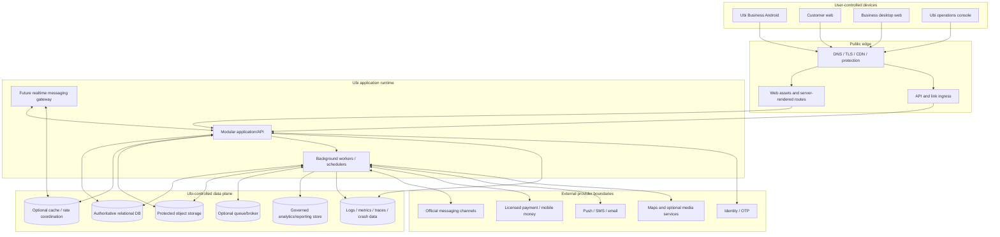
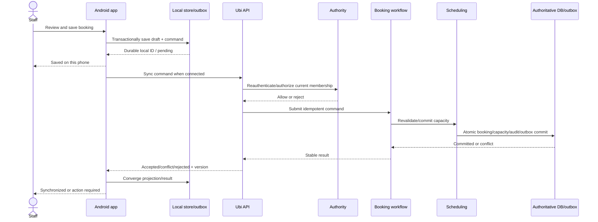

# Platform container and component architecture

Status: **Draft — technology choices remain open**  
Architecture level: logical containers and major components  
Depends on: system context and bounded-context map  
Blocks: repository/code architecture, APIs/events, database topology, deployment, security, observability and implementation slices

## Purpose

This document maps Ubi’s logical domains into a practical platform that a small early team can build and operate. It preserves clear boundaries without requiring dozens of network services.

## Recommended initial platform shape

```text
Client applications
├── Ubi Business Android (first)
├── Customer web (first public customer surface when required)
├── Business desktop web (after Android workflow validation)
└── Ubi operations console (minimum internal capabilities only)

Ubi server platform
├── Edge and web delivery
├── Modular application/API runtime
├── Background worker runtime
└── Optional future realtime gateway

Managed/supporting systems
├── Authoritative relational database
├── Protected object storage
├── Cache/rate/short-lived coordination store only where justified
├── Queue/broker only when database outbox + workers no longer suffice
└── Observability, crash reporting and governed analytics sinks
```

The first production version SHOULD run the core domain as one modular application deployable and one worker deployable against one authoritative relational database. Horizontal replicas are allowed. This is a modular monolith, not a single unstructured codebase.

## Container diagram



Diagram source: `diagrams/32-platform-containers.mmd`.

Dashed/future status is described in the component catalogue; diagram connectivity does not mean first-release inclusion.

## Release classification

| Container/component | Foundation | Pilot candidate | Expansion/future |
|---|:---:|:---:|:---:|
| Ubi Business Android | Yes | Yes | Continues |
| Modular application/API | Yes | Yes | Continues/extracts only with evidence |
| Authoritative relational database | Yes | Yes | Continues/scales |
| Background worker/outbox runtime | Yes | Yes | Continues/scales |
| Public link/token resolver | Yes | Yes | Continues |
| Customer lightweight web | Architecture foundation | Likely for shared booking/manage link | Broader account experience |
| Ubi operations console | Minimal restricted cases | Assisted onboarding/support | Trust/privacy/reconciliation expansion |
| Business desktop web | Contracts/responsive foundation | Usually after Android pilot | Broader multi-operation workspace |
| Object storage | Only if launch uses logos/media/evidence/export | Likely bounded use | Broader media |
| Cache/rate coordination | Only proven needs | Likely edge/auth rate coordination | Broader caching/realtime presence |
| Dedicated queue/broker | No by default | No unless volume/provider need proves it | Possible extraction |
| Dedicated search engine | No by default | No | Only measured search need |
| Analytics warehouse/lake | No by default | Governed operational projections/events | Add when questions/scale justify |
| Realtime messaging gateway | No | No unless native messages enter pilot | Expansion |
| Call signaling/media | No | No | Future gated |

## Client containers

### C-AND — Ubi Business Android

**Mission:** deliver the fastest, clearest and most resilient daily business workflow on constrained Android devices and networks.

Internal component direction:

```text
Presentation / navigation / accessibility
→ application use cases
→ domain/value validation used for local guidance
→ repository interfaces
   ├── durable local relational store
   ├── secure session/secret storage
   ├── command outbox and sync metadata
   └── network API client
→ sync coordinator and conflict UX
→ OS adapters: push, links, background work, camera/files, connectivity
→ telemetry/crash/performance with privacy filtering
```

Rules:

- Critical screens read local storage first.
- Eligible actions persist locally and receive a stable client command ID before showing local saved success.
- UI state is derived from repositories/use cases, not raw network callbacks.
- Process death, device rotation and background restrictions do not erase durable commands.
- Server truth is reconciled into local projections; client authorization/configuration is advisory when offline.
- Attachments/media are separate on-demand work and never block text booking.
- Feature modules follow user tasks/domain boundaries, not one folder per screen.
- Core business workflows MUST NOT be implemented as a remote website inside a WebView.
- Framework choice (native Kotlin/Compose versus Flutter) requires a separate decision and a D1 performance/accessibility/offline prototype.

### C-CWEB — Customer lightweight web

**Mission:** let a customer open a business/handoff/manage link and complete a supported action quickly without installing Ubi or creating an unnecessary account.

Component direction:

- server-rendered public/service/status shell;
- progressive enhancement for selection/forms;
- public profile/service query client;
- scoped token redemption and contact verification;
- booking/request review/submit/manage use cases;
- exact date/calendar/money/localized presentation;
- low-data image strategy and privacy-safe analytics;
- verified native-app association for later deep linking.

Rules:

- Core content/next action appears before client JavaScript completes.
- The page works at narrow width, keyboard/screen reader and constrained network.
- Public routes and scoped-token routes use different caching/security policies.
- Token/referrer data cannot leak to third-party page resources.
- Installing/logging in is an enhancement, not a prerequisite unless the action’s risk requires verification.

### C-BWEB — Business desktop web

**Mission:** support larger-screen, keyboard-efficient work such as configuration, multi-calendar/queue work, reporting and administration after Android fundamentals are validated.

Rules:

- It consumes the same versioned server domain contracts as Android, not a separate backend/database.
- Responsive web/PWA is the default option to evaluate before native Windows/macOS applications.
- Dense tables/calendars have accessible list/keyboard alternatives.
- Tenant/branch/operation context remains visible and protected.
- Offline scope may be narrower than Android and must be stated truthfully.

### C-OPS — Ubi operations console

**Mission:** provide case-based, least-privilege operational tools for onboarding, support, reconciliation, privacy, trust/safety and security.

Rules:

- Separate workforce identity, hostname/application registration and authorization policy plane.
- Starts with redacted metadata and case context.
- Elevation is purpose-scoped, time-bounded, approved/alerted/audited by risk.
- Every action calls the owning domain command; no generic database editor or hidden “login as anyone.”
- Production/test controls are visually and technically separated.
- The console is not exposed as a merchant admin role.

### C-CAPP — Later customer mobile applications

The later Android/iOS customer app may add account-linked history, push, native messaging and calls. It does not delay the lightweight web path and does not share business-app privileges/local tenant data.

Whether business and customer experiences are separate store applications remains the working direction. They may share design tokens, contract definitions and carefully reviewed libraries—not session storage, navigation or permission assumptions.

## Edge and web-delivery components

### E-DNS — DNS, domain and certificate layer

Responsibilities:

- primary Ubi domains and merchant subdomain routing;
- managed TLS certificate issuance/renewal;
- DNS security/monitoring and controlled changes;
- environment separation;
- safe rename/suspension/redirect behaviour.

Business slugs resolve through application data; a DNS record per business is not required when wildcard/subdomain routing is approved.

### E-CDN — Static/media delivery and caching

Responsibilities:

- versioned immutable client/web assets;
- safe public media variants;
- bounded public-page caching with invalidation/version keys;
- compression/protocol/performance controls;
- no caching of private/authenticated/token responses at shared scope.

### E-PROTECT — Public protection and traffic policy

Responsibilities:

- DDoS/bot/rate/size controls;
- obvious malicious request filtering;
- connection/time limits and safe headers;
- public/authenticated/provider-ingress route separation;
- privacy-safe edge metrics.

This layer supplements but cannot replace application authentication, authorization, input validation or business invariants.

### E-WEB — Web route renderer

May be deployed with or separately from the application depending on framework. It owns HTML/rendering/composition, never domain truth. It calls explicit public/customer/business APIs or server-side application interfaces with the same authorization rules.

### E-API — API and link ingress

Responsibilities:

- route/version/content-type/size handling;
- session/token/provider-authentication entry point;
- request/correlation/idempotency context creation;
- coarse rate/abuse control;
- safe error envelope and locale negotiation;
- dispatch to application use case/module;
- response/security/caching headers.

It must not become a second business-rule layer.

## Modular application/API runtime

### A-ENTRY — Request entry and subject resolution

Resolves one of:

- anonymous public principal;
- authenticated customer/business account session;
- scoped link grant;
- Ubi workforce identity/elevation;
- authenticated provider callback;
- internal service identity.

It constructs a typed execution context. It does not accept a client `role` or arbitrary tenant as authority.

### A-AUTHZ — Authorization coordinator

Combines current IAM assurance, Organization membership/capability/scope, resource ownership and domain context policy. Results are allow/deny/step-up/approval/action-needed with reason codes safe for audit and product copy.

High-risk and synchronized commands use authoritative online decisions. Read optimizations/caches carry version and short expiry; revocation cannot rely on a long-lived client role claim.

### A-USE — Application workflow layer

Coordinates one user/system use case through public domain-module interfaces:

- establishes transaction and idempotency scope;
- invokes authorization and validation;
- calls owner modules in dependency order;
- returns a stable result/conflict/rejection;
- records audit and outbox in the commit;
- never contains provider SDK types or UI copy.

Long-running external workflows create process-manager state and return pending/action-required rather than hold an HTTP transaction open.

### A-DOM — Domain modules

Enforce the bounded contexts from `31-domain-and-bounded-contexts.md`:

- Identity & Sessions;
- Organization & Authority;
- Public Presence;
- Catalog & Configuration;
- Scheduling & Capacity;
- Booking & Fulfilment;
- Request & Quotation;
- Customer Relationships;
- Conversation & Inbox;
- Access/Handoff Grants;
- Payments & Reconciliation;
- Communications & Reminders;
- External Connections;
- Media metadata;
- Sync protocol;
- Operations/Trust cases;
- Audit/Privacy/Reporting interfaces.

Each module owns its commands, aggregates, policies, repository interfaces, event definitions and tests. Modules do not import another module’s persistence implementation/entity classes.

### A-TX — Transaction, idempotency and outbox coordinator

Responsibilities:

- begin/commit/rollback one authoritative database transaction;
- acquire resource/aggregate concurrency controls in a consistent order;
- claim/check stable idempotency scope and persist the exact result;
- permit named atomic Booking/Scheduling coordination;
- append domain/audit/outbox records with the state change;
- prevent a successful client response before required durable commit.

This component cannot make a third-party API call part of a database transaction.

### A-QUERY — Query and projection layer

Builds actor-specific views from owner repositories or versioned projections:

- Android Today/schedule and incremental sync views;
- customer-visible booking/request/status;
- business configuration/inbox/reconciliation views;
- public catalog/availability representation;
- operations case metadata;
- governed reports.

Query models are not accepted back as unrestricted write models. Every mutation uses a typed command.

### A-PROC — Process managers

Initial candidates:

- payment-conditioned booking confirmation;
- custom-request/quotation conversion;
- provider connection/reauthorization;
- notification delivery/fallback;
- organization closure;
- privacy export/deletion/restriction;
- paid-without-booking and refund reconciliation.

Process managers persist current step, deadline, attempts, causation/idempotency and compensation/manual action. They do not hide partial external success.

## Background worker runtime

Workers are independently scalable processes using restricted workload identities. They consume durable work and invoke the same module/application commands as synchronous requests.

### W-OUT — Outbox dispatcher

- claims committed outbox items with lease/attempt control;
- publishes/invokes internal consumers at least once;
- records success/retry/permanent failure/dead letter;
- preserves aggregate/causation order where required;
- prevents one tenant/queue from starving others.

The first release may use the authoritative database as the durable queue/outbox. A broker is added only when throughput, delay isolation, provider fan-out or operational evidence justifies it.

### W-IN — Inbox/deduplication processor

Authenticates/resolves already received internal/provider work, stores stable receipt identities and ensures at-least-once delivery creates at-most-one logical domain effect.

### W-SYNC — Mobile synchronization processor

- accepts batches of client commands with bounded size;
- authenticates/authorizes each logical command under current state;
- routes to owner modules;
- returns accepted/rejected/conflict mappings;
- produces incremental change feed/cursors/tombstones;
- supports resume/full-resync rules.

It does not implement generic field merging for protected domain state.

### W-TIME — Expiry and scheduled-work engine

Handles holds, token/quote/payment expiry, reminders, membership/invite expiry, retention jobs and process deadlines using database-backed claims/leases and authoritative server time.

Jobs are idempotent and verify current version/state before acting. A late job must not expire a consumed hold or send a stale reminder.

### W-ADAPTER — Provider adapter workers

Separate adapter packages/queues for:

- phone verification/identity provider;
- messaging/social connections;
- payment/mobile-money provider;
- push/SMS/email delivery;
- media/map/geocoding services.

Provider SDKs and payloads stay here/inside Integration adapter boundaries. Each adapter has timeouts, retry classification, circuit breaker/backpressure, capability/version tests and reconciliation path.

### W-MEDIA — Media processing

Validates/scans/quarantines/transforms files and records derivatives. Runs separately from interactive booking transactions and can be disabled/degraded without blocking text operations.

### W-PROJ — Projection and analytics delivery

Builds rebuildable public/query/report projections and emits governed minimal analytics. Failure/replay does not mutate owner aggregates.

### W-PRIV — Privacy/records orchestration

Runs export/deletion/restriction/retention tasks against each owner module/store, tracks partial failure and returns completion evidence to the case. It respects legal holds and never reports premature completion.

## Future realtime and call components

### R-GATE — Realtime messaging gateway

Added only with native messaging. Responsibilities may include authenticated WebSocket/session connection, subscription authorization, presence/typing policy, event fan-out and delivery acknowledgement.

It is not the message store or booking authority. Reconnect uses durable conversation/sync APIs; ephemeral realtime loss cannot lose accepted messages.

### R-SIGNAL — Call signaling service

Future authenticated session authorization, invite/ringing/answer/end and network-state coordination. It rechecks relationship/block/rate/staff authority and persists minimum lifecycle evidence.

### R-MEDIA — Media relay/provider boundary

Future real-time media transport/relay with regional network, encryption, IP/privacy, quality and unit-cost controls. It does not imply recording. Recording/transcription is a separate unapproved system.

Calling components likely justify independent deployment and specialized provider infrastructure; they must not enter the booking application transaction path.

## Data-system responsibilities at component level

### D-DB — Authoritative relational database

Expected launch responsibilities:

- transactional owner-module data;
- tenant keys and database-enforced constraints;
- booking/capacity hard consistency;
- idempotency, outbox/inbox and process-manager durability;
- audit entry/reference and migration state;
- point-in-time recovery and restore evidence.

Exact PostgreSQL/provider/schema design remains for the database blueprint. Shared database does not mean shared table ownership.

### D-LOCAL — Android local relational store

Stores encrypted/protected session-dependent projections, durable pending commands, sync cursor/result/conflict, tombstones and bounded offline reference data. It is designed for logout/account/tenant switching, key loss, schema migration, quota and full resync.

### D-OBJECT — Protected object storage

Stores media/evidence/export objects under opaque tenant/purpose paths with private defaults, short signed access, lifecycle/version/scan metadata and deletion propagation.

### D-CACHE — Optional cache/rate coordination

Allowed uses include:

- coarse distributed rate/abuse counters;
- short-lived public/config/query cache with owner version;
- ephemeral locks/leases only when correctness does not depend on their survival;
- later realtime connection/presence coordination.

It is not authoritative for bookings, permissions, holds, payments, idempotency results or audit. The system must survive eviction/restart.

### D-QUEUE — Optional broker

Not required initially if the database outbox/worker system meets latency and capacity. If added, it transports at-least-once work; durable business acceptance remains in owner database/outbox/inbox.

### D-SEARCH — Optional search index

Not required for initial bounded staff/customer lookup. Start with authorized database-native search and measured indexes. A later engine receives tenant-safe rebuildable projections and never decides authorization from index contents alone.

### D-DATA — Reporting/analytics store

Start with governed operational projections and a metric dictionary. Add a warehouse/lake only when volume/questions/team/cost justify it. Analytical deletion/retention/lineage and access are production requirements from first event collection.

## Critical request paths

### Manual/offline Android booking



Diagram source: `diagrams/32-offline-booking-sequence.mmd`.

### Customer web booking

1. Edge resolves safe business/operation/service.
2. Customer web renders public version and candidate availability.
3. Contact/token verification is performed only when required.
4. Typed submit command reaches application workflow with idempotency key.
5. Authorization/customer policy and catalog version are validated.
6. Booking and Scheduling commit atomically.
7. Response states confirmed/requested/conflict truthfully.
8. Outbox later creates communication/report projections.

### Provider callback

1. Provider-specific ingress applies strict size/rate and preserves required raw bytes/headers.
2. Adapter authenticates callback and resolves live provider account/environment/connection/tenant.
3. Stable provider receipt/dedup is committed promptly.
4. Worker normalizes through a versioned anti-corruption contract.
5. Owning domain performs legal idempotent transition.
6. Domain transaction emits follow-up event; provider retry receives safe acknowledgement per provider rules.

## Cross-cutting component rules

### Tenant isolation

- Every request/work item/object/query explicitly carries resolved tenant or public/platform context.
- Repositories require tenant context and validate cross-record tenant equality.
- Cache/search/object keys include immutable tenant ID, not public slug.
- Provider ingress resolves tenant from protected connection mapping, not payload-provided business name.
- Operations elevation uses purpose/case scope and the same owner APIs.

### Security

- Secrets/credentials stay server-side in managed secret/key boundaries.
- Clients hold minimum revocable session material in platform secure storage.
- Sensitive request/response fields are redacted by structured logging policy.
- High-risk routes require recent assurance/approval online.
- Software supply chain, artifact signing and dependency ownership are release controls.

### Reliability

- Interactive commits end at durable authoritative state; external effects are outbox-driven.
- Every queue consumer/provider command is idempotent and observable.
- Timeouts have retry safety and visible pending/action-required outcomes.
- Backpressure protects the database/core booking path and fair tenant processing.
- Optional provider/analytics/media failure cannot disable core text booking.

### Observability

Every component emits privacy-safe:

- request/job correlation and causation;
- tenant hash/controlled ID where operationally justified;
- component/domain operation and result class;
- latency, retries, queue age and dependency outcome;
- version/release/environment;
- error details separated from customer copy;
- security/audit event reference for significant actions.

Observability cannot contain OTPs, credentials, usable tokens, full payment references or ordinary message/customer content.

### Localization and accessibility

- Domain/services return structured states/reason codes/data, not hard-coded English UI sentences.
- Server-rendered communication templates use approved localization resources.
- Client design tokens/components enforce target sizes, semantics, scaling and contrast.
- Date/calendar conversion is confined to validated input/presentation boundaries; canonical scheduling remains unambiguous.

## Deployment-unit decision rules

Keep a component inside the modular application when it needs core transaction consistency, has the same scaling/security profile and a single team can own it.

Use a worker when work is asynchronous, retryable, scheduled, provider-dependent, CPU/media-heavy or should not extend interactive latency.

Create a separate network service only when measured need proves:

- independent scaling or specialized protocol/runtime;
- stronger security/data isolation;
- failure isolation/SLO requirement;
- independent team/release ownership;
- provider SDK conflict or regional real-time requirement.

Every new service adds versioning, discovery, timeouts, retries, monitoring, deployment, secrets, on-call and data-consistency cost.

## Build-versus-buy boundary

Ubi should build its differentiating domain rules and buy/consume commodity capabilities where the provider is trustworthy, affordable and replaceable.

| Capability | Direction |
|---|---|
| Booking, scheduling, request/quote, offline sync and tenant authority | Build and own |
| Relational database hosting/backups | Prefer managed, while Ubi owns schema/restore validation |
| Object storage/CDN/TLS | Prefer managed with portable keys/metadata/export |
| Phone/SMS/email/push | Provider adapter with at least documented exit/fallback |
| Payment rails | Licensed provider; never invent a payment network |
| Social messaging | Official provider API/authorization only |
| Map/geocoding | Provider optional; preserve text/manual fallback |
| Media scan/transformation | Managed/open-source combination after privacy/cost review |
| Authentication | Own Ubi account/authority model; buy bounded delivery/verification capability where useful |
| Realtime calls | Specialized provider/infrastructure likely; future due diligence required |
| Analytics/observability | Managed/open tooling selected for privacy, region, cost and portability |

No provider is selected from feature marketing alone. Evaluate country support, contract/terms, data location, permissions, reliability, price at volume, support, export/deletion and exit.

## Platform fitness tests

1. Disable workers: already committed bookings remain readable; unsent effects remain durable and visible.
2. Kill Android after offline save: command remains and converges once after restart/reconnect.
3. Revoke staff membership before queued sync: server rejects safely and Android preserves input/action path.
4. Send 100 duplicate callbacks/commands: one logical money/message/booking effect results.
5. Take notification, map, media, analytics and social providers offline separately: core manual/direct booking continues as specified.
6. Attempt to use cache/search/public slug as authorization: request is denied by authoritative policy.
7. Restore the relational database and object metadata: tenant isolation, outbox/inbox/idempotency and booking-capacity constraints verify.
8. Scale worker queues independently without moving booking transactions out of the core application.
9. Trace a command from client ID through API, transaction, audit, outbox, provider and client convergence.
10. Demonstrate Ubi operations actions go through case/elevation and domain commands rather than direct table edits.

## Open decisions

- Android implementation framework after a D1 prototype and team/maintenance analysis.
- Web framework and whether rendering shares deployment with the application runtime.
- Backend language/runtime and modular boundary enforcement mechanism.
- Managed relational database/provider/region and connection-pooling design.
- Database outbox worker mechanism and threshold for a message broker.
- Edge/CDN/protection, object storage and observability providers.
- Session/token/key-management implementation.
- Exact first-release operations-console and customer-web scope.
- Deployment/account/network topology, recovery region and cost budget.
- Realtime messaging/call provider and extraction timing remain future decisions.

