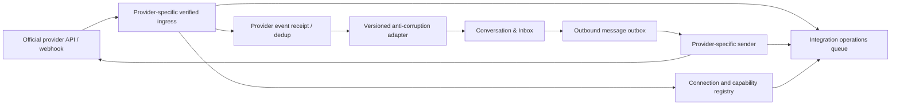

# External messaging-channel integration architecture

Status: **Draft — capability snapshot verified 2026-08-30; revalidation required before build/release**  
Depends on: conversation/handoff workflows, API/event architecture, security and authority  
Blocks: provider selection, app review/onboarding, inbox implementation, automation, privacy/legal review and support operations

## Purpose

Ubi may let a business connect eligible Telegram, WhatsApp, Instagram or Facebook business messaging so staff can receive/reply and turn conversations into structured requests/bookings. This is optional expansion. Direct Ubi links and manual call/walk-in booking must deliver value even if every platform refuses, changes or disables Ubi’s access.

## Realistic capability assessment

Official capabilities, commercial eligibility and approval change frequently. The following is a planning snapshot, not a promise to merchants.

| Channel | Verified practical direction | Ubi recommendation |
|---|---|---|
| Telegram | Official bots and connected Telegram Business bots can receive supported business-message updates and send/edit/delete/read messages within granted business rights; connection state/capabilities are explicit. | Technically suitable for an early controlled adapter pilot if target merchants/customers use it. Still requires bot/business onboarding, privacy, support and human-takeover operations. |
| WhatsApp | Official WhatsApp Business Platform supports partner/tech-provider onboarding, Embedded Signup, webhooks and business messaging subject to account, permission, template/window, pricing and policy rules. | Highest likely market relevance in many East African segments, but materially heavier onboarding, app review, business verification, phone/account/provider and ongoing policy/quality operations. Validate first-country demand and total cost before prioritizing. |
| Instagram | Official professional-account APIs support business/creator account capabilities; messaging access depends on the approved Meta configuration, permissions and account linkage/login model. | Viable after Meta business onboarding/app review is proven. Do not promise access to consumer accounts or all historical DMs/features. |
| Facebook Messenger | Official Messenger Platform supports Page messaging through Page access/permissions and messaging-window/policy constraints. | Viable for eligible Pages after approval. Treat as its own capability profile even if Meta offers unified onboarding. |
| TikTok | Publicly documented developer access located for direct messages is data portability/export, not evidence of a general real-time business inbox/send-reply API available to an ordinary Ubi integration. | Do not make TikTok DM management a launch dependency. Let businesses place a Ubi link in profile/content and record TikTok as manual source. Reassess only against an official real-time business messaging product and written eligibility. |

The platform with the easiest API is not automatically the first commercial channel. Selection combines merchant/customer usage, onboarding success, provider cost, approval probability, support load and fallback value.

## Non-negotiable boundary

Ubi MUST:

- use only official provider APIs, authorization and approved account types;
- show merchants the provider asset/account and scopes/capabilities being connected;
- maintain provider terms/app-review/data-use evidence;
- stop access promptly on disconnect/revocation;
- identify provider/source/capability and delivery limitations truthfully;
- support human takeover and provider-independent booking records;
- revalidate current provider documentation before each adapter release.

Ubi MUST NOT:

- request merchant social passwords, session cookies, QR-session cloning or device takeover;
- scrape websites/apps or automate consumer accounts;
- use unofficial libraries that impersonate user clients;
- promise complete historical inbox access, read receipts, message initiation or media unsupported by the provider;
- bypass messaging windows/templates/opt-outs/rate limits;
- merge provider identities into Ubi accounts without verification;
- train automation/vendors on provider content beyond approved purpose/terms.

## Adapter architecture



Diagram source: `diagrams/36-channel-adapter.mmd`.

### Layer responsibilities

1. **Provider authorization/onboarding** — official OAuth/Embedded Signup/bot connection and asset selection.
2. **Connection registry** — tenant mapping, account IDs, granted scopes, token reference, status and capability version.
3. **Verified ingress** — provider-specific challenge/signature/token/raw-body validation and prompt durable receipt.
4. **Anti-corruption adapter** — maps provider payload/version into canonical participant/message/delivery/connection evidence.
5. **Conversation domain** — thread, message, routing, assignment, automation/takeover and links to requests/bookings.
6. **Outbound outbox/sender** — validates current capability/window/template/recipient, submits idempotently and reconciles result.
7. **Operations** — reauthorization, webhook gaps, rate limits, unknown outcomes, app-policy changes and merchant support.

No provider SDK/payload type enters Booking, Request, Customer or Payment aggregates.

## Connection aggregate

Minimum fields/concepts:

- Ubi connection ID and tenant organization;
- provider and live/test environment;
- external business account/asset/page/phone/bot identifiers;
- merchant-visible display identity and verification snapshot;
- authorizing Ubi account/membership and provider actor evidence;
- provider application/client configuration version;
- granted scopes/rights and provider token/secret reference;
- discovered provider capabilities and constraints;
- routed Ubi branches/operations/queues;
- lifecycle/status/reason/last validated time;
- webhook subscription/challenge state;
- rate/quality/template/window/account restrictions;
- token expiry/rotation/revocation and provider deletion evidence;
- created/changed/disconnected audit.

### Lifecycle

```text
draft
→ authorization_started
→ validating
→ active
↔ degraded
→ reauthorization_required
→ active

authorization_started/validating → failed/expired
active/degraded/reauthorization_required → paused_by_merchant
active/degraded/reauthorization_required → revoked_by_provider
* → disconnecting → disconnected → deletion_pending → deleted
```

`active` means Ubi successfully validated the enabled capabilities; OAuth success alone is not enough.

## Merchant onboarding workflow

1. Authorized owner/admin chooses one provider and sees prerequisites, costs/limitations and data Ubi will access.
2. Ubi checks the merchant’s operation/queue and required Ubi permissions before leaving Ubi.
3. Merchant enters the official provider authorization/onboarding flow.
4. Provider authenticates the appropriate business administrator and returns authorized asset/account references/scopes.
5. Ubi verifies state/nonce/redirect, expected provider application/environment and granted asset ownership/management evidence.
6. Merchant selects/maps the specific external business asset to one Ubi organization and allowed operation/queue routing.
7. Ubi stores credentials in server-side secret storage and discovers/tests real capabilities.
8. Ubi subscribes/configures webhooks where applicable and runs an inbound/outbound sandbox/test.
9. Merchant reviews sender identity, automation setting, staff queue, retention/notice and fallback.
10. Connection becomes active only after test evidence and required provider review/live approval.
11. Merchant receives setup receipt and clear disconnect path.

A low-literacy onboarding assistant may guide each prerequisite, but cannot collect provider passwords or conceal that the merchant is authorizing a third party.

## Capability profile

Versioned capabilities include:

```text
can_receive_text
can_receive_media_types[]
can_send_text
can_send_media_types[]
can_reply_to_message
can_initiate_conversation
initiation_template_required
conversation_window_policy
can_edit_or_delete
can_mark_read
delivery_states_supported[]
historical_message_scope
interactive_controls[]
max_payload/media/rate
business_identity_fields
webhook/event types
human/provider coexistence signals
```

The UI, automation and sender evaluate the current profile. Provider name alone is not capability. Unknown/missing values are unavailable.

## Provider identity and tenant routing

Canonical external participant key:

```text
(provider, environment, connection_id, provider_participant_id)
```

Canonical external thread/message keys include provider account/connection namespace. A numeric/provider ID alone is never globally unique.

Routing rules:

- provider callback route resolves provider application/environment;
- authenticated payload/secret mapping resolves exact Ubi connection/tenant;
- payload-supplied business name/username does not choose tenant;
- one provider business asset cannot map to multiple Ubi organizations without an explicitly supported and reviewed fan-out model;
- operation routing uses controlled connection policy/customer choice/staff triage;
- unresolved or mismatched routing quarantines; it never guesses another tenant.

## Inbound event path

1. Receive through provider-specific endpoint with strict size/rate/raw-body handling.
2. Authenticate challenge/signature/token/certificate/time according to current provider rules.
3. Resolve provider app/environment/account/connection/tenant.
4. Persist event receipt/dedup identity before acknowledgement where provider protocol allows.
5. Acknowledge within provider deadline; normalization is asynchronous where possible.
6. Adapter validates provider schema/version and maps supported fields.
7. Conversation appends message/change/delete/delivery evidence idempotently.
8. Routing and human/automation policy run.
9. Unknown event/schema/account becomes quarantined operational work.

Provider retries/out-of-order delivery are normal. Original provider IDs/time/source and edit/delete status remain evidence.

## Canonical message contract

Minimum normalized fields:

- Ubi message ID, tenant/connection/conversation;
- provider namespace and provider message/thread/participant IDs;
- direction and author/source type;
- provider event receipt and adapter version;
- received/server/provider timestamps;
- text/structured action and supported attachment references;
- reply/quote/reference relation;
- provider capability/window/template context;
- provider delivery status with evidence time;
- edit/delete/tombstone relationship;
- automation/human sender evidence;
- classification/retention/access restrictions.

Unsupported provider fields may be held in restricted raw evidence briefly if justified, but do not become an ungoverned JSON dumping ground.

## Outbound message path

1. Staff/approved automation creates an immutable logical send command under Conversation authority.
2. Recheck staff membership/queue, block/opt-out, connection and automation/takeover state.
3. Resolve current provider capability, recipient relationship, messaging window/template and allowed content/media.
4. Render/validate provider-specific payload from the canonical approved message.
5. Persist outbound intent/outbox with stable provider reference/idempotency.
6. Sender submits with timeout/rate/fairness policy.
7. Record `submitted`, provider message ID or unknown/failure.
8. Webhook/query updates supported delivery states.
9. Unknown timeout reconciles before duplicate send.
10. Permanent failure becomes business action/fallback; it never changes booking truth.

If the provider offers no idempotency key, Ubi stores the exact submit attempt/reference and uses conservative retry rules based on whether bytes may have reached the provider.

## Automation and human coexistence

- Connection starts automation disabled or suggestion-only unless merchant explicitly enables a reviewed policy.
- Incoming messages may trigger only bounded factual responses/intake/draft/link actions.
- Human takeover writes a conversation control version/lease that queued automation must recheck immediately before send.
- If staff replies in the provider’s own app and the provider exposes echo/coexistence events, Ubi records them; otherwise Ubi clearly states its visibility limitation.
- Ubi cannot promise a complete unified transcript if provider-side actions are not exposed.
- Automation identity is disclosed where required/appropriate and never claims to be a human.
- High-risk ambiguity, complaint, payment, refund, cancellation exception and customer request trigger takeover.

## Message windows, templates and initiation

Provider policy controls may require:

- customer-originated contact before reply;
- reply within a time window;
- approved templates/tags/categories outside the window;
- business verification/display-name approval;
- quality/rate/recipient tier;
- purpose/consent and opt-out;
- pricing by conversation/message/category/region;
- restriction on promotional or automated content.

Ubi models these as provider capability/policy data, not hard-coded global rules. The sender refuses unsupported work and explains the approved alternate: template, Ubi link, manual call, SMS or wait for customer contact.

## Media handling

- Provider attachment metadata enters the adapter; content is fetched only with approved purpose and bounded size/type.
- Fetch runs asynchronously with provider credential, timeout and malware/content checks.
- Object is tenant/purpose scoped and private by default.
- Message remains usable with attachment pending/unavailable.
- Sending media uses provider-supported type/size/transformation and separate upload/reference lifecycle.
- Expired provider URLs/tokens are expected; retention cannot assume re-download forever.
- Voice notes/video/image OCR/transcription are not automatic; each requires purpose, accuracy, accessibility, privacy and cost approval.

## Connection security

- OAuth/state/PKCE/redirect protection where provider supports/applicable.
- Provider tokens encrypted through managed secret/key storage; database stores references/metadata, not plaintext.
- Minimum scopes/rights; do not request publishing/ads/profile controls merely for messaging.
- Environment/provider application/tenant separation.
- Automated token validity/expiry/permission review and safe rotation.
- Webhook challenge/signature/replay/rate validation.
- No credential in client, URL, analytics, ordinary logs or support screenshots.
- Workforce credential access is exceptional; ordinary support sees status/scopes/expiry, not token.
- Disconnect/revoke and provider app compromise runbooks are mandatory.

## Privacy, provider terms and data governance

For each provider/field Ubi records:

- merchant/customer notice and responsible controller/processor roles;
- provider platform terms/data-use purpose;
- requested permission and actual enabled Ubi feature;
- content/contact/media metadata classification;
- retention/deletion/export and provider-owned-copy limitation;
- automation/AI subprocessor and training prohibition/authority;
- cross-border/provider region and subprocessor analysis;
- app review/data-use checkup/audit evidence and due date;
- minor/sensitive/prohibited content handling;
- merchant disconnect and customer request propagation.

Provider content cannot be reused for Ubi advertising, generalized profiles or model training merely because an API returned it.

## Failure and degraded behaviour

| Failure | Ubi behaviour |
|---|---|
| Token/scope revoked | Connection reauthorization-required; stop affected sends/ingress trust; notify authorized merchant |
| Webhook silent | Detect lag via health/test/provider query where supported; show degraded; reconcile; direct/manual booking continues |
| Duplicate/out-of-order callback | Inbox/dedup + legal version transition; no duplicate message/automation/booking |
| Provider 429/5xx | Queue bounded by window/expiry, backoff/jitter, fair per connection; show delay |
| Unknown send outcome | Reconcile/query before retry; show submitted/unknown, not failed or delivered |
| Window/template restriction | Do not bypass; offer approved template or Ubi/manual fallback |
| Provider account restricted | Stop new automation/send, preserve Ubi history and give provider appeal/action guidance |
| Schema/API version changed | Quarantine unknown version, alert adapter owner, roll forward/disable capability |
| Provider-side staff reply invisible | State limitation explicitly; do not claim complete transcript |
| Connection mapped incorrectly | Quarantine and security alert; no cross-tenant routing |
| App/provider approval removed | Feature disabled safely; direct link/manual workflows remain |

## Monitoring and operations

Per provider/connection monitor:

- active/degraded/revoked and last successful validation;
- webhook receive/auth/dedup/schema/processing latency;
- inbound/outbound count, queue age and provider rate usage;
- send submitted/delivered/read/failed/unknown where supported;
- window/template rejection and quality/account restrictions;
- token expiry/permission change;
- routing/quarantine/takeover/automation loop;
- provider cost per conversation/message/tenant;
- merchant onboarding completion/failure/approval time;
- customer/merchant complaints and opt-outs.

Alerts map to provider runbooks and avoid message/customer content in metrics.

## Adapter test strategy

- Provider contract fixtures for every supported event/message/media/status/version.
- Official sandbox/test account plus controlled live canary where provider requires.
- Signature/authentication negative tests and raw-body preservation.
- Duplicate/out-of-order/missing callback tests.
- Token expiry/revoke/scope reduction/account restriction.
- Message-window/template/rate/quality-limit tests.
- Provider timeout after send and reconciliation.
- Human provider-side reply/echo visibility tests.
- Unicode/local-language/media/size tests.
- Cross-tenant account/payload mismatch attempts.
- App review/data-use checklist before production capability enablement.

## Channel selection gate

Score each candidate for the selected city/vertical:

| Dimension | Evidence required |
|---|---|
| Real customer/merchant use | Observed enquiry share, not national anecdotes |
| Official technical fit | Inbound/outbound, account type, history/window/templates/media/status |
| Merchant onboarding | Steps, verification, phone/page/account ownership, completion rate |
| Ubi approval eligibility | App review, partner/tech-provider requirements, live permissions |
| Unit cost | Provider fees, onboarding/support, verification, SMS/fallback, engineering |
| Reliability/support | Webhook/API SLO evidence, sandbox, incident/support path |
| Legal/privacy | roles, permissions, transfers, retention/deletion and notice |
| Operational completeness | reauth, restriction, dispute/abuse, reconciliation and exit |
| Fallback value | Direct Ubi link/manual workflow when unavailable |

Do not build four adapters simultaneously. Validate direct-link value, then ship one provider end to end.

## Recommended sequence

1. Direct Ubi subdomain/page and contextual booking link.
2. Manual source labels for WhatsApp, Telegram, Instagram, Facebook, TikTok, call and walk-in.
3. Merchant/customer research identifies the first real channel.
4. Build provider authorization, connection health, inbound/outbound text, human takeover and disconnect—no AI required.
5. Add structured draft/link assistance.
6. Add approved media/template/status features.
7. Consider bounded automation only after support/error evidence.
8. Add another provider only when the adapter operating model is proven.

## Acceptance scenarios

1. Merchant uses Ubi with no external connection and completes all core booking work.
2. Provider sends the same message event 50 times; one conversation message and one automation decision result.
3. Callback carries another account/tenant ID; it is quarantined with no data disclosure.
4. Merchant revokes provider access; new sends stop and Ubi booking history remains.
5. Staff takes over while automated reply is queued; final version check suppresses automation.
6. Provider send times out after possible success; Ubi reconciles and avoids a blind duplicate.
7. Provider has no read receipts/history; UI exposes only supported evidence.
8. Messaging window closes; Ubi refuses an ordinary reply and offers the allowed next path.
9. Provider outage lasts a day; direct link/manual booking continues and queued messages expire/recover correctly.
10. TikTok-origin enquiry is manually captured with source and Ubi link; Ubi does not scrape/import DMs.

## Verified official references

- [Telegram connected business bots](https://core.telegram.org/api/bots/connected-business-bots) documents connection updates, business rights and supported message actions.
- [Telegram bots](https://core.telegram.org/bots) documents the official bot platform and Business Mode direction.
- [WhatsApp Business developer hub](https://whatsappbusiness.com/developers/developer-hub/) describes the official hosted Business Platform, webhooks/test resources and integration path.
- [WhatsApp Business partners](https://whatsappbusiness.com/partners/become-a-partner/) describes Tech Provider/Partner roles and Embedded Signup onboarding.
- [Meta Messenger Platform sample repository](https://github.com/fbsamples/messenger-platform-samples) links official quick-start samples for sending/receiving and webhooks.
- [Meta Instagram API collection](https://www.postman.com/meta/instagram/documentation/6yqw8pt/instagram-api) documents professional-account scope/limitations and Graph API usage.
- [TikTok Data Portability direct-message scope](https://developers.tiktok.com/docs/en/data-portability-data-types) is documented as transferring/exporting message history; it is not used here as evidence of a realtime business inbox/send API.

## Open decisions

- First country/city/vertical and measured channel distribution.
- First provider adapter and whether Telegram technical ease or WhatsApp market prevalence wins.
- Ubi Meta Tech Provider/Partner/direct-versus-BSP approach and total cost.
- Telegram bot versus connected-business-bot product flow and merchant eligibility.
- Instagram/Facebook account/login/linkage requirements at implementation time.
- Provider content retention, AI/automation boundary and controller/processor responsibility.
- Per-provider app review, terms, permission and data-use compliance owner.
- Whether any channel integration belongs in pilot release after direct-link validation.

