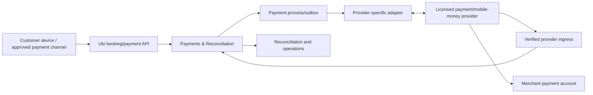

# Payment-provider integration architecture

Status: **Draft — no provider, payment role or country approved**  
Depends on: payment workflows, API/events, authority, quality and channel-independent booking  
Blocks: provider procurement, security/legal/accounting review, implementation, reconciliation and production operations

## Purpose

This document defines how Ubi can integrate mobile-money, bank/card or other licensed payment providers without confusing customer claims, provider evidence, booking confirmation and settlement. It keeps the first release viable with cash/pay-later/manual evidence and prevents accidental custody or financial regulation.

## Architectural boundary



Diagram source: `diagrams/37-payment-provider-boundary.mmd`.

Ubi’s database is authoritative for Ubi obligations/intents/evidence/allocations/cases. The provider is authoritative for its external transaction/refund/reversal/settlement evidence. The merchant/provider relationship determines where money actually goes.

## Recommended release levels

### Level P0 — No digital payment integration

- no deposit or pay at location;
- booking works fully without payment-provider dependency;
- Ubi records expected balance only if configured.

### Level P1 — Manual merchant-received evidence

- merchant presents its approved mobile-money/bank/cash instructions;
- customer/staff reports reference/receipt;
- Ubi labels it unverified until an authorized merchant verification step;
- no automated provider claim or Ubi settlement.

### Level P2 — Provider-hosted/request-to-pay integration

- merchant is onboarded to a licensed provider-approved account structure;
- Ubi creates idempotent request/checkout/push intent;
- provider collects sensitive input/authorization;
- authenticated webhook/API evidence updates Ubi;
- reconciliation/refunds/late payment/provider outage are operated.

### Level P3 — Advanced platform money movement

Split payments, payouts, escrow-like holds, security deposits, stored balance/credits, cross-border/currency conversion or Ubi custody are **future gated**. They require separate licensed legal/accounting/security/capital/operations design and cannot be enabled by adding fields to Level P2.

## Provider capability profile

Each provider/product/country/merchant connection stores a versioned capability profile:

```text
supported_country/currency
merchant/account eligibility and KYB flow
customer identifier requirements
payment methods and initiation modes
minimum/maximum/precision/rounding
request-to-pay / hosted checkout / redirect / deep-link support
provider idempotency/reference behaviour
webhook/event types and authentication
query/status/reconciliation/export APIs
partial/overpayment behaviour
expiry/cancel support
refund/partial refund support
reversal/dispute/chargeback support
settlement/payout/fee reporting
sandbox/live separation
rate/timeout/availability constraints
credential rotation/scopes
fees/taxes/settlement timing
data location/retention/support
```

Missing/unknown capability is unavailable. Provider name is not enough because one provider may expose different products/capabilities per country or merchant type.

## Merchant payment connection

Minimum concepts:

- Ubi payment connection ID and organization tenant;
- provider/product/environment/country/currency;
- external merchant/account/store/terminal identifiers;
- account-holder/display/settlement identity evidence;
- provider onboarding/KYB/approval status;
- authorizing owner/finance user and approval evidence;
- credential/key/certificate reference and scope/version;
- webhook/query/refund/reconciliation capability;
- routing by branch/operation/method/currency;
- fee/settlement model snapshot/reference;
- lifecycle, restrictions and last validated time;
- token/certificate rotation/revocation;
- disconnect/closure/remaining-transaction reconciliation.

### Lifecycle

```text
draft
→ onboarding_started
→ provider_review
→ validating
→ active
↔ degraded
→ reauthorization_or_action_required
→ active

* → suspended/revoked
* → disconnecting → disconnected
```

Ubi `active` means a live-safe test validated credentials, account/currency/routing and required provider callbacks/query. It does not mean every customer/payment will succeed.

## Merchant onboarding workflow

1. Select country/operation/method based on approved provider inventory.
2. Explain provider identity, merchant relationship, fees, settlement, refunds/disputes, data use and Ubi role.
3. Require organization owner/authorized finance capability and recent strong authentication.
4. Use provider-hosted onboarding/official OAuth/key-exchange flow where available.
5. Provider performs its own merchant/KYB/contract/settlement-account validation.
6. Ubi receives only required account/capability/credential reference and validates returned state/asset ownership.
7. Merchant maps provider account/method to Ubi operations/currencies.
8. Ubi registers/verifies callbacks, runs a small sandbox/live validation permitted by provider and tests query/refund capability if enabled.
9. Merchant reviews test result, customer wording and manual fallback.
10. Connection activates with monitoring, rotation and support owner.

Changing settlement destination/account is ownership-risk: step-up, exact before/after, delay/approval/notifications and audit are required. Ordinary staff cannot do it.

## Canonical provider adapter

The provider adapter exposes narrow commands/evidence:

```text
CreateProviderPayment
QueryProviderPayment
CancelProviderPayment
CreateProviderRefund
QueryProviderRefund
FetchTransactionReconciliation
FetchSettlementReport
VerifyAndNormalizeProviderEvent
```

Canonical evidence contains:

- Ubi/provider connection and environment;
- provider transaction/event/refund/settlement IDs;
- provider account/merchant and payer reference category;
- expected/actual exact amount and currency;
- provider state and evidence time/source;
- initiation/expiry/completion/reversal timestamps;
- fee/settlement fields only where reliable/needed;
- normalized error/retry/unknown classification;
- raw evidence hash/protected reference and adapter version.

Provider `success`, `captured`, `completed`, `paid`, `settled` and similar words are not copied directly into Ubi state. Payment domain maps them under the approved provider capability/version.

## Payment initiation modes

### Hosted checkout/redirect

1. Ubi creates obligation and payment intent with exact amount/currency.
2. Worker/adapter creates provider session with stable merchant/intent reference and approved return/callback URLs.
3. Customer opens provider-hosted experience.
4. Provider handles credentials/PIN/card/mobile-money authorization.
5. Return/redirect shows only navigation outcome; Ubi displays `checking payment` and queries/waits for authenticated evidence.
6. Webhook/query verifies and allocates.

Return URL contains opaque session reference, not authorization to mark success. Open redirects and provider-lookalike domains are prevented.

### Request-to-pay/push prompt

1. Customer enters/reviews the minimum approved payer identifier through Ubi/provider component.
2. Ubi creates one provider request with exact purpose/amount and stable idempotency/reference.
3. Provider asks the customer to approve on their device/channel.
4. Ubi shows processing with deadline and never asks for the customer’s PIN.
5. Provider callback/query supplies final/processing/failure evidence.

Staff/automation cannot socially engineer the customer to reveal a PIN/OTP. Ubi copy explicitly says approval occurs in the provider’s trusted channel.

### Customer transfer/reference

At P1, Ubi may present merchant-approved payment destination instructions. A submitted reference/receipt is `reported_unverified`. Automatic reference lookup/verification becomes P2 only through an official authorized provider/bank API.

### Provider deep link/USSD-like flow

Use only official documented mechanisms. App return is not payment proof; platform/device availability and fallback are tested. Ubi must not construct secret/unsupported USSD flows or intercept financial credentials.

## Payment intent and provider attempt mapping

```text
One Ubi obligation
→ one or more Ubi payment intents over time
→ one or more provider attempts per intent when policy permits
→ zero or more provider transaction evidence items
→ exact Ubi allocations
```

Rules:

- A failed/expired attempt does not delete the intent/obligation.
- Retrying the same intended provider request uses the same provider/Ubi idempotency when outcome is unknown.
- A deliberately new customer retry gets a new attempt under the same bounded intent/remaining obligation.
- Provider transaction cannot be allocated twice or to another tenant/currency by reference reuse.
- Partial/overpayment enters configured allocation/exception policy.
- Intent/attempt IDs are not provider credentials.

## Provider callback path

1. Dedicated provider/environment endpoint receives bounded raw bytes/headers.
2. Verify current official signature/token/certificate/source/time/replay requirements.
3. Resolve exact provider application/account/connection/tenant.
4. Persist provider event receipt/dedup and protected raw/hash evidence.
5. Acknowledge within provider deadline after required durable point.
6. Adapter validates schema/event version and normalizes provider evidence.
7. Payment domain locks/loads relevant transaction/intent/allocation and checks legal transition.
8. Validate merchant, amount, currency, provider reference, duplicates/reversal and obligation.
9. Commit evidence/state/allocation/reconciliation case/outbox atomically.
10. Payment-conditioned booking process consumes the event idempotently.

Unknown/unmapped transactions enter an orphan reconciliation queue, not a guessed booking.

## Polling and reconciliation

Webhooks alone are insufficient because they may be missing/delayed and provider state may change later.

### Real-time reconciliation

- query provider after unknown timeout/redirect or overdue processing where supported;
- compare provider account/reference/amount/currency/status;
- preserve every evidence transition;
- stop blind retry once possible provider acceptance exists.

### Daily transaction reconciliation

- obtain provider transaction/export/API range using checkpoint;
- compare to Ubi intents/transactions/allocations/refunds/reversals;
- identify missing, orphan, duplicate, mismatch and late events;
- apply idempotent safe transitions or create cases;
- record source/checkpoint/count/value/control totals.

### Settlement reconciliation

- compare eligible verified transactions/refunds/reversals/fees with provider payout/settlement statement;
- exact totals by merchant/currency/settlement period;
- identify missing/short/duplicate/fee/account mismatches;
- preserve provider settlement ID and evidence;
- never infer settlement merely from payment verification.

Reconciliation jobs and data availability vary by provider. If settlement data cannot be obtained, Ubi must state that limitation and not offer a false settled report.

## Booking interaction

Payment integration never calls Booking by directly setting `confirmed=true`.

```text
Payment evidence accepted
→ exact allocation verifies configured obligation
→ payment.payment_condition_satisfied event
→ process manager invokes ConfirmBooking command
→ Booking rechecks quotation/catalog/policy/hold/capacity/idempotency
→ confirmed OR paid-without-booking case
```

Reversal/dispute emits a financial exception to Booking/Operations but does not erase fulfilment/history automatically.

## Holds and deadlines

- Hold expiry uses server time and is displayed before payment starts.
- Provider expected processing/approval delay informs hold duration.
- Hold is not extended by UI polling, redirect or duplicate callbacks.
- Payment result after expiry enters late-payment reconciliation.
- If provider has long pending state, business policy must decide whether to hold longer, accept paid-without-capacity risk or avoid payment-conditioned instant booking.
- All late/unknown paths have merchant/customer communication and resolution owner.

## Refund integration

1. Payment domain calculates eligible provider transaction/allocation/remaining refundable maximum.
2. Authorized request/approval binds exact amount/currency/reason/customer destination policy.
3. Create immutable refund intent and stable provider idempotency/reference.
4. Submit once; timeout becomes unknown/reconcile.
5. Authenticated callback/query confirms processing/success/failure/reversal.
6. Update exact refund allocations and booking financial summary.
7. Notify customer/business; later settlement reconciliation confirms payout effect.

Manual cash/transfer return is a different evidence type and cannot be labelled provider refund.

## Security scope reduction

- Prefer provider-hosted/tokenized interaction; Ubi does not collect/store mobile-money PIN, bank password, card security code or reusable payment credential.
- If card data ever touches Ubi systems, formal payment-card security scope/assessment is required before build—not after launch.
- Credentials/certificates/webhook secrets use managed secret/key storage, rotation, environment/tenant/provider isolation and minimum scope.
- No provider secret in Android/web client, source repository, ordinary DB column, log, analytics, ticket or screenshot.
- Exact allow-listed provider endpoints and TLS validation; outbound SSRF/DNS controls where applicable.
- Signed callback raw-body verification before JSON trust.
- Payer/reference/receipt/provider payload is confidential with field/media access control and retention.
- High-risk refund/settlement/config actions use step-up, approval/limits, audit and anomaly alerts.
- Provider SDK/dependency and webhook parsers undergo supply-chain/security testing.

## Privacy and legal/accounting gate

Before P2 production, document:

- Ubi legal entity and exact payment role;
- provider/licensed entity and contracts;
- merchant/customer terms and responsible support/refund/dispute party;
- money flow and whether Ubi ever receives, controls or instructs settlement;
- KYB/KYC data responsibility and what Ubi stores;
- consumer disclosure/receipt/cancellation/refund rules;
- tax/invoice/fee treatment and accounting entries;
- data location/transfer/subprocessor/retention/deletion;
- fraud/chargeback/dispute/complaint/escalation;
- safeguarding/custody/licensing conclusions from local counsel;
- incident notification and provider breach/availability obligations.

Architecture cannot decide legal classification by naming a feature “payment facilitation.”

## Fraud and abuse controls

- Rate/velocity/amount/reference duplication by account/tenant/provider/payer/device/network.
- Merchant account/settlement change controls.
- Customer cannot mark their own evidence verified.
- Staff verification self-approval/threshold policy.
- Reused/fake receipt/reference detection supports review, not automatic accusation.
- Enumeration-safe payment/status endpoints and scoped links.
- Refund abuse/over-refund/rapid cancellation and provider reversal monitoring.
- Provider risk results are evidence; Ubi decisions remain explainable/redressable.
- One-person businesses get realistic compensating controls rather than impossible dual approval.

## Offline boundary

Allowed offline:

- cached exact booking financial summary with `as of`;
- draft/report cash/reference/receipt as local `unverified` command;
- prepare refund request draft.

Online required:

- provider request creation/status verification;
- final payment-conditioned confirmation;
- provider/manual verification decision under current authority;
- refund approval/execution;
- settlement/dispute/configuration.

No local state/color says provider verified.

## Provider outage/degraded paths

| Failure | Required behaviour |
|---|---|
| Create request times out | Query/reconcile stable reference; do not create a new charge blindly |
| Redirect succeeds but webhook absent | Show checking; query/provider reconciliation; booking not falsely confirmed |
| Callback duplicate/out of order | Dedup/legal transition; preserve evidence; one allocation/effect |
| Provider unavailable before initiation | Offer configured cash/pay-later/manual method or retry; no fake payment |
| Provider unavailable after possible initiation | Preserve processing/unknown; customer warned not to repeat; reconcile |
| Amount/currency/merchant mismatch | Exception; no auto allocation/confirmation |
| Payment succeeds after hold expiry | Paid-without-booking case; rebook/alternative/refund |
| Refund timeout | Same refund/reference query; no blind duplicate |
| Credential/certificate expires | Connection degraded; stop new requests; reconcile existing through approved alternate |
| Provider account restricted | Stop affected method, notify owner/finance, preserve bookings and fallback |
| Settlement feed unavailable | Payment may remain verified but settlement unknown; finance queue/statement limitation |

## Observability and financial control totals

Per provider/merchant/currency measure:

- connection/KYB/capability status;
- intent/attempt state and age;
- create/query/webhook latency/outcome/retry/unknown;
- verified amount/count, partial/over/late/orphan/mismatch;
- payment-condition-to-booking success/paid-without-booking;
- refund request/processing/failure/unknown and value;
- reversal/dispute and aging;
- reconciliation checkpoint/coverage/difference/control totals;
- settlement/fee differences;
- provider cost/success by method/network class without sensitive details.

Financial metrics use exact amounts and bounded labels; ordinary logs/metrics exclude payer identifiers/full references.

## Provider selection scorecard

| Dimension | Required evidence |
|---|---|
| Country/customer coverage | Actual pilot user/merchant compatibility and method preference |
| Legal/commercial fit | Licensed entity, Ubi/merchant roles, contracts, support/dispute allocation |
| Merchant onboarding | KYB steps, settlement account, completion time/failure and small-business eligibility |
| Technical | idempotency, webhooks, query/reconciliation, refunds/reversals/settlement, sandbox |
| Reliability/support | published/contracted service, escalation, incident history/evidence |
| Security/privacy | hosted/tokenized flow, signature/key model, data fields/location/retention |
| Cost | customer/merchant/provider/Ubi fees, minimums, SMS, refunds, settlement and support |
| UX/accessibility | language, low-end device, weak network, async/push clarity and fallback |
| Operations | dashboards/export, orphan/late/unknown resolution, credential rotation |
| Exit | transaction/settlement export, credential revoke, data deletion and replacement |

Do not select a provider because it has a familiar brand or working demo alone.

## Acceptance tests

1. Same create/refund callback/request is replayed 100 times; one provider logical request/allocation/refund results.
2. Provider returns after HTTP timeout; Ubi queries/reconciles and does not duplicate payment.
3. Redirect says success but provider evidence says processing; UI stays checking and booking condition remains unsatisfied.
4. Amount/currency/merchant account mismatch enters exception with no automatic allocation.
5. Payment verifies after hold expiry; customer/business see paid-without-booking recovery.
6. Reversal arrives after completed service; history remains and financial exception opens.
7. Provider is offline; direct booking with configured pay-later/cash path remains available.
8. Staff reports receipt offline; it remains unverified through sync until authorized verification.
9. Settlement destination change requires stronger owner/finance control and old/new alerts/audit.
10. Restore Ubi database; provider transactions after recovery point are re-ingested/reconciled without duplicates.

## Recommended sequence

1. Validate whether deposits improve the first vertical enough to justify integration.
2. Launch P0 or carefully controlled P1 if sufficient.
3. Select one country/provider/method after scorecard/legal review.
4. Build sandbox adapter, callback/query/idempotency and reconciliation first.
5. Implement merchant onboarding and controlled live canary.
6. Enable small-value/limited operations with daily reconciliation.
7. Add refunds/reversals/settlement operations before broad rollout.
8. Expand method/provider only after support, success and unit-economics gates.

## Open decisions

- Launch country/operator and legally approved Ubi payment role.
- Whether initial vertical needs deposit/payment integration at all.
- First provider/method/currency and merchant account model.
- P1 manual verification responsibility and thresholds.
- Provider idempotency/query/webhook/refund/reconciliation capability.
- Hold/expiry/late-payment and paid-without-booking policy.
- Record/receipt/tax/settlement retention and merchant accounting export.
- Provider fees, Ubi pricing and who bears failed/refund/SMS/support cost.

