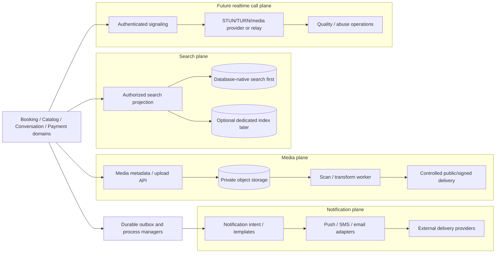

# Media, search, notification and future-call architecture

Status: **Draft — calls future gated**  
Depends on: platform components, API/events, communications, privacy and quality attributes  
Blocks: supporting-provider selection, object/index schemas, client implementation, safety operations and unit-cost approval

## Purpose

Media, search, notifications and calls improve Ubi but have very different durability, privacy, latency and cost. This document keeps them outside the authoritative booking transaction while defining how they connect safely.

## Architectural separation



Diagram source: `diagrams/38-supporting-services.mmd`.

Failure of these supporting planes must not corrupt or falsely change booking/payment truth.

# Part I — Media and files

## Media scope

Potential media classes:

- public business logo/cover/service/gallery images;
- private message attachments;
- payment receipt/evidence;
- custom-request reference images/documents;
- staff/customer profile image if justified;
- generated reports/exports;
- future call recording/transcript—currently excluded.

Each class has different authorization, publication, scan, transformation, retention and deletion. A generic public uploads folder is prohibited.

## Media object model

Minimum concepts:

- media object ID, tenant and owner/linking context;
- purpose/classification/publication class;
- uploader principal/session/source;
- declared and detected media type/size;
- original filename only as protected metadata, never storage key;
- opaque storage provider/key/version;
- checksum and duplicate relationship;
- upload/scan/process/publication lifecycle;
- derivative variants and parent;
- access policy and signed-link issuance evidence;
- retention/legal hold/deletion/tombstone;
- malware/policy/moderation result and reviewer where applicable.

### Lifecycle

```text
upload_intent
→ uploading
→ uploaded_unverified
→ scanning_processing
→ ready_private
→ published_public             (only approved public class)

uploaded_unverified/scanning_processing → quarantined
uploaded_unverified/scanning_processing → rejected
scanning_processing → processing_failed
ready_private/published_public → restricted
* → deletion_pending → deleted/tombstoned
```

`uploaded` never means safe or publicly accessible.

## Upload path

1. Client/domain requests upload intent with tenant, purpose, linking resource, declared type/size/checksum.
2. Server authorizes uploader/resource and chooses policy/quota/storage class.
3. Server returns expiring single-purpose upload credentials/URL and opaque object ID.
4. Client uploads directly to private quarantine area where supported, with byte/part/time limits.
5. Client finalizes; server/storage verifies expected object/size/checksum.
6. Worker detects actual type, scans and performs approved transformation/metadata stripping.
7. Object becomes ready/quarantined/rejected; linking domain observes event/result.
8. Public publication is a separate authorized command producing safe variants/cache policy.

Client never chooses bucket/key/ACL, and user filenames are not trusted for path, MIME or script behaviour.

## Processing rules

- Validate magic bytes/content, extension, dimensions, duration/page count and decompressed size.
- Defend against image/document bombs, polyglots, malformed parsers and active document content.
- Strip unnecessary EXIF/location/device metadata from public/customer-shared derivatives.
- Preserve original only if justified; otherwise retain approved normalized version.
- Produce responsive thumbnails/variants asynchronously.
- Prefer efficient modern image format when supported, with compatible fallback; measure encoder quality/cost.
- Never execute macros/scripts or render untrusted active HTML/SVG directly.
- OCR, face recognition, moderation and AI description are separate processing purposes—not automatic.
- Text workflow remains usable while media is pending/failed.

## Access and delivery

### Public media

- Explicitly published derivative under non-sensitive opaque/versioned URL.
- CDN cacheable with immutable content hash/version.
- Safe content type, nosniff/download headers and no user-controlled active origin.
- Unpublish creates new profile projection and invalidates/blocks according to risk; public copies/cache limits are disclosed.

### Private media

- Default object storage private.
- Each access resolves current tenant/resource/participant/staff/case authorization.
- Return short-lived signed URL/cookie or protected stream with exact object/variant/disposition.
- Signed URL is a bearer capability with short expiry and no inclusion in analytics/referrer/log.
- Revocation/high-risk case may require proxy/current check rather than longer signed URL.
- Receipt/message/customer objects never share public CDN namespace/ACL.

## Android media behaviour

- Text command is committed locally separately from attachment upload.
- Capture/import copies to private app storage/content interface with quota and cleanup.
- Resize/compress public/service images on device only when quality/privacy/tested; server still validates.
- Upload resumes in chunks where provider supports and does not re-upload completed bytes blindly.
- Metered/battery policy defers noncritical gallery media; receipt/user-requested upload can be manually prioritized.
- Local thumbnail/media cache is bounded and evictable; command metadata remains.
- Failed attachment preserves the text booking/request and offers retry/remove.

## Media security/privacy/operations

- Separate public/private/quarantine/export storage prefixes/buckets/accounts as risk justifies.
- Encryption at rest/in transit; managed key access and protected deletion.
- Object-store events are authenticated and deduplicated.
- Malware engine outage leaves object quarantined; it does not auto-approve.
- Per-tenant/account/purpose quotas and rate limits.
- Access/download/publication/review audited by classification/risk.
- Backup/replication/retention differs for authoritative evidence versus replaceable thumbnails/cache.
- Provider deletion verification and orphan-object reconciliation jobs.
- Metrics: upload success/bytes/time, scan lag/result, transform cost, access denial, cache hit/egress, orphan/deletion backlog.

# Part II — Search architecture

## Search purposes

Ubi has distinct search experiences:

1. staff tenant-private customer lookup;
2. staff booking/request/conversation/reference lookup;
3. service/resource/configuration lookup within an operation;
4. Ubi operations case search under restricted purpose;
5. public business/service discovery—future marketplace scope, not first release.

They do not share one global index or authorization policy.

## Initial direction: database-native search

Use the authoritative relational database plus purpose-built indexes/projections first because:

- launch scope/query volume is bounded;
- tenant authorization and transaction freshness are easier to enforce;
- operating a dedicated search cluster adds cost, monitoring, backups, tenant filtering and deletion complexity;
- Ubi has not validated marketplace discovery.

Possible database techniques (exact choice in data blueprint) include normalized exact phone/reference lookup, prefix/indexed name/code fields and approved full-text/trigram capabilities. Every query requires measured query plan and bounded result/page.

## Search projection

Searchable data is an explicit projection, not unrestricted indexing of every table/message.

For each field:

- source owner/version;
- tenant and visibility scope;
- normalization/language/transliteration purpose;
- classification and who may search/display;
- ranking/sort semantics;
- retention/deletion/merge/tombstone behaviour;
- freshness objective and rebuild procedure.

Customer phone/name search stays within the merchant tenant. Global customer search by phone/name is prohibited for ordinary merchant use.

## Query and result rules

- Normalize Unicode/phone/reference with field-specific safe rules; preserve entered display form.
- Support Ethiopic and other selected scripts/fonts/input; do not require Latin transliteration.
- Optional transliteration/aliases are additive and reviewed; they never replace canonical names.
- Avoid fuzzy customer matching that exposes unrelated people; potential duplicates are suggestions under authorized review.
- Return minimum disambiguation fields (for example safe contact suffix/recent booking) according to capability.
- Search term length/rate/page bounded; expensive wildcard/regex/user query language prohibited.
- Stable ranked results and exact-match priority documented.
- “No access” and “no result” avoid tenant/resource disclosure.
- Search analytics excludes raw personal queries unless specifically justified/retained.

## Dedicated search-engine adoption gate

Add a dedicated index only when measured need includes:

- database search cannot meet approved latency/load despite proper schema/index/query;
- complex multilingual/fuzzy/public discovery is validated product value;
- index can be tenant-safe, rebuildable and operated within budget;
- deletion/restriction/merge propagation is reliable and monitored;
- authorization filters cannot be bypassed by stale/missing index fields;
- backup/rebuild/provider-exit/security/on-call are owned.

If added:

- owner database remains authoritative;
- outbox builds an idempotent versioned projection;
- documents carry immutable tenant/resource/visibility/version;
- application reauthorizes and may rehydrate current data before display/action;
- stale/out-of-order updates cannot resurrect deleted/older data;
- index loss triggers rebuild, not operational data loss.

## Search acceptance tests

1. Merchant A cannot find Merchant B’s customer/reference by exact or fuzzy query.
2. Merged/deleted/restricted customer disappears/redirects according to policy without data resurrection.
3. Amharic/Ethiopic and selected local-language names are searchable/rendered without forced Latin text.
4. Large tenant/abusive prefix queries remain bounded and do not starve booking writes.
5. Index/projection is unavailable; bounded authoritative lookup/fallback works or degrades clearly.

# Part III — Notification delivery architecture

## Channel components

```text
Authoritative domain event
→ Communications notification intent
→ localized template and recipient/purpose policy
→ in-app notification and/or provider delivery outbox
→ push / SMS / email / connected-channel adapter
→ provider submission and callback/query
→ delivery evidence / retry / fallback / business action
```

### In-app

Durable authenticated notification/action center is the primary business operational record. Push is a wake-up hint, not its database.

### Push

Platform push providers are used for Android and later Apple clients. Ubi stores app-install-scoped tokens, environment/app binding, permission/last-result and invalidation. Payload is privacy-minimized; tap fetches current authorized state.

### SMS

One or more country-capable providers may deliver OTP/security/critical customer messages. Sender ID, template registration, route quality, delivery states, fraud, country rules and cost are provider/country capabilities.

### Email

Optional for verified addresses/longer receipts/exports. Domain authentication/reputation, bounce/complaint/unsubscribe and secure-link policy are operational requirements.

### Connected channel

Uses the channel adapter and provider policy/window/template, not a generic SMS-like assumption.

## Delivery adapter contract

```text
ResolveEndpointCapabilities
SubmitMessage
QueryMessageStatus      (where supported)
ProcessDeliveryEvent
DisableInvalidEndpoint
```

Canonical evidence:

- notification intent/attempt IDs;
- tenant/recipient purpose and endpoint reference;
- provider/environment/account/template;
- submitted/provider message ID/time;
- highest supported delivery state/evidence time;
- failure/retry/unknown category and provider safe code;
- cost/segment/category metadata where available;
- adapter/version/correlation.

## Endpoint lifecycle

- Phone/email verification is owned by IAM/contact/CRM policy; Communications receives purpose-approved endpoint reference.
- Push token belongs to app install/platform/environment/account association and can rotate at any time.
- Invalid/unregistered/bounced/complained/opted-out endpoints are suppressed according to purpose/channel rules.
- Phone recycling/shared device risk means old endpoint cannot be treated as identity forever.
- Preference/consent change invalidates future optional work; already required/transactional messages follow approved policy.

## Delivery strategy

- Domain transaction emits outbox event; communications creates one logical intent.
- Choose channel by purpose, urgency, verified endpoint, preference, provider/country capability, sensitivity and cost.
- Render approved localized template with allow-listed variables.
- Recheck current state before stale reminder/action.
- Submit with stable attempt/reference and provider-specific timeout.
- Retry only transient/unknown-safe errors within usefulness/window.
- Critical all-channel failure creates staff action; booking remains committed.
- Fallback is explicit policy, not broadcast to every channel.
- Delivery/read never establishes acceptance/payment/attendance.

## Notification provider selection

Evaluate country delivery/latency, OTP/security quality, sender identity, template/registration, two-way/receipt capability, carrier coverage, fraud controls, data region/retention, cost/segment/currency, support, sandbox, webhook/idempotency and provider exit.

Use at least a manual/provider fallback plan before assuming multi-provider automatic failover. Automatic SMS failover can duplicate messages/cost and needs dedup/reference/unknown-outcome handling.

## Notification acceptance tests

1. Push token rotates/invalidates; endpoint disables without losing in-app notice.
2. Rescheduled booking suppresses old reminder immediately before send.
3. Provider times out after possible send; Ubi avoids unsafe duplicate/fallback until policy decides.
4. Shared lock screen/SMS exposes no sensitive service/payment detail.
5. All providers fail; business sees follow-up task and booking remains confirmed.

# Part IV — Future Ubi audio-call architecture

## Release gate

Calling is inevitable in product direction but not part of the first booking release. It launches only after:

- scoped customer-business identity/relationship;
- native messaging/block/report/support foundations;
- phone/audio permission and push/ringing reliability tests;
- N1/N2 East African network field testing;
- provider/build cost and region/data/privacy review;
- abuse/harassment/impersonation/time-of-day controls;
- incident and quality operations;
- legal consent/emergency/recording policy.

## Recommended build direction

For the first one-to-one audio release, Ubi SHOULD evaluate a reputable managed realtime communications provider or well-supported media stack rather than build a global media network. Ubi must still own relationship authorization, signaling policy, call lifecycle, block/report, metadata governance and support.

Provider due diligence covers:

- African/East African network reach and relay locations;
- adaptive audio codecs/bitrate, packet-loss concealment and reconnect;
- Android/iOS/web/desktop SDK maturity/accessibility;
- end-to-end media encryption claims and key/metadata model;
- IP/participant metadata exposure and retention;
- STUN/TURN/relay/SFU infrastructure and fallback;
- push/background ringing limits;
- quality telemetry without recording content;
- concurrency/minutes/egress/relay cost and fraud;
- abuse controls, outage/support, SLA and exit/migration.

## Call components

### Call policy/authorization

Validates:

- authenticated caller/session/device;
- business/customer relationship or public business call permission;
- staff membership/branch/operation/queue scope;
- target block/report/restriction/preferences;
- business calling hours/rate/abuse/risk;
- booking/conversation context and minimum disclosure;
- feature/provider/network eligibility.

### Signaling

- Creates opaque expiring call session/participant grants.
- Coordinates invite, ringing, accept/decline/cancel/end/reconnect.
- Uses authenticated realtime connection and push as wake-up hint.
- Reauthorizes on join/reconnect/device switch.
- Does not carry permanent media credentials or booking secrets.
- Persists minimum lifecycle/correlation for support/safety.

### Media plane

- Establishes direct or relayed encrypted audio using provider/standards-based transport.
- TURN/relay fallback is expected on carrier/NAT networks; direct peer success cannot be assumed.
- Adapts bitrate/jitter/packet loss and prioritizes intelligible audio.
- Connection failure/reconnect is explicit and bounded.
- Media plane cannot mutate booking/payment or access unrelated tenant data.

### Ringing/notification

- Push notification may wake app, but server signaling state is authoritative.
- Missed/declined/ended states are reconciled when device was offline/background-restricted.
- Lock-screen caller information is minimized and verified business context is clear.
- If app cannot ring reliably, offer message/call-back/ordinary carrier contact—never claim carrier-grade reachability.

## Call lifecycle/evidence

Call session stores:

- call ID, tenant/conversation/booking relationship;
- caller/callee participant/account/business roles;
- policy/authorization result and block/rate context;
- created/ringing/answered/ended/failed timestamps from authoritative signaling;
- device/session/provider call references;
- end/failure reason category;
- coarse quality aggregates and relay/region/cost;
- report/safety case linkage;
- retention/deletion/legal-hold class.

It does not store audio by default.

## Weak-network quality strategy

- Audio-only first; no video in initial call product.
- Test D1 devices on N1/N2, network handoff, packet loss/jitter/high latency and low battery.
- Fast truthful `connecting`, `reconnecting`, `poor connection`, `ended` states.
- Allow seamless fallback to native message/booking context/call-back request.
- Avoid heavy animation/video backgrounds during call.
- Measure setup time, answer success, reconnect, dropped calls, one-way audio, jitter/loss and customer-reported quality by network class.
- Do not automatically redial repeatedly or consume data without consent.

## Call safety and privacy

- Block prevents new signaling before target notification.
- Rate/time/relationship controls and staff offboarding are server-enforced.
- Report flow preserves minimum evidence and offers merchant/Ubi escalation.
- Caller identity shows business/customer relationship without exposing private phone by default.
- Call metadata/content access is separate and purpose-scoped.
- IP exposure, relay logs and provider metadata are in privacy inventory.
- Ubi clearly states calls are not emergency service and depend on connectivity/device/provider.
- No hidden recording, transcription or AI listening.

## Recording/transcription boundary

Disabled by default and excluded from first call release. Any future proposal requires:

- documented lawful purpose and jurisdiction/party-consent matrix;
- prominent pre-call/in-call indication and participant controls;
- provider/region/encryption/key/access/retention/deletion/export;
- staff policy and abuse prevention;
- transcript language/accuracy/review and dispute treatment;
- no representation of summary as verbatim record;
- separate cost/security/incident/operations approval.

## Call failure behaviour

| Failure | Behaviour |
|---|---|
| Push not received/background denied | Call expires/missed truthfully; in-app/message/call-back path |
| Microphone denied/in use | Explain permission/device action; text booking remains |
| Signaling reconnect | Reauthorize/resume within short session window or end |
| Media direct path fails | Approved relay fallback; no endless connecting |
| Poor network/drop | Adaptive audio, reconnect state, then message/call-back fallback |
| Provider outage | Disable call start/ringing, preserve message/booking and status page/support |
| Staff membership revoked | Active/new call authorization ends according to security/safety policy |
| Block/report during call | End/restrict and create minimum evidence/case |
| Cost/fraud spike | Per-tenant/account/concurrency/minute controls and alerts |

## Call acceptance tests

1. Blocked participant cannot ring target even with an old conversation/booking ID.
2. D1/N1 packet loss/latency test adapts or ends truthfully and preserves text fallback.
3. App killed/background-restricted yields reconciled missed/expired state without ghost ringing.
4. Network switches mobile/Wi-Fi mid-call; reconnect succeeds or ends without duplicate session.
5. Provider unavailable; booking/messaging remains fully operational.
6. No audio object exists after normal call; metadata retention follows approved policy.
7. Revoked staff cannot start/rejoin a customer call.
8. Call cost/quality is attributable by provider/region/network without storing content.

# Cross-cutting governance

## Supporting-system invariants

1. Media/search/notification/call systems never write booking/payment truth directly.
2. Private media is never public by storage default.
3. Search is tenant/authorization scoped and rebuildable.
4. Notification delivery/read is not domain acceptance.
5. Call state is not booking state.
6. Optional supporting-system outage cannot remove an accepted booking.
7. Every provider has versioned capability, credential, cost, retention and exit ownership.
8. Android text workflows do not wait on media/search/provider success.

## Open decisions

- Object storage/CDN/scan/transformation providers and media quotas/retention.
- Approved media types and whether payment receipts enter the pilot.
- Database search strategy and launch-language normalization/index support.
- First push/SMS/email providers and country sender/template/route rules.
- Notification fallback and cost budgets.
- Native messaging release timing before calls.
- Realtime call provider/build decision, relay regions, audio quality and cost budgets.
- Call metadata retention and legal/safety requirements.
- Recording/transcription remains unapproved.

