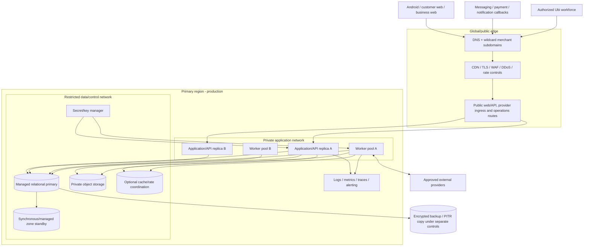

# Deployment, network and environment architecture

Status: **Draft — provider/region not selected**  
Depends on: system/platform components, quality attributes, events/sync and supporting-service architecture  
Blocks: cloud/provider procurement, infrastructure-as-code, CI/CD, security controls, disaster recovery, cost model and production launch

## Purpose

This document defines a production shape Ubi can realistically operate with a small team while meeting tenant isolation, offline sync, booking integrity and recovery requirements. It deliberately avoids premature multi-region, Kubernetes and microservice complexity.

## Recommended launch topology

Use one carefully selected **primary cloud region**, multiple failure zones where the provider supports them, managed relational database/object storage and horizontally replicable application/worker runtimes.



Diagram source: `diagrams/39-production-deployment.mmd`.

Logical zones are security/administrative boundaries. Exact subnets/products depend on the selected provider.

## Region strategy

### Initial direction

- One primary write region.
- Multi-zone application/database availability inside that region where reliable/affordable.
- Global or regional edge for DNS/TLS/static assets/protection.
- Encrypted point-in-time backups with separate administrative protection and, if legally/commercially approved, another failure domain/region.
- No active-active booking writes across regions at launch.

### Region selection evidence

Test candidate regions from the chosen city/carriers/devices rather than assuming geographic distance equals network quality.

Score:

- D1/N1/N2 end-to-end API and web latency from actual mobile networks;
- managed relational availability/PITR/zone failover/restore;
- data protection/residency/cross-border and government/law-enforcement context;
- messaging/payment/provider connectivity and callback latency;
- service availability, support and incident history;
- egress/SMS/object/database/observability/backup cost in payable currency;
- team access/skills and managed-service operational burden;
- capacity/quotas and future regional expansion;
- provider contract, subprocessor, encryption/key and exit/export terms.

A more distant stable region with better carrier peering and services may outperform a nominally closer region. Field measurement decides.

## Environment model

| Environment | Purpose | Data | External provider mode | Access |
|---|---|---|---|---|
| Local developer | Fast isolated development/unit tests | Generated fixtures only | Mocks/local emulators by default | Individual developer |
| CI/ephemeral test | Automated test/build/security/contract suites | Generated per run | Mocks/provider sandbox when required | Workload identity |
| Shared development | Integration of incomplete features | Synthetic/demo | Sandbox/test credentials | Engineering scoped |
| Staging/preproduction | Production-like release/migration/performance/recovery validation | Synthetic or approved generated realistic volume | Separate sandbox/test accounts; limited live canary only by approval | Restricted team |
| Production | Real merchant/customer operations | Production classified data | Live approved provider accounts | Least privilege/JIT/case-based |
| Disaster-recovery exercise | Isolated restore and continuity proof | Protected restored copy under temporary controls | External sends disabled by default | Named exercise team |

Rules:

- Production is a separate cloud account/project/subscription/credential root from non-production.
- Production data does not flow down by default.
- Provider live and test application/account/webhook/credentials never share identifiers or routes accidentally.
- Environment is encoded in trusted deployment/configuration, not client input.
- Test/demo UI and booking/payment records are visibly unmistakable.
- Staging mirrors topology/contracts enough to test migration/release, but does not need production scale 24/7.
- Ephemeral environments have automatic expiry, cost/secret/data cleanup and no broad provider permissions.

## Cloud account and administrative structure

Recommended administrative hierarchy:

```text
Organization/billing root (no routine workloads)
├── security/log archive account/project
├── production account/project
├── non-production account/project(s)
└── backup/DR account/project where provider design permits
```

Principles:

- Root/billing credentials strongly protected and not used by CI/operators.
- Separate identity groups/roles for infrastructure deployment, app deployment, read-only operations, security response, database administration and billing.
- Workforce SSO/MFA/strong authentication; no permanent shared admin account.
- Just-in-time/break-glass production access with reason, expiry, alert and review.
- Infrastructure/service/workload identities replace long-lived developer keys.
- Central immutable/protected administrative audit and security logs.
- Spending/budget permissions do not imply customer-data access.

## Public routing and domains

### Domain plan

```text
<merchant-slug>.<primary-domain>   customer public business hub
app.<primary-domain>               customer/application web as approved
api.<primary-domain>               client API
ops.<primary-domain>               Ubi workforce console
status.<primary-domain>            public status communication
provider-specific ingress paths or hostnames under controlled domain
```

Exact domains remain a brand/security decision. Rules:

- Wildcard merchant subdomain routing maps slug to immutable public profile server-side; not one DNS record/certificate per merchant.
- Wildcard and named certificates are automatically issued/renewed/monitored through managed control.
- `ops` receives separate identity, route and stronger edge/network policy.
- Provider callback routes are isolated by provider/environment/account validation and do not expose broad APIs.
- HSTS/security headers/cookie scopes prevent merchant subdomains from setting/receiving privileged parent-domain cookies.
- Merchant-controlled arbitrary HTML/JavaScript is prohibited on shared Ubi origin.
- Custom merchant domains are later gated because verification, certificates, phishing, cookies, abuse and support expand significantly.
- Slug rename/suspension/closure has safe redirect/reservation/booking-recovery policy.

## Network and trust zones

### Public edge zone

- Managed DNS, TLS, CDN/static cache, WAF/DDoS/bot/rate controls.
- Only approved ports/protocols.
- Separate policies for public content, authenticated API, provider ingress and operations.
- Edge logs minimized and protected; tokens/query content redacted.

### Application zone

- Application and worker runtimes have no public administrative endpoint.
- Load balancer/edge is normal ingress; provider callback still reaches verified application adapter through controlled route.
- Service-to-data access uses workload identity/short credentials/TLS and allow-listed network policy.
- Application replicas are stateless except bounded ephemeral cache; sessions/commands live in authoritative stores.

### Data/restricted zone

- Database/cache/secret/key/private object endpoints are not public.
- Only required workload/admin roles and paths allowed.
- Database operator access uses audited secure tunnel/provider session, not world-accessible IP.
- Backup/export/replication roles are separate from application write credentials.
- Audit/security log destination protected from ordinary application deletion.

### Controlled egress

- Workers/app contact allow-listed approved provider endpoints as operationally feasible.
- DNS/TLS/timeout/redirect/SSRF protections for server-fetch/upload/provider integrations.
- Egress metrics identify provider/cost/failure without full content.
- Provider callbacks never require opening database/control plane publicly.

## Application runtime deployment

### Initial form

Preferred evaluation order:

1. Managed container/application platform with regional replicas, health checks, autoscaling and workload identity.
2. Managed virtual machines/container service only if needed for cost/runtime/control.
3. Kubernetes only after demonstrated service count/team/portability/operational need.

Kubernetes is not a reliability feature by itself and creates upgrades, security, networking and on-call burden.

### Application replicas

- Minimum two replicas across available zones for production when cost/provider supports.
- Readiness means instance can safely serve requests; liveness avoids restart loops during dependency outage.
- Graceful shutdown stops new work, completes/cancels bounded requests and releases leases.
- No local-disk dependency for accepted work/session/critical data.
- Horizontal scaling respects database connection budget.
- Requests carry correlation/idempotency; load balancer need not provide sticky session for correctness.

### Worker pools

Separate logical/concurrency pools for:

- core outbox/timers/sync follow-up;
- provider ingress/messaging/payment;
- notifications;
- media;
- analytics/projections;
- bulk privacy/export/retention.

They may share a deployable initially but have queue/concurrency/priority/fairness limits. Autoscaling uses queue age/depth/processing and database/provider capacity, not CPU alone.

## Database connectivity and availability

- Managed PostgreSQL remains the proposed direction, pending data blueprint/provider selection.
- Application uses bounded pool/proxy strategy; total connections calculated across replicas/workers/deploy overlap.
- Multi-zone standby/failover if available/affordable; test actual failover time/client reconnection.
- Writer endpoint/failover DNS behaviour and transaction retry classification documented.
- No automatic retry of ambiguous non-idempotent transaction without Ubi idempotency/result recovery.
- Encryption, patching, maintenance, metrics, slow query and storage growth controlled.
- Point-in-time recovery and automated backups retained under approved schedule.
- Restore test verifies schema, constraints, tenant isolation, idempotency/outbox/inbox/timers and application use.
- Read replicas are optional later for governed reporting; they cannot serve authorization/booking decisions with unsafe lag.

## Cache and queue deployment

### Cache/rate coordination

- Managed optional service only for approved ephemeral functions.
- Private endpoint/auth/TLS, memory/eviction/max-item/key naming and tenant quotas.
- Loss/restart is survivable; bookings/permissions/holds/payments/idempotency/audit never depend solely on it.
- Avoid storing personal content where counters/opaque references suffice.

### Durable queue

- Start with relational outbox/worker unless capacity evidence requires broker.
- If broker added, private/authenticated/encrypted, per-environment namespaces, dead-letter/retention/quotas and producer/consumer ACLs.
- Broker loss does not erase authoritative accepted state; database outbox/inbox remains the acceptance/dedup source unless a later ADR changes it.

## Object/media deployment

- Private original/quarantine/evidence/export storage; separate public derivative delivery policy.
- Provider-side encryption plus Ubi key/access controls as approved.
- CORS allows only exact upload origins/methods/headers; signed upload bounded by size/type/key/expiry.
- Object lifecycle/retention/versioning/deletion and incomplete multipart cleanup.
- Scan/transform workers have least access and cannot list unrelated tenants broadly where provider controls permit.
- CDN origin access prevents public bypass to private objects.
- Object inventory/reconciliation detects orphan DB/object state.

## Secrets and keys

Classes:

- application session/signing/encryption keys;
- database/cache credentials;
- provider OAuth/token/webhook/certificate secrets;
- object upload/signing/CDN keys;
- CI/CD/deployment/signing credentials;
- Android/app-store signing keys;
- audit/backup keys.

Rules:

- Managed secret/key service; plaintext not in repo/image/IaC state/log/ticket.
- Workload identity fetches exact runtime secret; developers do not download production secrets routinely.
- Environment/provider/connection isolation and metadata owner/rotation/expiry.
- Rotation supports old/new overlap and rollback where protocol requires.
- Secret access/change audited/alerted; periodic inventory detects unused/orphan secrets.
- Emergency revoke/rotate runbooks tested.
- Backup key access separated enough to recover but protected from ordinary application compromise.
- Android signing keys use store/provider-secure process with offline/recovery control and named custodians.

## Configuration and feature flags

- Immutable build artifact promoted across environments; environment configuration injected separately.
- Typed/validated configuration with safe defaults and startup failure for missing critical values.
- Secrets separate from non-secret configuration.
- Country/provider/feature/tenant eligibility changes use controlled admin/domain configuration with audit.
- Feature flag has owner, purpose, scope, default, expiry/removal and rollback.
- Flags cannot bypass database migration, authorization or safety policy.
- Kill switches for provider/automation/payment/call can stop new work while preserving/reconciling existing state.
- Configuration drift detection compares deployed versus approved desired state.

## Infrastructure as code

All production infrastructure/configuration that can be codified SHOULD use reviewed infrastructure-as-code:

- accounts/projects, networks, IAM/workload roles;
- edge/DNS/certificates/routing/protection;
- application/worker runtimes and scaling;
- database/cache/object/queue configuration;
- secret references/key policies, not plaintext secret values;
- logs/metrics/alerts/budgets/backups;
- provider callback resources where safely automatable.

State storage is encrypted, versioned, access-controlled and backed up. Manual emergency change is audited and reconciled into code after incident.

## Build artifact and supply-chain path

```text
source review
→ isolated CI build/test/lint/security/dependency checks
→ SBOM and immutable signed artifact
→ non-production deployment and contract/migration tests
→ release approval
→ production progressive deployment
→ health/SLO/business-invariant checks
→ complete or rollback/roll-forward
```

- CI from untrusted contributions cannot access production secrets/deploy role.
- Dependencies/base images pinned and scanned with owner/update policy.
- Artifact registry immutable/retained by release; production deploys artifact digest, not mutable tag.
- Build provenance/signature verified at deploy where tooling permits.
- Promotion does not rebuild different production code from same source.

## Application/database release strategy

### Progressive deployment

- Rolling/canary deployment by instance/traffic with fast rollback for application-only change.
- Health includes API, representative booking read and queue/DB saturation—not only `/health` process response.
- Stop rollout on error/latency/conflict/provider/tenant-isolation signals.
- Deploy window accounts for old/new app and Android clients simultaneously.

### Database migration

Use expand → migrate/backfill → switch → contract:

1. Add backward-compatible schema/index without requiring new code.
2. Deploy code that reads/writes compatible forms.
3. Backfill in bounded restartable batches with metrics/tenant fairness.
4. Verify constraints/counts/invariants.
5. Switch read/write path.
6. Remove old path only after rollback/client/worker/event window passes.

- Migration lock/time/storage impact tested on production-like data.
- Large indexes/constraints use provider-safe online/concurrent approach where available.
- Down migration is not automatically safe; roll-forward/data restoration procedure is explicit.
- Never run destructive migration automatically on every app replica startup.

## Android release and backend compatibility

- Separate internal, closed/pilot, staged production and production tracks.
- Release artifact signed and reproducible/provenanced according to tooling.
- Backend supports declared old client/offline-command window before raising minimum version.
- Remote flag can disable unsafe feature but cannot repair incompatible local schema alone.
- Crash/ANR/performance/sync/conflict segmented by app version/D1 devices.
- Staged rollout halts on critical flow/tenant/privacy/crash regression.
- Forced upgrade only for security/integrity incompatibility with plain-language recovery for pending work.
- Store listing/privacy/data safety/permissions match actual runtime/provider behaviour.

## Web release and caching

- Hashed static assets immutable and CDN cached.
- HTML/public projections use short/versioned cache and safe invalidation.
- Authenticated/token/customer/payment/operations responses are private/no-store as classified.
- Service worker/PWA, if used, has explicit version/update/cache rules and never caches privileged responses across accounts.
- Rollback keeps compatible assets/API/schema; avoid HTML pointing to deleted assets.
- Content security, trusted origins and third-party scripts minimized.

## Observability architecture

### Collection

- Structured application/worker/security logs with central protected transport.
- Metrics for SLOs, database/pool, queue/timer, sync, provider, object, cost and business integrity.
- Distributed traces/correlation sampled and content-redacted.
- Android/web crash/performance telemetry under approved privacy notice/settings.
- Administrative/cloud/audit/DNS/IAM/key/secret events in protected security archive.

### Separation and retention

- Production/non-production data sources and access separate.
- No OTP, password, token, secret, PIN, full payment reference, raw message/customer/media content in ordinary logs.
- High-cardinality tenant/resource IDs not metric labels; protected queryable logs use controlled IDs only as needed.
- Retention/tiering/egress/cardinality budgets prevent uncontrolled observability cost.
- Deletion/privacy/security access processes include observability where applicable.

### Alerting

Alerts map to user/business impact, owner and runbook:

- booking API error/latency and capacity-integrity failure;
- database failover/storage/connection/replication/PITR failure;
- queue/timer oldest age/blocked critical work;
- sync conflicts/rejections/full-resync spike;
- provider callback/signature/unknown/payment reconciliation;
- notification failure for critical messages;
- cross-tenant/authorization/security/anomaly;
- backup/restore/key/certificate/secret expiry;
- cost/budget/egress anomaly.

## Availability and failure domains

### Component availability direction

- Edge/DNS/TLS provider redundancy capability evaluated; DNS/certificate renewal monitored.
- At least two application/worker replicas/failure-zone placement where practical.
- Managed database zone failover and backup restore.
- Optional cache/analytics/media/search outage cannot stop core text booking.
- Provider-specific circuit/backpressure prevents cascading failure.
- Android local-first reduces business impact of network/region interruption.

### Dependency failure matrix

| Failure | Degraded service |
|---|---|
| One app replica/zone | Other replica serves; no accepted-work loss |
| Database primary failover | Brief write/read interruption; idempotent client retry/result recovery |
| Full primary region | Android cached/offline work continues locally; web/server unavailable; recover per RTO |
| Cache | Rate/public performance degrades safely; authoritative operations continue |
| Object/media | Text flows continue; media pending/unavailable |
| Analytics/observability partial | Operations continue; buffer/alert/manual visibility according to criticality |
| Messaging/payment/notification provider | Adapter-specific pending/fallback/reconciliation; core booking truth remains |
| DNS/edge | Major outage; provider/vendor resilience and emergency change tested |

## Backup, recovery and disaster strategy

### Initial objectives

Use proposed quality targets until business/cost approval:

- authoritative operational database RPO ≤ 5 minutes;
- booking core RTO ≤ 4 hours;
- supporting administration RTO ≤ 8 hours;
- rebuildable analytics may have longer approved RPO;
- object/evidence RPO/retention by classification.

### Backup controls

- Automated full/snapshot plus transaction-log/PITR according to provider.
- Encryption and access separate from ordinary application credentials.
- Retention tiers and immutable/protected copies against accidental/malicious deletion where available.
- Backup success/freshness/size/key/copy monitoring.
- Database, object, configuration/IaC, secrets/key recovery procedures and provider account inventory.
- Backups are production personal/business data and follow residency/retention/legal hold/deletion policy.

### Restore exercise

1. Declare recovery point/scenario/owners and disable external side effects.
2. Restore into isolated temporary network/account.
3. Restore matching application/schema/config and protected object references.
4. Verify integrity/constraints/tenant isolation/auth/booking-capacity/payment/outbox/inbox/timers/audit.
5. Reconcile provider callbacks/transactions after recovery point using dedup/idempotency.
6. Measure actual RPO/RTO and data gaps.
7. Delete exercise environment/data securely after evidence/report.
8. Track remediation owners/dates.

Multi-region warm standby is considered only after region-outage business impact, law, provider availability and cost justify it. A backup in another region is not an automatically ready application failover.

## Capacity and scaling

Before each pilot/release forecast:

- active organizations/members/devices;
- peak API requests/concurrent sessions;
- schedule horizon/bookings/customers;
- offline command burst after network outage;
- provider callback/message/payment burst;
- reminder timers/notifications;
- media objects/bytes/egress/processing;
- DB rows/storage/IO/connections/query percentiles;
- queue depth/processing/replay/reconciliation;
- observability volume and backup/restore time.

Load test 3× forecast sustained and short 10× ingress burst as defined in quality requirements. Protect database by pool/admission/backpressure; do not autoscale app replicas until they exhaust database connections.

## Cost architecture

Track fixed and variable costs by environment/provider/capability:

- application/worker compute and database size/IO/backups;
- edge/CDN/DNS/WAF/egress;
- object storage/scan/transform/download;
- cache/queue/search/analytics/observability;
- SMS/OTP/push/email/messages/payment/calls;
- CI/artifact/security tools;
- support/on-call/vendor/legal/compliance.

Required unit metrics:

- infrastructure cost per active organization and booking;
- notification/message/payment/call provider cost per successful outcome and failure;
- media/storage/egress per active merchant;
- observability/backup cost as share of platform;
- non-production idle cost;
- paid-without-booking/reconciliation/support cost.

Budget alerts and owner approval prevent a provider retry loop, attack or media upload from producing uncontrolled spend.

## Data residency and vendor exit

Before provider/region approval:

- map every data class to service/region/replica/backup/log/support/subprocessor;
- launch-country transfer/residency/legal requirements reviewed by local counsel;
- provider contract/security/privacy/incident/deletion/export evidence;
- encryption/key/control and workforce access locations;
- migration/export formats and tested restore outside provider-specific tooling where feasible;
- DNS/domain/signing keys and source/IaC remain Ubi-controlled;
- provider termination plan for DB/object/secrets/logs/identity/messages/payments.

Avoid deep proprietary dependencies where they provide little value, but do not reject managed reliability purely for theoretical portability.

## Production access and change management

- All changes via reviewed CI/IaC/domain admin workflows by default.
- Direct production shell/database access disabled or JIT with strong authentication, ticket/case, expiry and session audit.
- Support cannot run arbitrary SQL or edit state.
- Emergency change has incident commander/peer where possible, exact scope, rollback and retrospective code reconciliation.
- Destructive database/object/account operations need target resolution, backups/impact preview and dual control by risk.
- Provider console changes recorded/reconciled with Ubi connection/config state.
- Quarterly access/role/secret/provider/backup review initially, adjusted by risk.

## Deployment acceptance tests

1. Kill one app and worker replica; traffic/work recovers without duplicate accepted effects.
2. Simulate database failover mid-booking; original idempotency key recovers one result.
3. Exhaust cache/restart it; no permission/booking/hold/payment/audit truth is lost.
4. Disable media/analytics/provider egress; manual/direct text booking remains.
5. Attempt direct public database/object/private-admin access; network/IAM deny and alert.
6. Deploy old/new server/worker with queued older Android commands/events; compatibility holds.
7. Execute forward schema migration/backfill and rollback/roll-forward on production-like volume.
8. Restore DB/object/config in isolated environment within objective and verify tenant isolation/outbox/provider reconciliation.
9. Rotate database/provider/signing secret without extended outage or plaintext exposure.
10. Route two merchant subdomains and attempt cookie/cache/tenant crossover; isolation holds.
11. Simulate region unavailability; Android retains cached/queued work and status/support/recovery procedure activates.
12. Cost/queue/provider attack triggers rate/budget controls without losing accepted critical work.

## Architecture completion gate

Platform architecture stage is ready for data/security/experience design when:

1. Context/component/data ownership is unambiguous.
2. API/event/idempotency/sync contracts are reviewed.
3. First provider integrations remain optional and have capability/exit boundaries.
4. Payment cannot bypass reconciliation/booking confirmation.
5. Media/search/notifications/calls cannot corrupt core truth.
6. Launch topology can be deployed, observed, backed up, restored and costed.
7. Open provider/runtime decisions have prototypes/evidence plans rather than guesses.

## Open decisions

- Cloud provider, primary region and measured carrier latency.
- Account/project/network/managed runtime and database topology.
- Container/PaaS/VM selection; Kubernetes remains unjustified initially.
- Edge/CDN/WAF/DNS/certificate provider and primary domains.
- Database HA/PITR/backups/restore region and approved RPO/RTO cost.
- Object/cache/observability/security tooling.
- CI/CD/artifact/IaC/signing tools and access model.
- Exact production/non-production topology and monthly budget.
- Data residency/transfer and vendor contractual approval.
- Multi-region DR trigger and future country expansion architecture.

