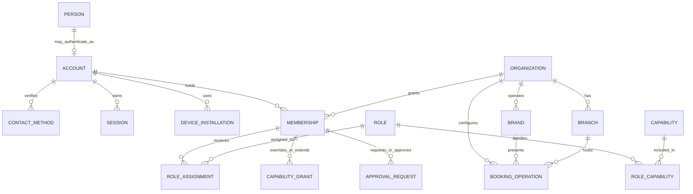
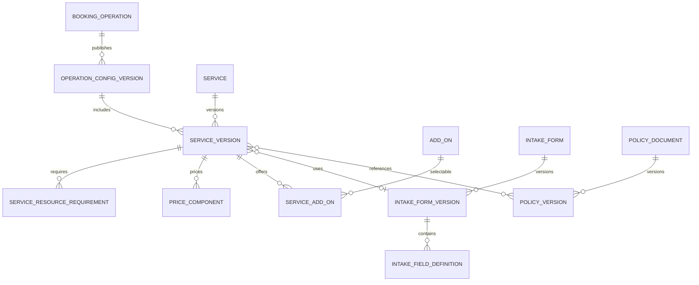
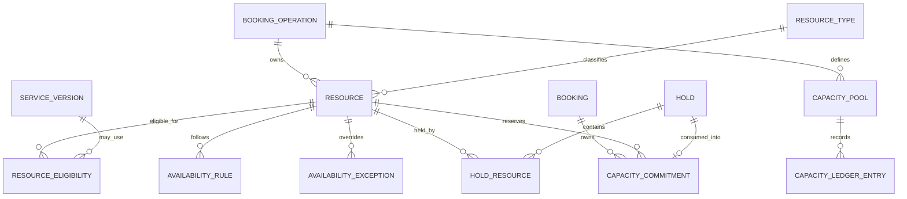
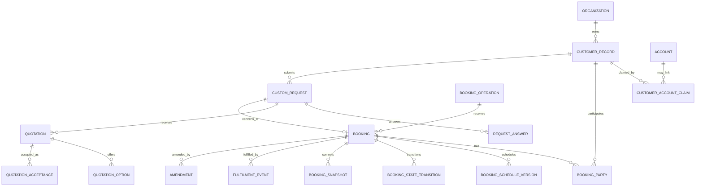
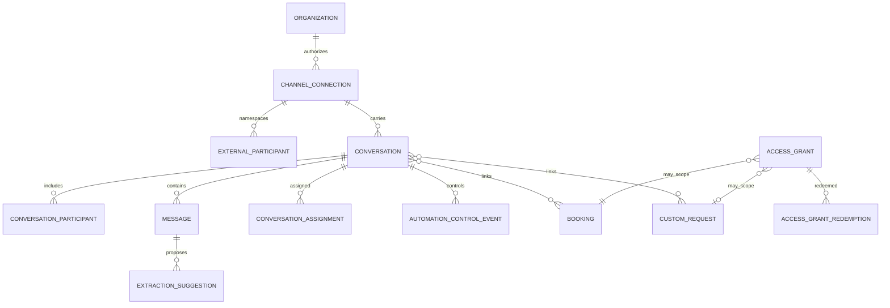
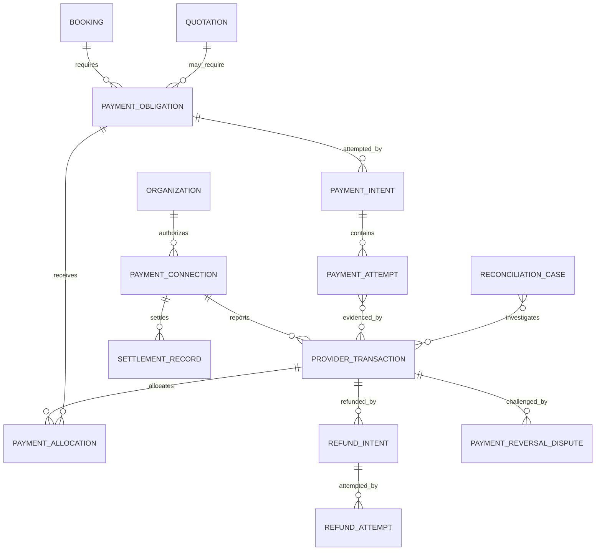

# Conceptual data-domain model

Status: **Draft — conceptual, not executable schema**  
Depends on: bounded contexts, workflows, authority, API/events and offline synchronization  
Blocks: operational database architecture, logical schema, constraints/indexes, privacy/retention and analytics

## Purpose

This document translates Ubi’s product/domain language into persistent concepts and relationships. It answers what must exist and who owns it before deciding PostgreSQL columns, indexes or migrations.

## Model rules

1. One concept has one write owner.
2. Account, membership, merchant customer and external participant remain separate.
3. Organization is the initial tenant boundary; tenant-owned records retain immutable `organization_id` even when derivable.
4. Current state and immutable/versioned evidence/history are separate.
5. Booking, payment, conversation, notification and fulfilment states are separate.
6. Published/accepted terms are snapshotted; later edits never rewrite commitments.
7. Capacity/holds/commitments are explicit, not inferred from booking text.
8. Provider identifiers/evidence remain namespaced and attributable.
9. Custom fields extend approved typed forms; core invariants are not hidden in arbitrary JSON.
10. Soft deletion is not a universal substitute for lifecycle, archival, privacy deletion or legal retention.
11. Cross-tenant relationships are prohibited unless a platform-owned model explicitly and safely permits them.
12. Analytical projections are derived consumers, not operational writers.

## High-level ownership

```text
Identity & Sessions
→ Organization & Authority
→ Operation/Catalog configuration
→ Scheduling & Capacity
→ Booking / Request & Quotation

Customer Relationship ───────┘
Conversation/Handoff ────────┘
Payment ─────────────────────┘ (condition/evidence, not booking owner)
Communications ──────────────┘ (notification of truth)

Audit / Privacy / Operations / Analytics observe and govern through explicit contracts.
```

## Identity and tenancy model



Diagram source: `diagrams/40-identity-tenancy-er.mmd`.

### Person

Represents a real human only where Ubi has a justified need to distinguish the human from authentication. A person may exist without an Ubi account. Avoid creating a global person record for every merchant customer unnecessarily.

### Account

Authentication/security identity. It owns account lifecycle and links to credentials/contact verification/sessions. It does not own organization authority or merchant customer data.

### Contact method

Phone/email or later approved contact linked to an account with normalized value, verification episode, lifecycle and privacy controls. A recycled/shared phone can later link differently; history/evidence remains controlled.

### Session and device installation

Session represents current authentication authority/revocation. Device installation represents an app instance for push/sync/security metadata, not a permanent physical device or person.

### Organization

Primary tenant and contracting/operating business boundary. Organization state controls whether operations may act but does not delete their history.

### Brand, branch and booking operation

- Brand: public commercial identity.
- Branch: physical/operational management/location scope.
- Booking operation: coherent booking configuration/workflow/catalog/resources/policies.

Brand/branch can relate to multiple operations. Relationships are explicit and effective-dated if reassignment affects history.

### Membership and authority

Membership links one Account to one Organization. Role assignments and explicit grants/denials are scoped to organization/branch/operation/resource/queue/assigned records. Ownership/legal-representative recognition and privileged approvals remain separately evidenced.

## Catalog and configuration model



### Service and service version

`Service` is stable identity/lifecycle. `ServiceVersion` is immutable published/draft configuration: localized names, description, duration, fulfilment, archetype compatibility, price method and relevant policies. A new version supersedes rather than rewrites published terms.

### Operation configuration version

Captures operation archetype and configuration compatibility/effective publication. It references services/resources/form/policy versions and country feature overlay.

### Package/add-on/option

Stable commercial components with versioned definitions. Selection is snapshotted into request/booking rather than joined to mutable current price during historical display.

### Typed intake form

Form version owns ordered typed field definitions, choices, validation, conditional visibility and permitted data classification/purpose. Submitted answers are stored as typed values/provenance against exact field version.

### Policy version

Cancellation, deposit, confirmation, reschedule, privacy or other customer-visible policy is immutable after publication/acceptance. Legal documents and operational configuration may use different owners but share explicit version/effective/acceptance linkage.

## Scheduling and capacity model



### Resource

Schedulable staff, space, room, asset, vehicle, equipment or pooled capacity identity. A human Account is not itself the Resource; an optional relationship maps a staff resource to an account/membership.

### Availability rule and exception

- Rule: effective-dated recurring local schedule/timezone.
- Exception: explicit closure/opening/block/change for a bounded interval/date.

Rules describe potential eligibility. They do not contain bookings and do not prove a slot is free.

### Resource requirement and eligibility

Service version defines required resource roles/quantities/assignment policy. Eligibility maps concrete/pool resources to those roles with effective dates/capability.

### Hold

Expiring aggregate reserving capacity for a request/quote/payment flow. It has purpose, owner, server expiry and resource allocations. It is consumed/released/expired once.

### Capacity commitment

Authoritative allocation of exact resource/pool quantity over an interval/date/session/range to a Booking. History records move/release/override. Database constraints/transaction rules prevent prohibited overlap/overcapacity.

### Capacity ledger/pool

For pooled/session inventory, ledger entries add/release/adjust capacity against a bounded bucket/session. Exact aggregate/count constraint strategy is deferred; never rely only on a cached counter.

## Core commercial model



Diagram source: `diagrams/40-commercial-core-er.mmd`.

### Customer record

Tenant-private merchant relationship record. It stores minimum operational contact/profile/preferences/provenance and links to bookings/requests. It may link to an authenticated Account through a verified claim, but never becomes the Account.

### Customer duplicate/merge relationship

Possible duplicate is a review object. A merge records surviving/source customer IDs, transferred relationships and reversible/auditable history. Cross-organization merge is prohibited.

### Booking

Stable authoritative root for a service commitment. It contains operation, archetype, source, confirmation mode, current lifecycle, responsible next action and references to immutable snapshots/schedule/capacity/parties.

### Booking party

Explicit role: booker, payer, organizer, attendee/beneficiary, primary contact, service provider or other approved role. It references customer/account/membership/external representation carefully; roles do not imply one another.

### Booking snapshot

Immutable customer-visible/operational terms at submission/confirmation/amendment:

- service/package/add-ons and localized presentation;
- price components/currency/deposit/balance condition;
- policy/document versions;
- customer-entered answers/provenance;
- operation/branch/fulfilment location presentation;
- source/confirmation evidence.

Snapshot is structured first-class data, not only a PDF/JSON blob. A bounded serialized evidence representation may supplement it.

### Booking schedule version

Immutable schedule history: local date/time/timezone/calendar presentation, UTC interval/date/range, resource/capacity references, change actor/reason and effective/current marker. Rescheduling creates a version and moves capacity atomically.

### Booking state transition and fulfilment event

State transition is append-only evidence for booking lifecycle. Fulfilment events track check-in/start/complete/no-show separately while Booking derives current fulfilment summary.

### Custom request

Owns intake, requirements, provenance, assignment, next action and review lifecycle before booking.

### Quotation/option/acceptance

Quotation has stable lineage and immutable issued versions/options. Acceptance binds actor/auth/token evidence to exact version/option. Conversion links one accepted version to one resulting booking through idempotency.

### Amendment

Versioned post-confirmation scope/price/schedule proposal and acceptance. Applying it creates new booking snapshots/capacity/payment obligations without deleting old evidence.

## Conversation and access model



### Channel connection

Tenant-authorized provider business asset with scopes, capabilities, credential reference and lifecycle. Provider credential secret is stored outside ordinary relational fields; database holds protected reference and metadata.

### External participant

Identity only inside `(provider, environment, connection)` namespace. It may link to a Customer Record through verified/reviewed association but is not a global account.

### Conversation, participant and message

Conversation owns operational thread status/routing. Participant assigns role/provider/account/customer references. Message is immutable source/direction/content/attachment/delivery evidence with edit/delete relationships; long histories are separate rows, not embedded arrays.

### Assignment and automation control

Independent histories for queue/staff assignment and disabled/suggestion/active/paused/takeover/resume. They do not change booking status.

### Extraction suggestion

Proposed field/value from message with source/provenance/confidence/reviewer/final target. It never directly becomes committed truth without domain command.

### Access grant

Scoped, expiring, revocable token verifier metadata. Secret token is stored hashed/protected. Redemption history records verified purpose/action/result. Opening never equals acceptance.

## Payment model



Diagram source: `diagrams/40-payment-er.mmd`.

### Price snapshot and payment obligation

Price snapshot belongs to Booking/Quotation commercial terms. Payment obligation states exact amount/currency/purpose/deadline/condition. It does not mean money moved.

### Intent and attempt

Intent coordinates satisfying an obligation; Attempt is one method/provider/customer interaction. Duplicate retries map to one logical provider operation.

### Provider transaction and manual evidence

Provider transaction stores authenticated provider evidence. Manual/customer-reported evidence is a distinct source/type and remains unverified until authorized verification. They must not share a generic boolean `paid`.

### Allocation

Exact verified value applied from transaction to obligation. Constraints prevent over-allocation/duplicate logical allocation and cross-currency/tenant mismatch.

### Refund, reversal/dispute and settlement

Each has independent lifecycle/evidence. Settlement belongs to provider/merchant accounting; Booking can display derived financial summary but cannot rewrite these states.

### Reconciliation case

Typed discrepancy with linked evidence, owner/deadline/resolution commands. It is not resolved by manually changing a balance.

## Communications model

```text
Domain event
→ Notification intent (recipient, purpose, policy, logical identity)
→ zero or more delivery attempts (channel/provider/endpoint/template)
→ provider delivery evidence

Booking/payment state remains upstream.
```

### Recipient endpoint and preference

Endpoint is a protected reference to verified phone/email/push/connected participant. Preference/consent is purpose/channel/version/source specific. Communications owns the dispatch projection; authoritative contact/consent owner remains identifiable.

### Template version and reminder

Template is immutable localized approved content with allowed variables/classification/provider mapping. Reminder schedule stores domain version, due time/timezone and cancellation/supersession.

### Notification intent/attempt

Intent is one logical communication purpose/event/recipient. Attempts track providers/channels/retry and known delivery state. `read` never proves domain acceptance.

## Media model

### Media object

Metadata for purpose/tenant/uploader/classification/storage key reference/checksum/detected type/size/state/retention. Binary is in object storage, not the operational database.

### Media link

Typed relationship between media object and catalog/message/payment evidence/request/export. Avoid unconstrained `owner_type + owner_id`; use approved typed link tables or constrained registry so tenant/deletion rules remain enforceable.

### Variant/access grant

Derivatives reference parent and processing version. Access delivery is short-lived evidence, not stored as permanent public URL for private files.

## Synchronization model

### Client installation/sync scope

App installation plus account/organization/scope/filter/schema/protocol and current cursor. It does not grant authority independently.

### Client command

Immutable offline intent with stable ID/type/version/base versions/dependencies/payload hash and lifecycle/result. Payload may use typed relational adjuncts or bounded JSON per command schema; accepted domain state is never queried from payload alone.

### Command result/conflict

Stores stable server outcome/resource mapping/version/problem and preserved user input reference. Conflict is typed and resolution creates a new command.

### Change feed/tombstone

Server projection change sequence and deletion marker scoped to tenant/filter/version. It supports convergence, not an unbounded event-sourcing promise.

## Audit, privacy and operations model

### Audit event

Append-only attributable action/outcome with actor/service/session/tenant/resource/purpose/correlation/causation and bounded before/after evidence. It is separate from debug logs and domain/analytics events.

### Operations case

Onboarding/support/integration/payment/privacy/trust/security work queue with category, severity, subject/resource references, purpose, owner/deadline and resolution. Domain changes occur through commands.

### Privileged access grant

Purpose/case/resource scope, approver, start/expiry and usage/review evidence for Ubi workforce elevation/break glass.

### Privacy/records case

Verified request/authority, jurisdictions/responsibilities, requested rights and propagation tasks across owners/stores/providers. Completion is derived only from required task evidence/exceptions.

### Data inventory/retention/legal hold

Versioned governance records connect data class/field/object/event to purpose, owner, classification, retention, deletion and legal hold. Retention rules are not scattered constants only.

## Public presence model

- `public_profile` is a controlled projection/aggregate of safe organization/brand/branch/operation data.
- `public_slug` has normalization, target, lifecycle, reservation/redirect history and abuse status.
- Published service/profile/media references exact versions.
- Public availability is computed/projection data with no customer/private resource detail.
- Historical slug cannot authorize resources and may stop redirecting after approved retention.

## Address and location model

Avoid a mandatory Western street schema. Concept supports:

- country and variable administrative area hierarchy;
- locality/subcity/district/free-form directions;
- landmark and optional map point/accuracy/source;
- public versus private operational instructions;
- service area (named areas/radius/polygon later);
- timezone and verified/unverified source.

Exact coordinates/home/service addresses are sensitive. A map result is suggestion, not verification.

## Temporal and version model

Different time meanings have distinct fields:

- `created_at`/`recorded_at`: database record/evidence time;
- `occurred_at`: domain/provider fact time;
- `effective_from`/`effective_until`: configuration applicability;
- `scheduled_start`/`scheduled_end`: service instant interval;
- `local_date` plus timezone/calendar context: date-only commitment;
- `expires_at`: server-controlled validity;
- `device_created_at`: untrusted context;
- aggregate/config/event version: concurrency/compatibility.

Use server/database time for commits/expiry. Never infer event order from device time.

## Status/lifecycle model

Statuses are context-specific constrained values with legal transition rules. Do not create one shared status table/enum for:

- account/organization/membership;
- booking/request/quote/fulfilment;
- hold/capacity;
- payment/attempt/refund/settlement/dispute;
- conversation/message/delivery;
- notification;
- sync command;
- media;
- operations/privacy case.

Current state may be stored for efficient queries, while append-only transition/evidence tables retain history. Database constraints restrict allowed values/basic shape; application/domain commands enforce contextual transition policy.

## Structured data versus JSON

Use first-class relational columns/tables for:

- tenant/identity/authorization;
- lifecycle/concurrency/version;
- schedule/timezone/capacity;
- money/currency/allocation;
- provider/event/idempotency references;
- fields used for constraints, joins, deletion, reporting and access.

Use bounded versioned JSON only for:

- provider raw/canonical extension evidence with adapter/schema version;
- command/event payload with registered schema and promoted index fields;
- custom intake values tied to field definitions where relational typed child columns are impractical;
- immutable snapshot supplement;
- diagnostic metadata with strict size/classification.

JSON is not permission to skip schema, size, validation, indexes, retention or migration.

## Deletion model

Use the correct mechanism:

- lifecycle `archived/closed/revoked/restricted` for business truth;
- immutable history for accepted/financial/audit evidence;
- privacy erasure/redaction/pseudonymization for personal fields according to law/responsibility;
- tombstone for offline/search/cache propagation;
- hard deletion for transient/unrequired data after retention/relationship checks;
- legal hold to suspend otherwise due deletion;
- object/provider deletion tasks with completion evidence.

Avoid cascade deletion from Organization/Account/Customer into bookings/payments/audit by default. Closure is a process, not a database cascade.

## Conceptual invariants

1. Every tenant-owned relationship stays in one organization unless explicitly platform-owned.
2. A membership/account/customer/provider participant link never grants authority by association alone.
3. Booking confirmation owns one valid capacity outcome and exact commitment snapshot.
4. Hold/capacity cannot be consumed or released twice.
5. Current catalog edit cannot change a prior booking/quote snapshot.
6. Quotation acceptance names one exact immutable version/option.
7. One provider transaction value cannot be allocated/refunded beyond approved exact amount.
8. Reported/manual payment does not become provider verified by status reuse.
9. Conversation/message/notification/call states cannot change booking/payment directly.
10. Provider IDs are unique only inside provider/environment/account/connection namespace.
11. Every retry-sensitive command/event/provider receipt has a durable uniqueness identity.
12. Offline pending work remains distinguishable from synchronized server truth.
13. Audit/operations/analytics cannot become hidden writers of domain tables.
14. Public projections expose only deliberately published fields.
15. Deletion/retention/legal hold propagates with evidence and never claims more than performed.

## First-release data boundary

The conceptual model is broad; first implementation SHOULD include only the selected vertical’s minimum entities. Likely foundation:

- Account/contact/session/device installation;
- Organization/branch/operation/membership/role/capability/audit;
- Service/config version/resource/availability rule/exception;
- Customer record;
- Booking/party/snapshot/schedule/state/capacity commitment/source;
- Android client command/result/change cursor/tombstone;
- Outbox/inbox/idempotency/timer;
- In-app notification/action and minimal operations case;
- governance metadata needed for collected fields.

Custom requests, conversations, external channels, integrated payments, richer media and calls enter only when their release is approved.

## Open decisions

- First vertical/archetype and resulting minimum aggregate/table set.
- Stable ID strategy and client-generated mapping.
- Exact booking/capacity transaction and pooled-capacity representation.
- Snapshot relational/serialized balance and custom-field typed storage.
- RLS/composite tenant-constraint implementation.
- Audit integrity/storage and retention design.
- Customer duplicate matching/merge and account-claim verification.
- Address/geospatial/provider choices.
- Data retention/legal country overlay and deletion/pseudonymization.
- Event/change-feed retention versus full-resync windows.

